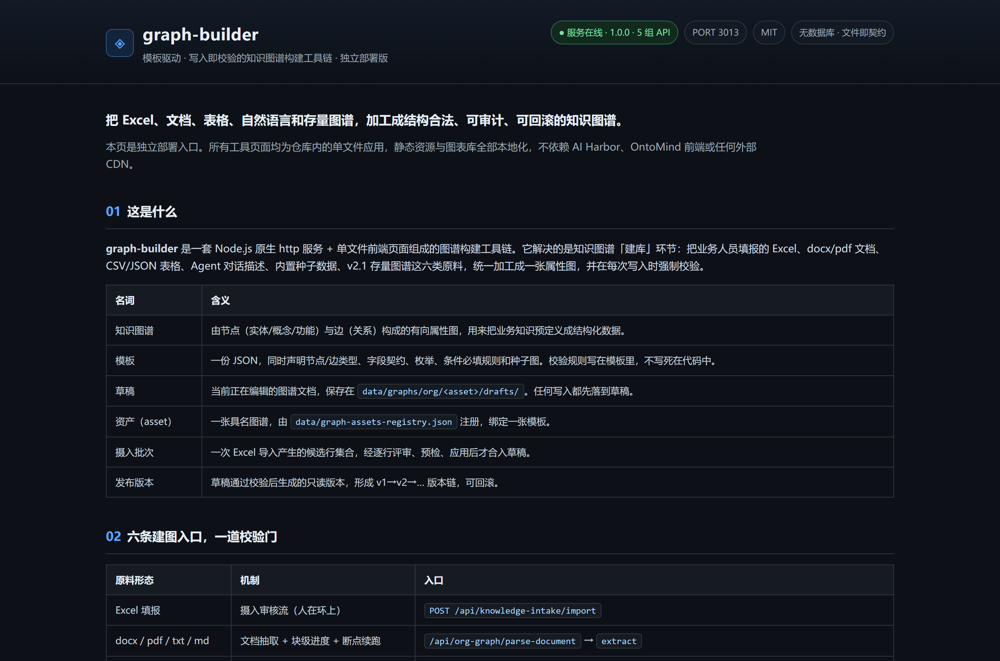
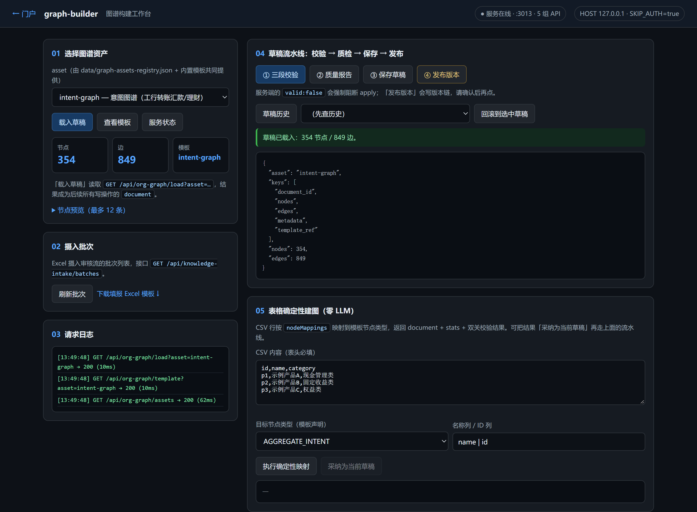
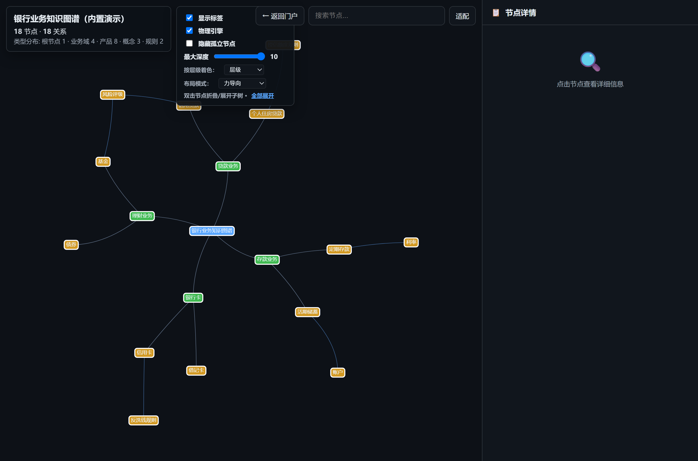
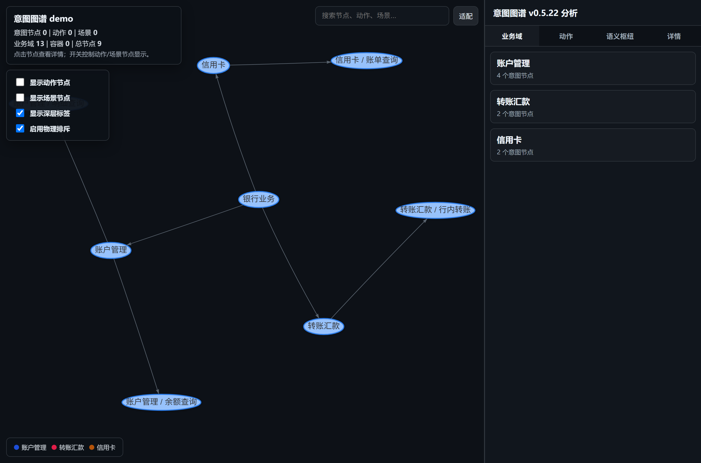

# graph-builder — 模板驱动 · 写入即校验的知识图谱构建工具链



## 项目简介

**graph-builder** 是一套独立的知识图谱构建工具链：Node.js 原生 http 服务 + 仓库内单文件前端页面，把 Excel、docx/pdf 文档、CSV/JSON 表格、Agent 对话描述、内置种子数据与 v2.1 存量图谱这六类原料，加工成**结构合法、可审计、可回滚**的属性图。

- **问题域**：知识图谱的「建库」环节。业务填报到图谱的转换常是一次性黑盒脚本，非法数据静默入图，填错之后没有版本也没有回滚。
- **方案机制**：**模板驱动校验**（规则声明在模板 JSON，不写死在代码）、**三段校验管线**（骨架 → 字段 → 条件必填）、**预检 → 应用 → 回滚**（`preview-apply` 在内存副本上跑真实校验，`valid:false` 由服务端强制阻断落盘）、**版本链发布**（v1→v2→… 只读可追溯）。
- **交付物**：`server.js` 单服务入口、4 组 API 路由族、13 张模板、5 个可独立打开的前端工具页、测试套件、24 张架构图与 5 张真实运行截图。
- **状态**：本项目从 AI Harbor / OntoMind 单体剥离，为独立部署版。默认监听 `127.0.0.1:3013` 且 `SKIP_AUTH=true`，面向本机/内网开箱体验；**不是生产就绪的多租户服务**，对外暴露前必须换认证与访问控制（见[已知限制](#已知限制)）。

> 写法参考（实调原文）：[Ollama](https://github.com/ollama/ollama) 的「2 行跑起来 + 链接优先」、[Mermaid](https://github.com/mermaid-js/mermaid) 的「示例/截图先行」、[Prometheus](https://github.com/prometheus/prometheus) 的「一段简介 + 加粗机制名清单 + 架构图 + 多条安装路径」，系统型骨架沿用本工具链原有的入口对照表与按目标导航。

## 名词表

| 名词 | 含义 |
|------|------|
| **知识图谱 / 属性图** | 由节点（实体、概念、功能）与边（关系）构成、节点和边都带属性的有向图。本仓库产出的是 JSON 文件，不落数据库。 |
| **模板** | 一份 JSON，同时声明节点/边类型、字段契约、枚举、条件必填规则与种子图；校验规则写在模板里，不在代码里。 |
| **草稿 / 资产 / 版本** | 草稿是正在编辑的图谱文档；资产是一张绑定模板的具名图谱；版本是草稿通过校验后生成的只读发布快照，形成 v1→v2→… 版本链。 |
| **摄入批次** | 一次 Excel 导入产生的候选行集合，经逐行评审、预检、应用后才合入草稿。 |
| **AI Harbor / OntoMind** | 本项目剥离前的宿主单体平台：AI Harbor 是集成多个工作台的门户（默认 :3000），OntoMind 是其中的知识工程前端（默认 :17386）。剥离后本项目不依赖两者。 |
| **[vis-network](https://visjs.github.io/vis-network/docs/)** | vis.js 家族的网络可视化库，用 HTML canvas 渲染节点与边、支持自定义形状与物理布局；本仓库把 9.1.2 的 standalone 构建本地化到 `tools/vendor/`，画布与展示页无外网依赖。 |
| **[AntV G6](https://g6.antv.vision/en/manual/introduction/)** | 蚂蚁集团 AntV 的图可视化引擎，提供绘制、布局、分析、交互与动画能力；意图图谱编辑器使用其本地化构建 `tools/vendor/g6.min.js`。 |

> 完整术语表与分层约定见[系统架构与技术方案](docs/architecture.md)；端点与字段契约以 [API 参考](docs/api.md) 为唯一权威，本页不重复定义。

把各种形态的知识原料——业务人员填的 **Excel**、**CSV/JSON 表格**、**docx/pdf 文档**、**一段自然语言描述**、**内置种子数据**、**v2.1 存量图谱**——加工成一座**结构合法、可审计、可回滚**的知识图谱。建图入口有六条，按原料形态选：

| # | 建图方式 | 入口 | 特点 |
|---|---------|------|------|
| 1 | **Excel 摄入审核流**（业务人员主力） | `POST /api/knowledge-intake/import` | 三工作表 → 候选批次 → 人工评审 + AI 辅助 → 预检 → 应用 → 回滚，全程人在环上 |
| 2 | **文档抽取**（docx/pdf/txt/md/xlsx） | `parse-document` → `document-triage` → `extract` | 体检 → 分块 LLM 抽取（断点续跑 + 块级进度）→ 消歧对齐 |
| 3 | **表格确定性映射**（CSV/JSON，零 LLM） | `POST /api/org-graph/from-tabular` | 表头映射到模板字段 → 确定性建图，可单测断言、结果可复现 |
| 4 | **Agent 对话建图**（自然语言） | `/api/org-graph/builder-agent/*`（openjiuwen 8 技能） | 对话即建图：描述需求/上传材料 → 生成/质检/填充/消解，@技能显式调用 |
| 5 | **种子数据起步**（内置真实/模拟数据） | `POST /api/org-graph/seed` | org-people 157 人 mock / customer-ecosystem 25 家真实画像 + 40 条关系 |
| 6 | **存量图谱迁移**（v2.1 双通道保真） | `POST /api/org-graph/import`（importer 注册表） | 可编辑通道 + 无损通道，反向导出同一张映射表；新数据源=一个 importer 模块+注册一行 |

**六条入口过的是同一道门**：**模板驱动校验**守门——schema、枚举、条件必填规则全部声明在模板文件里，任何写入路径（Excel 合入、AI 抽取、表格映射、Agent 生成、手工编辑）过的是同一套校验器；**预检 → 应用 → 回滚 → 发布**让每一步可观测、可反悔——原料随便哪种形态进，图谱不腐化。

**这也不是意图图谱专用工具。** 校验器是通用引擎，规则声明在模板 JSON 而非代码——同一套流水线可以构建**任意类型的属性图**：意图图谱、组织人员图谱、客户生态图谱、金融知识图谱、个贷风控图谱、通用知识图谱……仓库内置 **13 张模板**（`data/graph-builder-templates/`），其中意图图谱只是**先行的打样**：它的场景模型最复杂（条件必填规则最多），用它把流水线锤打成熟后，其余类型图谱都是"一份模板 JSON + 注册表一行"零代码接入。线上实证：组织人员（173 节点/843 边）、客户生态、金融知识、工行 HR（341 种子节点）、个贷风控、银行业务语义等 **6 类非意图图谱已用同一套引擎真实发布**。

> 建图侧：Node 原生 http 单服务（无框架、无数据库）｜ 校验：模板三段管线（骨架 → 字段 → 条件必填）｜ 数据：JSON 文件即契约 ｜ 前端：仓库内 5 个单文件工具页（`/tools/*`，图表库全部本地化，见[独立前端](#独立前端)）｜ 许可：MIT

## 内置图谱模板库（13 张，同一套引擎）

**结论：模板 = schema + 校验规则 + 种子图，三合一 JSON。** 加一张新图谱 = 加一份模板文件 + 注册表一行，校验、草稿、版本、发布、审计全部复用，零代码。

| 类别 | 模板（template_id） | 节点 / 边类型 | 说明 |
|------|------|------|------|
| **意图图谱**（打样） | `intent-graph` | 9 / 21 | 意图建模 v2.1：聚合意图/意图/业务对象/动作/槽位/状态/风险…，内置工行 355 节点种子图 |
| | `intent-graph-v4` | 4 / 4 | V4.1 功能节点×场景制（ROOT/DOMAIN/CATEGORY/LEAF + 场景数组），主规范见 [schema-v4](docs/intent-graph-schema-v4.md) |
| | `ccb-mobile-banking` | 9 / 17 | 建行手机银行意图图谱（基于 intent-graph 复制定制） |
| **组织与人力** | `org-people` | 3 / 4 | 员工/部门/项目 × 汇报/所属/参与/协作，支撑 Agent 找人与排期 |
| | `icbc-hr` | 4 / 7 | 对齐工行 GIL HR schema：员工/机构/职务/业务指标，341 种子节点 |
| | `work-relationship` | 6 / 7 | 人员/组织/团队/角色/项目/主题的工作关系 |
| **客户与风控** | `customer-ecosystem` | 3 / 7 | 对公客户生态：企业客户/决策人/产品 × 供应链/任职/适配产品关系 |
| | `personal-credit-risk` | 9 / 11 | 个贷风控：借款人为中心，亲属/担保/任职持股/资产负债/逾期/团伙关联 |
| **领域知识** | `finance-knowledge` | 5 / 7 | 金融知识：机构/产品/人物/概念/事件 × 发行/持股/任职/监管/事件影响 |
| | `bank-semantic-graph` | 7 / 10 | 银行业务语义记忆：产品/账户/信用卡/贷款/服务/概念/规则 |
| | `knowledge-concept` | 4 / 4 | 概念/文档/能力/智能体之间的知识依赖 |
| **通用底座** | `generic-knowledge` | 5 / 6 | 通用知识图谱：概念/实体/人物/组织/事件 × 关联/组成/使用/前驱/参与/包含 |
| | `blank-property-graph` | 1 / 1 | 白纸起步：从一个通用实体和一种关系开始构建属性图 |

> 每张模板的完整字段契约直接看 JSON：[`data/graph-builder-templates/`](data/graph-builder-templates/)。意图图谱的深度规范（场景模型、识别侧召回裁决）见 [intent-graph-schema-v4.md](docs/intent-graph-schema-v4.md)——那是**一份领域规范**，不是本工具链的边界。


## 按目标选入口

| 我想…… | 去哪 |
| --- | --- |
| 5 分钟把它跑起来，亲手走一遍建图→发布 | [快速开始](#快速开始) |
| 我打开浏览器就能用，不想先读 API | [独立前端](#独立前端)（`/tools/index.html`） |
| 看懂六条建图入口各落在哪些端点上 | 本页[开头建图方式表](#) 或 [API 参考](docs/api.md) |
| 看懂「导入→评审→预检→应用→发布」落在哪些代码上 | [系统架构与技术方案](docs/architecture.md) §4–§5 |
| 理解模板怎么约束数据、我的行为什么被拒 | [架构文档 §6 模板驱动校验](docs/architecture.md#6-模板驱动校验核心机制) |
| 我是业务人员，要填报意图 | [Excel 填报模板](docs/intent-graph-excel-template.xlsx)（8 Sheet + 下拉校验，当前为意图图谱打样板式；其他类型图谱经 `/api/org-graph` 上传模板即接入） |
| 查端点、对字段、对错误码 | [API 参考](docs/api.md) |
| 改代码、跑测试、加一张新图谱 | [开发与测试指南](docs/development.md) |
| 部署、配密钥、上生产 | [部署指南](docs/deployment.md) |
| 评审方案、质疑某个设计取舍 | [架构文档 附录 A 设计决策记录](docs/architecture.md#附录-a设计决策记录) |

**目录**：[它解决什么问题](#它解决什么问题) · [核心特性](#核心特性) · [图谱长什么样](#图谱长什么样) · [系统架构](#系统架构) · [摄入流水线](#摄入流水线) · [快速开始](#快速开始) · [开发与测试](#开发与测试) · [仓库结构](#仓库结构) · [常见问题](#常见问题)

## 它解决什么问题

知识图谱的"建库"环节通常卡在三件事上，本仓库各给出一个可运行的答案：

1. **业务填表到图谱的加工是黑盒** — 一次性脚本转换，合进去对不对没人知道。这里做成**两段式流水线**：批次导入 → 逐行评审 → `preview-apply` 先在内存里合入草稿副本、跑真实模板校验、把逐条结果和统计还给你 → 确认无误才真正落盘。先看结果再落地，零惊吓。
2. **不合法的数据静默入图** — 字段缺失、枚举写错、引用悬空，坏数据混进图谱后排查成本极高。这里校验器是**唯一的门**：`valid:false` 在服务端强制阻断 apply（不信任前端），曾经因契约漂移产生的坏输出被**防倒退反向用例**锁死——放宽校验的回归会在测试里当场炸掉。
3. **填错了没法反悔** — 手工改 JSON 既无版本也无审计。这里 apply 前自动快照，`rollback` 做节点级精确还原（实测 358 → 354 节点、849 条边分毫不差）；发布走版本链 v1→v2→…，历史版本只读可追溯。

而"为什么要用图谱约束大模型"——以打样的意图图谱为例：传统方案让大模型直接从全库猜意图，会幻觉、不可控、无法审计。意图图谱把"用户能说什么"**预先定义成结构化数据**，大模型只在图谱给出的候选里挑，**图谱里没有的意图永远选不出来**：

- **零幻觉**：大模型不猜集合外的意图
- **可审计**：每条意图有 ID、负责人、版本、证据
- **可治理**：别名 / 负例 / 混淆对独立维护，不牵连代码
- **业务驱动**：业务人员填 Excel，技术团队加工成图谱，不依赖开发改代码

同一思想平移到其他图谱类型：客户生态图谱约束 Agent 只能沿"企业→决策人→产品"的真实关系链推理，个贷风控图谱把"担保圈/团伙关联"预先定义成可查询结构——**图谱类型会换，"预定义结构约束模型输出"的内核不变**。

## 核心特性

1. **模板即真理，且不止一张** — 一份模板文件同时是 schema（节点/边类型及各类型字段契约）、校验规则（条件必填，如 `交付形态=answer → 参考答案至少其一`）和种子图。仓库内置 13 张模板：意图图谱打样最深的规则（10 条条件必填、355 节点种子），组织/客户/金融/风控/通用等 12 张按各自业务定制。新增一张图谱资产 = 加一份模板文件 + 一行注册，零代码。
2. **写入即校验** — 三段校验管线：骨架（ID 唯一 / 类型白名单 / 无孤儿边 / 无自环）→ 字段（必填 / 类型 / 枚举 / 禁止模板外字段）→ 条件必填（跨字段约束由模板声明，不写死在代码）。`false` 布尔算已填，只有 `undefined/null/''` 算缺失——语义明确、无歧义。


3. **六条建图入口，一道校验门** — Excel 摄入审核流（人在环上）、文档抽取（断点续跑）、表格确定性映射（零 LLM 可复现）、Agent 对话建图（openjiuwen 8 技能）、种子起步（真实/模拟数据一键）、v2.1 迁移（双通道保真）——六条路径产出过同一套校验器，`valid:false` 一律落不了盘。
4. **AI 辅助、人审主导** — LLM 做骨架映射建议、扩问补全、节点审查，但每一行内容由人 approve / reject；AI 挂了流水线照转（离线能力：导入、评审、校验、合入、回滚、表格映射全部不依赖模型）。
5. **mock 占位可入图** — 未就绪的上游引用填 `mock:*`，校验给警告不阻断建图；质量审计会列出全部 mock，发布前替换。
6. **多形态原料直通图谱** — docx/pdf/表格分块 LLM 抽取（单请求最长 11 分钟的块级进度可查）、摄入 Excel ↔ 图谱双向转换、CSV/JSON 表头映射确定性成图——同一个模板管住所有入口。
7. **文件即契约** — 无数据库：模板和图谱全是 JSON，目录布局即数据模型，Git 友好、拷走即备份；运行期生成物（批次、历史、缓存）全部 gitignore，仓库里只有模板和种子。

## 图谱长什么样

**结论：模板决定图谱长什么样——13 张模板各有各的形，这里以打样的 V4 意图图谱为例。** 它是一张以分类树为骨架的有向图 + 一本资源字典，不是一棵简单的分类树。它回答三个核心问题：

| 问题 | 图谱怎么回答 | 例子 |
|------|-------------|------|
| 用户说的每类话，对应哪个业务动作？ | 功能节点 × 意图场景 | "查下余额" → 余额查询功能的查询场景 |
| 这个动作需要用户提供什么信息？ | 场景的槽位契约 | 转账需要：收款人、金额 |
| 这个动作由哪个系统功能来完成？ | 节点的 bindings 引用资源字典 | 余额查询 → `balance_get_v2` 能力 |

三种要素：

| 要素 | 是什么 | 在 JSON 里 |
|------|--------|-----------|
| **节点** | 功能节点。层级深度不固定——domain 一级，category 可任意多层嵌套，leaf 是最小不可再分的业务功能。任意层级节点声明**意图场景**（查询/办理/问答…）就直接服务用户 | `intentTree` 数组 |
| **边** | 三类，见下表 | 层级边在 `parent_intent_id`；横切关系在 `relations`；资源引用在 `bindings` |
| **资源字典** | 系统能力、常见问答、风控策略的集中登记表，定义一次、被任意节点引用 | `resourceRegistries` 对象 |

三种边：

| 边类型 | 含义 | 例子 |
|--------|------|------|
| ① 层级边 | 父→子，构成分类树骨架 | "基金定投"的父节点是"基金" |
| ② 横切关系边 | 跨分支节点间关系：`same_as` / `confusable_with` / `related_to` | "行内转账"和"跨行转账"是易混淆对 |
| ③ 资源引用边 | 节点→资源：调什么接口、答什么内容、受什么约束 | "查余额"引用 `balance_get_v2` |

> 字段级结构定义、识别侧两通道召回 + 裁判裁决的完整规范，见[主规范文档](docs/intent-graph-schema-v4.md)（V4.1，13 章 + 3 附录，本文档不重复定义）。

## 总体定位：一图说清


三个读点：

1. **建图（左）** — 六条入口按原料形态选：Excel 摄入审核流（图中主体，人工评审 + AI 辅助）、文档抽取、表格确定性映射、Agent 对话建图、种子起步、v2.1 迁移——原料形态不同，入图纪律相同；
2. **校验门（中）** — 模板三段管线是**唯一的门**：候选行、AI 抽取、表格映射、Agent 生成、手工保存全部过同一套校验器，`valid:false` 服务端强制阻断、错误明细逐条返回；
3. **用图（右）** — 合入草稿可回滚、发布走版本链、审计逼出 mock 占位；底部红环是本工具链的灵魂：不合法数据永远进不了图。

再往下钻一层——校验门背后的模板生态：**13 张模板、五类图谱、一个引擎**（意图图谱是打样，其余类型同样已真实发布）：


> 每个阶段由哪些代码承载、校验器内部怎么工作，见[架构文档](docs/architecture.md)。

## 系统架构

**结论：一个 Node 进程、四层结构、一个数据目录；routes 只做 HTTP 适配，全部领域逻辑在 tools 层、可独立测试。**


一次请求的路径：

1. **① 接入** — `server.js` 把 `req.url` 解析为 `req.pathname`（与原宿主单体一致的契约），按前缀分发给两个路由处理器，各自检查自己的前缀并自证"归不归我管"。
2. **② 适配** — `routes/` 解析参数 / multipart / JSON body，调用 tools 层，统一 `{success, data}` 或 `{success, error:{code, message}}` 响应壳。
3. **③ 落盘** — 全部状态落 `data/` 下的 JSON 文件；模板只读，草稿/版本/批次经既定写入路径落盘。

| 层 | 承载 | 关键点 |
| --- | --- | --- |
| 入口 | `server.js` | pathname 预解析、双路由分发、`/healthz`、docs 静态（含路径穿越防护） |
| 路由层 | `routes/knowledge-intake.js`（约 3800 行）、`routes/org-graph.js`（约 2400 行） | 摄入工作流与图谱资产的全部端点；路由可零改动嵌回任何宿主 |
| 服务层 | `services/intent-draft-trial.js` | 意图试算：向量召回 + 词法裁决 |
| 工具层 | `tools/` 17 个模块 | 校验器（3 个）、LLM 客户端、文档抽取、质量审计、双向转换；**零路由依赖**，`node --test` 直测 |
| 数据层 | `data/` | 13 张模板 + 图谱存储 + 注册表；运行期生成物 gitignore |

> 分层纪律（routes → services → tools → data，禁止反向依赖）、判定表（一个新需求该落在哪一层）、模块内部细节——见[架构文档](docs/architecture.md)。

## 摄入流水线

**结论：导入即逐行校验、评审逐行定夺、预检先看结果、应用带快照、回滚节点级精确——每个阶段有明确的守门人和产物。**

> 这是六条建图入口中的第 1 条（Excel 摄入审核流，业务人员主力路径）；其余五条（文档抽取 / 表格映射 / Agent 对话 / 种子 / v2.1 迁移）不走批次评审，直接产出图谱文档后过同一套模板校验、走草稿 → 预检 → 发布，见开头[建图方式表](#)。


```
Excel（三工作表）──import──▶ 候选批次（行级校验：枚举/路径父子/重复/描述长度）
      │
      ▼
   人工评审（approve / reject / reset，按 rowId 批量）──AI 辅助──▶ 骨架映射 / 扩问补全（建议稿，人说了算）
      │
      ▼
preview-apply：内存合入草稿副本 ──▶ 真实 validateGraph ──▶ valid:false 阻断（无副作用）／valid:true 出统计
      │
      ▼
   apply 落盘草稿（自动快照，rollbackable）──▶ 发布 org-graph-v{N+1}（可选审批队列）
```

这条流水线不是纸面设计——本仓库交付前完整跑通过一遍真实链路：合法 Excel 导入 → 4 行 approve → `preview-apply` 返回 `valid:true` → apply 后草稿 354→358 节点、离线复验 0 错误 → rollback 后 354 节点 / 849 边精确还原。127 个测试锁定这条链路的每个契约。

## 快速开始

### 本地运行（Node ≥ 18）

```bash
git clone https://github.com/wanshoulu/graph-builder.git
cd graph-builder && npm install && npm start
```

打开 <http://127.0.0.1:3013/> —— 根路径 302 到 `/tools/index.html`。改端口用 `PORT=4013 npm start`；需要 AI 辅助时 `cp .env.example .env` 填 `DEEPSEEK_KEY` 等（不填也能跑，见[常见问题](#常见问题)）。



### 跑起来后你会看到

1. `curl http://127.0.0.1:3013/api/health` 返回 `{"ok":true,"service":"graph-builder",...}` 与 5 组 API 前缀。
2. `curl http://127.0.0.1:3013/api/org-graph/assets` 返回意图图谱等资产清单（模板版本、节点/边类型齐全）。
3. 浏览器打开 `/tools/workbench.html?autoload=1` 自动载入草稿，点「① 三段校验」→「② 质量报告」→「③ 保存草稿」→「④ 发布版本」，每一步的响应与请求日志都在页面上。
4. `curl -F "file=@docs/intent-graph-excel-template.xlsx" http://127.0.0.1:3013/api/knowledge-intake/import` 得到批次号——用模板里自带的示例行即可走通 Excel 摄入审核流；其余五条见开头建图方式表。
5. 按上面的[摄入流水线](#摄入流水线)走 review → preview-apply → apply → rollback，`GET /api/org-graph/load?asset=intent-graph&kind=draft` 能看到草稿节点数随 apply / rollback 增减。

### 我要了解架构和 Schema

→ 读 [docs/intent-graph-schema-v4.md](docs/intent-graph-schema-v4.md)

| 我想了解 | 看哪里 |
|---------|--------|
| 整体架构和识别流程 | 第 4 章 |
| 图谱数据结构（节点/边/资源） | 第 7–10 章 |
| 从零开始建图谱 | 第 13 章 |
| 完整 JSON Schema | 附录 A |

### 我要修改 Excel 模板

```bash
cd docs && python gen_excel_template.py   # 改生成脚本后重新生成 xlsx
```

## 开发与测试

两套测试**全部离线运行，不需要任何 API Key**：

```bash
npm test              # 全量 127 个用例（node --test）
npm run test:contract # 契约回归锁：摄入输出必须 0 校验错误 + 防倒退反向用例
```

改动从哪下手、分层约定、加一张新图谱资产的步骤——见[开发与测试指南](docs/development.md)。

## 仓库结构

```
graph-builder/
├── server.js                    # 入口：pathname 预解析 + 4 组路由分发 + 静态托管 + 根路径 302 到门户
├── config/api-keys.js           # 模型路由注册表（密钥仅环境变量注入，仓库零密钥）
├── middleware/auth.js           # JWT 认证（SKIP_AUTH=true 免登录，默认开发模式）
├── routes/
│   ├── knowledge-intake.js      # Excel 摄入工作流：导入/评审/AI辅助/预检/应用/回滚
│   ├── org-graph.js             # 图谱资产：模板/草稿/版本/抽取/审计/试算/发布
│   ├── intent-graph-editor.js   # 意图图谱编辑器：版本/schema/加载/校验/导出
│   └── intent-graph-autobuild.js# 自动建图：候选/生成/任务/合并/发布桥接
├── services/intent-draft-trial.js  # 意图试算（向量召回 + 词法裁决）
├── tools/                       # 领域工具库 + 独立前端（单文件应用）
│   ├── index.html               # 门户：六条建图入口、名词表、模板生态、工具导航
│   ├── workbench.html           # ★ 图谱构建工作台：校验→质检→保存→发布→回滚
│   ├── intent-graph-editor.html # 意图图谱编辑器（+ 7 个配套 JS）
│   ├── graph-intent-visual.html / graph-eval.html / wiki-graph.html  # 画布 / 评测 / 展示
│   ├── vendor/                  # vis-network 9.1.2 / G6 / d3 本地构建，零 CDN
│   ├── x6-graph-template-validator.js       # ★ 三段校验器（骨架/字段/条件必填）
│   ├── template-driven-graph-validator.js   #   模板→校验器工厂
│   ├── v4-graph-validator.js + intent-graph-schema.js  # V4 适配与映射
│   ├── llm-client.js            #   共享 LLM 客户端（deepseek→qwen 回退）
│   └── …（graph-extractor / intake-graph-bridge / graph-audit / org-graph-model 等）
├── data/
│   ├── graph-builder-templates/ # 13 张模板：意图（3）+ 组织人力（3）+ 客户风控（2）+ 领域知识（3）+ 通用（2）
│   ├── graph-builder-samples/   # 3 份样例 CSV（表格确定性建图用）
│   ├── graphs/                  # 种子草稿 354 节点 + demo.json 演示图谱 + menu-tree 示例候选
│   └── knowledge-intake/        # 摄入批次（运行期生成，gitignore）
├── tests/                       # 127 个用例，含契约回归锁与防倒退反向用例
└── docs/                        # 规范 + 24 张架构图 + 5 张真实截图 + Excel 模板
```

## 独立前端

剥离后不需要 AI Harbor 门户、OntoMind SPA、nginx 同源代理或 Java 后端，`npm start` 后浏览器直接打开：

| 页面 | 路径 | 作用 | 后端依赖 |
|------|------|------|---------|
| 门户 | `/tools/index.html` | 名词表、六条入口、模板生态、工具导航、服务自检 | `/api/health` |
| **图谱构建工作台** | `/tools/workbench.html?autoload=1` | 载入草稿 → 三段校验 → 质量报告 → 保存 → 发布 → 历史回滚；含表格确定性建图与摄入批次 | `/api/org-graph/*`、`/api/knowledge-intake/batches` |
| 意图图谱编辑器 | `/tools/intent-graph-editor.html` | 专家手工建模、schema 校验、版本导出、组织图谱视图 | `/api/intent-graph/*`、`/api/intent-graph-autobuild/*` |
| 图谱画布 | `/tools/graph-intent-visual.html` | vis-network 交互可视化、业务域/动作/枢纽分栏 | 无（纯前端） |
| 图谱评测 | `/tools/graph-eval.html` | 评测明细统计与对比 | 无（纯前端） |
| 知识图谱展示 | `/tools/wiki-graph.html` | 按类型着色、层级过滤、节点详情；`?asset=<id>` 可切换到真实图谱资产 | `/api/graph/data`、`/api/org-graph/*` |






**独立化改造清单**：默认端口 `3013`（避开 AI Harbor `:3000` 与其余已拆分工作台）；根路径 302 到 `/tools/index.html`，避免直出 HTML 导致相对资源 404；`/tools/`、`/docs/` 静态映射并做路径穿越防护；`vis-network` / `G6` / `d3` 全部本地化到 `tools/vendor/`，删除 CDN 兜底；清理旧平台品牌与站外导航；新增 `/api/graph/data` 与内置 `demo.json`；`/favicon.ico` 返回 204。

## 为什么这样剥离（设计决策与代价）

| 决策 | 代价 |
|------|------|
| 以已有后端工具链为骨架，不重写路由 | 保留两个大路由文件（摄入 199 KB / 资产 146 KB）带来的复杂度；换来 127 个测试契约与真实链路数据一条不丢。 |
| 只纳入能在本仓跑通的单文件页面 | 放弃 `x6-graph-builder.html`：它依赖 26 个 `knowledge-*.js` 与 `/api/knowledge-builder/*`，后者又依赖 181 KB 的 runtime 路由和十余个运行时模块，硬搬会留下大量 404。 |
| 补齐编辑器与自动建图两组路由 | 自动建图 `generate` 依赖 LLM 密钥，未配置时降级；`data/graphs/menu-tree.json` 只带 5 条示例候选，需替换真实菜单树才能用于生产。 |
| 只带模板与种子，排除 29 MB 级存量图谱 | 编辑器版本列表初始为空、历史评测明细不可回放；换来仓库约 6.5 MB、干净 clone 后立即可跑。 |
| 单文件 HTML + 本地 vendor，不引入 Vite/React | 无构建链、开箱即用；代价是没有组件复用、前端路由与权限模型，页面之间靠链接跳转。 |

## 已知限制

- **默认免鉴权**：`SKIP_AUTH=true` + 绑定 `127.0.0.1`。这是本机开箱体验的取舍，对外暴露前必须设 `SKIP_AUTH=false` + `JWT_SECRET` 并在反代层做访问控制。
- **AI 能力需密钥**：映射、抽取、扩问、节点审核、自动建图生成在未配置 `DEEPSEEK_KEY` 等密钥时返回明确错误；确定性通道（导入、评审、模板校验、应用、回滚、表格映射）不受影响。
- **外部 Agent 端点未内置**：`/api/org-graph/builder-agent/*`、`/trial-agent/*` 默认指向 `BUILDER_AGENT_URL` / `TRIAL_AGENT_URL`，独立部署时若未启动对应服务，这两组端点不可用。
- **历史数据未随仓上传**：存量意图图谱、评测大文件、发布版本链与草稿历史均不在仓库内；`data/graphs/` 只保留一个 354 节点种子草稿、一份 18 节点演示图和 5 条示例候选。画布页、评测页、展示页读取的 `intent-graph-graph.json` / `intent-graph-bundle.json` / `embeddings-cache.json` 均为**小体积示例数据**，需替换成真实文件才能看到线上图谱与评测结果；向量缓存为空是刻意保留的降级状态。
- **写操作无二次保护**：工作台的保存/发布直接调用写端点，服务端只有模板校验与文件锁，没有审批流以外的权限模型；`REQUIRE_PUBLISH_APPROVAL=true` 可开启审批队列。
- **未做统一入口**：本项目与其余拆分出来的工作台各自独立端口，没有总导航；AI Harbor `3000` 仍以 iframe 加载站内副本，不在本仓库职责内。

## 常见问题

**没有模型 Key 能体验吗？** 能，且不止一半：导入、评审、模板校验、预检、应用、回滚、发布、审计的确定性通道全部离线可用；缺的只是 AI 骨架映射、扩问补全、语义抽取和语义试算——调用时报 `MISSING_KEY`，不影响其它端点。

**我的行为什么被拒了？** 速查最高频的四条：功能全路径必须 `父/子` 斜杠分级且**先父后子**；功能名称必须与路径末段一致；业务描述至少 10 字；枚举值严格匹配（客户分类、安全分级 L1-L4、意图类型"查询/办理/…"、执行模式带后缀如 `knowledge-only-知识应答`）。完整规则见 [API 参考](docs/api.md)。

**为什么我的批次 preview-apply 报错？** 这正是这道门在干活：`validation.errors` 逐条列出哪个节点违反模板的哪条规则（字段缺失 / 枚举非法 / 条件必填未满足）。改 Excel 或评审结论后重试，**合法之前服务端不会落盘**。

**数据存在哪、怎么备份？** 全部在 `data/` 一个目录：模板 + 图谱草稿/版本 + 摄入批次，拷走即备份；`drafts/history/`、批次目录是运行期生成物，真正的资产是 `graph-builder-templates/` 与 `graphs/org/`。

**想加一张自己的图谱（不是意图图谱）？** 加一份模板 JSON（含 node_types / edge_types / 校验规则 / 种子图）+ 在资产注册表登记一行——校验器、草稿管理、版本发布、审计全部复用，零代码。步骤见[开发指南](docs/development.md)。

**生产部署要注意什么？** 三件事：`SKIP_AUTH=false` + `JWT_SECRET`（默认免登录仅限开发）；模型密钥走环境变量不进镜像；分块抽取单请求可达 11 分钟，反代调大读超时。完整清单见[部署指南](docs/deployment.md)。

## 文档

- [系统架构与技术方案](docs/architecture.md) — 术语、两层子系统流程、模板校验机制、数据契约、设计决策（含代价）与已知限制
- [API 参考](docs/api.md) — 全部端点、Excel 三工作表格式、错误码速查
- [意图图谱 Schema V4.1](docs/intent-graph-schema-v4.md) — 主规范：节点/边/资源字典/校验规则/开发流程（13 章 + 3 附录）
- [开发与测试指南](docs/development.md) — 环境、测试命令、分层约定、常见改动入口
- [部署指南](docs/deployment.md) — 环境变量、Docker、Nginx 同源反代、生产清单
- [docs/diagrams/](docs/diagrams/) — 24 张架构图：工具链 5 张（模板生态 / 总体定位 / 系统分层 / 摄入流水线 / 校验管线）+ V4 规范 19 张
- [docs/screenshots/](docs/screenshots/) — 5 张真实运行截图（2x PNG）：门户、工作台（354 节点 / 849 边）、图谱展示、图谱画布、意图图谱编辑器

## 版本

| 版本 | 说明 |
|------|------|
| **图谱规范 V4.1**（当前） | 功能节点 + 意图场景模型；skillBinding 一等公民；V4 适配器契约；Excel 一体化导入 |
| **独立部署版 1.0**（当前） | 自 AI Harbor / OntoMind 剥离出可独立运行的前端与 4 组路由；默认 :3013、零 CDN；127 测试全绿；5 张真实截图 |
| **工具链 1.0** | 自 ai-harbor 单体独立成库（GitCode 版，纯 API）；修复 4 处摄入↔模板契约漂移；E2E 全链路验证 |
| 图谱规范 2.1 | 历史运行版本（`tools/graph-importers/` 保留 v2.1 导入兼容） |

## 许可证

[MIT](LICENSE)
