<p align="center">
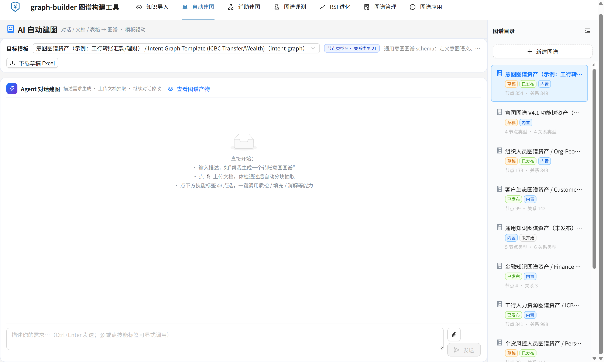
</p>

# graph-builder — 模板驱动的知识图谱构建工具链 + RSI 意图进化实验台

## 项目简介

**graph-builder** 是一套独立的图谱构建与意图进化工具链：Node.js 原生 http 服务 + 仓库内独立前端。前半段把 Excel、docx/pdf 文档、CSV/JSON 表格、Agent 对话描述、内置种子数据与 v2.1 存量图谱这六类原料，加工成**结构合法、可审计、可回滚**的属性图；后半段用 **RSI（Recursive Self-Improvement，递归自我改进）** 闭环，把意图识别的错题反馈变成可测量、可验证、可回滚的图谱改进版本。

- **问题域**：① 知识图谱的「建库」环节——业务填报到图谱的转换常是一次性黑盒脚本，非法数据静默入图，填错之后没有版本也没有回滚；② 图谱建好之后「准不准、怎么改」——靠人工复盘日志改提示词、补说法，改进没有对照、没有复测、没有留痕。
- **方案机制**：**模板驱动校验**（规则声明在模板 JSON，不写死在代码）、**三段校验管线**（骨架 → 字段 → 条件必填）、**预检 → 应用 → 回滚**、**版本链发布**（v1→v2→… 只读可追溯）；进化侧是 **RSI 四关测量门禁**（练习题初筛 → 防回退 → 隐藏考 → 生产引擎复核）、**引擎指纹**（跨口径成绩不可比）与 **Agent + Skill 决策层**（V2，Python 进程内的 openjiuwen DeepAgent + SKILL.prompt + 5 个 HTTP 工具）。
- **交付物**：`server.js` 单服务入口、7 组 API 路由族、14 张模板、6 个单文件工具页 + 1 个 React SPA 统一工作台、独立 Python Agent 服务、测试套件、24 张架构图与 8 张真实运行截图（hero + 7 张）。
- **状态**：本项目从 AI Harbor / OntoMind 单体剥离，为独立部署版（当前 1.1）。默认监听 `127.0.0.1:3013` 且 `SKIP_AUTH=true`，面向本机/内网开箱体验；**不是生产就绪的多租户服务**，对外暴露前必须换认证与访问控制（见[已知限制](#已知限制)）。RSI 的 Python Agent 是可选进程，不启动它时 `rules`/`model` 决策模式与全部只读界面仍可用。

> 写法参考（实调原文）：[Ollama](https://github.com/ollama/ollama) 的「2 行跑起来 + 链接优先」、[Mermaid](https://github.com/mermaid-js/mermaid) 的「示例/截图先行」、[Prometheus](https://github.com/prometheus/prometheus) 的「一段简介 + 加粗机制名清单 + 架构图 + 多条安装路径」，系统型骨架沿用本工具链原有的入口对照表与按目标导航。
>
> 本次新增名词的原文调研：[openJiuwen 双维度 RSI 框架](https://cn.chinadaily.com.cn/a/202609/14/WS6aa7b4d1e4b09a165c789ef1.html)（中国日报，2026-09：RSI = Recursive Self-Improvement，递归自我改进，Harness 优化 + Artifacts 优化）、[Anthropic · Equipping agents with Agent Skills](https://www.anthropic.com/engineering/equipping-agents-for-the-real-world-with-agent-skills)（SKILL.md 的 YAML frontmatter 与 progressive disclosure）、[openJiuwen Agent Platform](https://openjiuwen.com/)（DeepAgent / WorkSwarm）。名词解释不取项目内用法当定义。

## 名词表

| 名词 | 含义 |
|------|------|
| **知识图谱 / 属性图** | 由节点（实体、概念、功能）与边（关系）构成、节点和边都带属性的有向图。本仓库产出的是 JSON 文件，不落数据库。 |
| **模板** | 一份 JSON，同时声明节点/边类型、字段契约、枚举、条件必填规则与种子图；校验规则写在模板里，不在代码里。 |
| **草稿 / 资产 / 版本** | 草稿是正在编辑的图谱文档；资产是一张绑定模板的具名图谱；版本是草稿通过校验后生成的只读发布快照，形成 v1→v2→… 版本链。 |
| **摄入批次** | 一次 Excel 导入产生的候选行集合，经逐行评审、预检、应用后才合入草稿。 |
| **RSI** | **Recursive Self-Improvement（递归自我改进）**。openJiuwen 2026-09 发布的双维度 RSI 框架把它定义为「从真实任务反馈中生成改进方案、执行验证、保留有效改进」，分 **Harness 优化**（提示词/技能/工具/执行约束）与 **Artifacts 优化**（交付物）两个方向；本仓库是这套思路在「意图图谱」这一具体优化对象上的落地。 |
| **Agent Skill** | Anthropic 定义的「organized folders of instructions, scripts, and resources that agents can discover and load dynamically」，入口是带 YAML frontmatter 的 `SKILL.md`，靠 **progressive disclosure** 按需加载。本仓库的 `SKILL.prompt` 是同一类「把领域指令作为资源包交给 Agent」的实践，但实现不同，见 [RSI 意图进化](#rsi-意图进化v2-是-agent--skill不是-node-调度层)。 |
| **DeepAgent** | openjiuwen 提供的 Agent 构造入口 `create_deep_agent(model, card, workspace, system_prompt, tools, …)`。本仓库 `services/rsi-agent/app/agent_factory.py` 用它把 SKILL 正文注入 `system_prompt`、把 5 个 HTTP 回调注册成 tools。 |
| **引擎指纹 / 四关门禁** | 每次评测成绩带 `engineSha + protoRev + engineMode` 三元组；跨指纹的历史分数不可比。方案要过练习题初筛、防回退、隐藏考、生产引擎复核四关才允许采纳。 |
| **AI Harbor / OntoMind** | 本项目剥离前的宿主单体平台：AI Harbor 是集成多个工作台的门户（默认 :3000），OntoMind 是其中的知识工程前端（默认 :17386）。剥离后本项目不依赖两者。 |
| **[vis-network](https://visjs.github.io/vis-network/docs/)** | vis.js 家族的网络可视化库，用 HTML canvas 渲染节点与边、支持自定义形状与物理布局；本仓库把 9.1.2 的 standalone 构建本地化到 `tools/vendor/`，画布与展示页无外网依赖。 |
| **[AntV G6](https://g6.antv.vision/en/manual/introduction/)** | 蚂蚁集团 AntV 的图可视化引擎，提供绘制、布局、分析、交互与动画能力；意图图谱编辑器使用其本地化构建 `tools/vendor/g6.min.js`。 |

> 完整术语表与分层约定见[系统架构与技术方案](docs/architecture.md)；端点与字段契约以 [API 参考](docs/api.md) 为唯一权威，本页不重复定义。RSI 的完整链路与设计取舍见 [RSI V2 架构说明](docs/intent-rsi-v2-architecture.md)。

把各种形态的知识原料——业务人员填的 **Excel**、**CSV/JSON 表格**、**docx/pdf 文档**、**一段自然语言描述**、**内置种子数据**、**v2.1 存量图谱**——加工成一座**结构合法、可审计、可回滚**的知识图谱。建图入口有六条，按原料形态选：

| # | 建图方式 | 入口 | 特点 |
|---|---------|------|------|
| 1 | **Excel 摄入审核流**（业务人员主力） | `POST /api/knowledge-intake/import` | 三工作表 → 候选批次 → 人工评审 + AI 辅助 → 预检 → 应用 → 回滚，全程人在环上 |
| 2 | **文档抽取**（docx/pdf/txt/md/xlsx） | `parse-document` → `document-triage` → `extract` | 体检 → 分块 LLM 抽取（断点续跑 + 块级进度）→ 消歧对齐 |
| 3 | **表格确定性映射**（CSV/JSON，零 LLM） | `POST /api/org-graph/from-tabular` | 表头映射到模板字段 → 确定性建图，可单测断言、结果可复现 |
| 4 | **Agent 对话建图**（自然语言） | `/api/org-graph/builder-agent/*`（openjiuwen 8 技能） | 对话即建图：描述需求/上传材料 → 生成/质检/填充/消解，@技能显式调用 |
| 5 | **种子数据起步**（内置真实/模拟数据） | `POST /api/org-graph/seed` | org-people 157 人 mock / customer-ecosystem 25 家真实画像 + 40 条关系 |
| 6 | **存量图谱迁移**（v2.1 双通道保真） | `POST /api/org-graph/import`（importer 注册表） | 可编辑通道 + 无损通道，反向导出同一张映射表；新数据源=一个 importer 模块+注册一行 |

**六条入口过的是同一道门**：**模板驱动校验**守门——schema、枚举、条件必填规则全部声明在模板文件里，任何写入路径（Excel 合入、AI 抽取、表格映射、Agent 生成、手工编辑）过的是同一套校验器；**预检 → 应用 → 回滚 → 发布**让每一步可观测、可反悔——原料随便哪种形态进，图谱不腐化。

**这也不是意图图谱专用工具。** 校验器是通用引擎，规则声明在模板 JSON 而非代码——同一套流水线可以构建**任意类型的属性图**：意图图谱、组织人员图谱、客户生态图谱、金融知识图谱、个贷风控图谱、通用知识图谱……仓库内置 **13 张业务模板 + 1 张 RSI 引擎 schema 基准**（`data/graph-builder-templates/`），其中意图图谱只是**先行的打样**：它的场景模型最复杂（条件必填规则最多），用它把流水线锤打成熟后，其余类型图谱都是"一份模板 JSON + 注册表一行"零代码接入。线上实证：组织人员（173 节点/843 边）、客户生态、金融知识、工行 HR（341 种子节点）、个贷风控、银行业务语义等 **6 类非意图图谱已用同一套引擎真实发布**。

> 建图侧：Node 原生 http 单服务（无框架、无数据库）｜ 进化侧：同仓 Python Agent（openjiuwen DeepAgent，独立进程 :18132）｜ 校验：模板三段管线 ｜ 数据：JSON 文件即契约 ｜ 前端：7 个单文件工具页 + 1 个 React SPA（图表库全部本地化，见[独立前端](#独立前端)）｜ 许可：MIT

## 内置图谱模板库（13 张业务模板 + 1 张引擎基准）

**结论：模板 = schema + 校验规则 + 种子图，三合一 JSON。** 加一张新图谱 = 加一份模板文件 + 注册表一行，校验、草稿、版本、发布、审计全部复用，零代码。

| 类别 | 模板（template_id） | 节点 / 边类型 | 说明 |
|------|------|------|------|
| **意图图谱**（打样） | `intent-graph` | 9 / 21 | 意图建模 v2.1：聚合意图/意图/业务对象/动作/槽位/状态/风险…，内置工行 355 节点种子图 |
| | `intent-graph-v4` | 4 / 4 | V4.1 功能节点×场景制（ROOT/DOMAIN/CATEGORY/LEAF + 场景数组），主规范见 [schema-v4](docs/intent-graph-schema-v4.md) |
| | `ccb-mobile-banking` | 9 / 17 | 建行手机银行意图图谱（基于 intent-graph 复制定制） |
| **组织与人力** | `org-people` | 3 / 4 | 员工/部门/项目 × 汇报/所属/参与/协作，支撑 Agent 找人与排期 |
| | `icbc-hr` | 4 / 7 | 对齐工行 GIL HR schema：员工/机构/职务/业务指标，341 种子节点 |
| | `work-relationship` | 6 / 7 | 人员/组织/团队/角色/项目/主题的工作关系 |
| **客户与风控** | `customer-ecosystem` | 3 / 7 | 对公客户生态：企业客户/决策人/产品 × 供应链/任职/适配产品关系 |
| | `personal-credit-risk` | 9 / 11 | 个贷风控：借款人为中心，亲属/担保/任职持股/资产负债/逾期/团伙关联 |
| **领域知识** | `finance-knowledge` | 5 / 7 | 金融知识：机构/产品/人物/概念/事件 × 发行/持股/任职/监管/事件影响 |
| | `bank-semantic-graph` | 7 / 10 | 银行业务语义记忆：产品/账户/信用卡/贷款/服务/概念/规则 |
| | `knowledge-concept` | 4 / 4 | 概念/文档/能力/智能体之间的知识依赖 |
| **通用底座** | `generic-knowledge` | 5 / 6 | 通用知识图谱：概念/实体/人物/组织/事件 × 关联/组成/使用/前驱/参与/包含 |
| | `blank-property-graph` | 1 / 1 | 白纸起步：从一个通用实体和一种关系开始构建属性图 |
| **引擎基准**（非业务资产） | `template.intent.v2.json` | 9 / 21 | 不注册成图谱资产，专供 RSI 评测引擎做 schema 常量对齐与漂移检测（`tools/intent-graph-schema.js` 的 `checkTemplateAlignment()`）。本仓 `web` 之前缺它，1.1 补齐后漂移检测返回 `ok:true` |

> 每张模板的完整字段契约直接看 JSON：[`data/graph-builder-templates/`](data/graph-builder-templates/)。意图图谱的深度规范（场景模型、识别侧召回裁决）见 [intent-graph-schema-v4.md](docs/intent-graph-schema-v4.md)——那是**一份领域规范**，不是本工具链的边界。

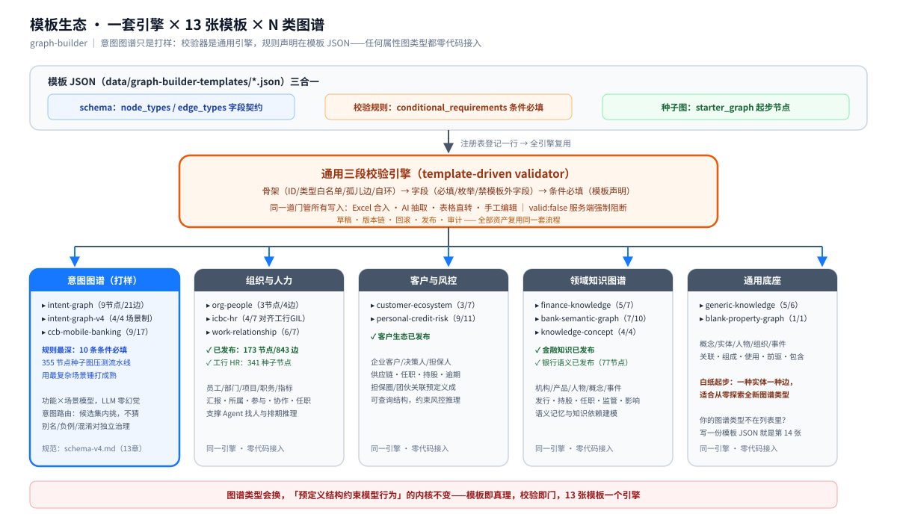

## 按目标选入口

| 我想…… | 去哪 |
| --- | --- |
| 5 分钟把它跑起来，亲手走一遍建图→发布 | [快速开始](#快速开始) |
| 我打开浏览器就能用，不想先读 API | [独立前端](#独立前端)（`/tools/index.html`） |
| 看懂 RSI V2 为什么是 Agent + Skill、Node JS 在做什么 | [RSI 意图进化](#rsi-意图进化v2-是-agent--skill不是-node-调度层) 或 [RSI V2 架构说明](docs/intent-rsi-v2-architecture.md) |
| 用错题反馈自动改进意图图谱 | [RSI V2 工作台](#rsi-意图进化v2-是-agent--skill不是-node-调度层)（`/intent-rsi`） |
| 看懂六条建图入口各落在哪些端点上 | 本页[开头建图方式表](#) 或 [API 参考](docs/api.md) |
| 看懂「导入→评审→预检→应用→发布」落在哪些代码上 | [系统架构与技术方案](docs/architecture.md) §4–§5 |
| 理解模板怎么约束数据、我的行为什么被拒 | [架构文档 §6 模板驱动校验](docs/architecture.md#6-模板驱动校验核心机制) |
| 我是业务人员，要填报意图 | [Excel 填报模板](docs/intent-graph-excel-template.xlsx)（8 Sheet + 下拉校验，当前为意图图谱打样板式；其他类型图谱经 `/api/org-graph` 上传模板即接入） |
| 查端点、对字段、对错误码 | [API 参考](docs/api.md) |
| 改代码、跑测试、加一张新图谱 | [开发与测试指南](docs/development.md) |
| 部署、配密钥、上生产 | [部署指南](docs/deployment.md) |
| 评审方案、质疑某个设计取舍 | [架构文档 附录 A 设计决策记录](docs/architecture.md#附录-a设计决策记录) |

**目录**：[它解决什么问题](#它解决什么问题) · [核心特性](#核心特性) · [图谱长什么样](#图谱长什么样) · [系统架构](#系统架构) · [RSI 意图进化](#rsi-意图进化v2-是-agent--skill不是-node-调度层) · [摄入流水线](#摄入流水线) · [快速开始](#快速开始) · [开发与测试](#开发与测试) · [仓库结构](#仓库结构) · [常见问题](#常见问题)

## 它解决什么问题

知识图谱的"建库"环节通常卡在三件事上，本仓库各给出一个可运行的答案：

1. **业务填表到图谱的加工是黑盒** — 一次性脚本转换，合进去对不对没人知道。这里做成**两段式流水线**：批次导入 → 逐行评审 → `preview-apply` 先在内存里合入草稿副本、跑真实模板校验、把逐条结果和统计还给你 → 确认无误才真正落盘。先看结果再落地，零惊吓。
2. **不合法的数据静默入图** — 字段缺失、枚举写错、引用悬空，坏数据混进图谱后排查成本极高。这里校验器是**唯一的门**：`valid:false` 在服务端强制阻断 apply（不信任前端），曾经因契约漂移产生的坏输出被**防倒退反向用例**锁死——放宽校验的回归会在测试里当场炸掉。
3. **填错了没法反悔** — 手工改 JSON 既无版本也无审计。这里 apply 前自动快照，`rollback` 做节点级精确还原（实测 358 → 354 节点、849 条边分毫不差）；发布走版本链 v1→v2→…，历史版本只读可追溯。

而"为什么要用图谱约束大模型"——以打样的意图图谱为例：传统方案让大模型直接从全库猜意图，会幻觉、不可控、无法审计。意图图谱把"用户能说什么"**预先定义成结构化数据**，大模型只在图谱给出的候选里挑，**图谱里没有的意图永远选不出来**：

- **零幻觉**：大模型不猜集合外的意图
- **可审计**：每条意图有 ID、负责人、版本、证据
- **可治理**：别名 / 负例 / 混淆对独立维护，不牵连代码
- **业务驱动**：业务人员填 Excel，技术团队加工成图谱，不依赖开发改代码

同一思想平移到其他图谱类型：客户生态图谱约束 Agent 只能沿"企业→决策人→产品"的真实关系链推理，个贷风控图谱把"担保圈/团伙关联"预先定义成可查询结构——**图谱类型会换，"预定义结构约束模型输出"的内核不变**。

**第四件事由 RSI 回答**：图谱建好之后，识别不准怎么办。传统做法是人工看日志、改提示词、补说法，改完没有对照也没有复测。RSI 把这条路径做成闭环——错题反馈 → 改进提案 → 同一引擎复测 → 四关门禁 → 采纳或回滚，每一步的资产、成绩与指纹都落盘可查。

## 核心特性

1. **模板即真理，且不止一张** — 一份模板文件同时是 schema（节点/边类型及各类型字段契约）、校验规则（条件必填，如 `交付形态=answer → 参考答案至少其一`）和种子图。仓库内置 13 张业务模板 + 1 张 RSI 引擎基准：意图图谱打样最深的规则（10 条条件必填、355 节点种子），组织/客户/金融/风控/通用等 12 张按各自业务定制。新增一张图谱资产 = 加一份模板文件 + 一行注册，零代码。
2. **写入即校验** — 三段校验管线：骨架（ID 唯一 / 类型白名单 / 无孤儿边 / 无自环）→ 字段（必填 / 类型 / 枚举 / 禁止模板外字段）→ 条件必填（跨字段约束由模板声明，不写死在代码）。`false` 布尔算已填，只有 `undefined/null/''` 算缺失——语义明确、无歧义。

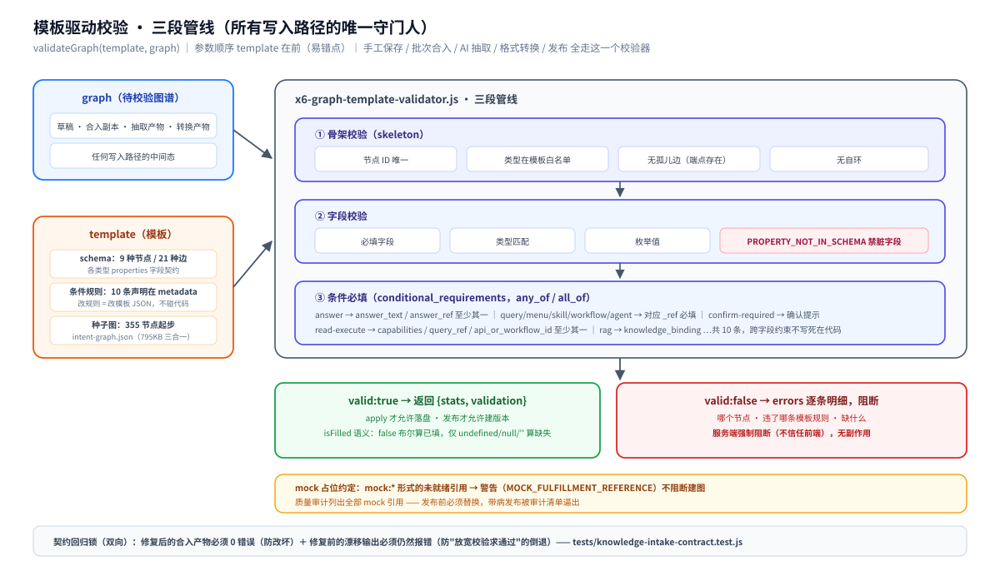
3. **六条建图入口，一道校验门** — Excel 摄入审核流（人在环上）、文档抽取（断点续跑）、表格确定性映射（零 LLM 可复现）、Agent 对话建图（openjiuwen 8 技能）、种子起步（真实/模拟数据一键）、v2.1 迁移（双通道保真）——六条路径产出过同一套校验器，`valid:false` 一律落不了盘。
4. **AI 辅助、人审主导** — LLM 做骨架映射建议、扩问补全、节点审查，但每一行内容由人 approve / reject；AI 挂了流水线照转（离线能力：导入、评审、校验、合入、回滚、表格映射全部不依赖模型）。
5. **mock 占位可入图** — 未就绪的上游引用填 `mock:*`，校验给警告不阻断建图；质量审计会列出全部 mock，发布前替换。
6. **多形态原料直通图谱** — docx/pdf/表格分块 LLM 抽取（单请求最长 11 分钟的块级进度可查）、摄入 Excel ↔ 图谱双向转换、CSV/JSON 表头映射确定性成图——同一个模板管住所有入口。
7. **文件即契约** — 无数据库：模板和图谱全是 JSON，目录布局即数据模型，Git 友好、拷走即备份；运行期生成物（批次、历史、缓存、RSI 快照/断点）全部 gitignore，仓库里只有模板和种子。
8. **RSI 意图进化（V2 = Agent + Skill）** — Python Agent 用 SKILL 指令做提案，5 个 HTTP 工具回读 Node 状态，`probe_query` 做反事实复测；Node 保留测量与采纳权威，**服务端测量永不经过模型**。四关门禁 + 引擎指纹让成绩可比较、可复现，详见[专节](#rsi-意图进化v2-是-agent--skill不是-node-调度层)。

## 图谱长什么样

**结论：模板决定图谱长什么样——13 张业务模板各有各的形，这里以打样的 V4 意图图谱为例。** 它是一张以分类树为骨架的有向图 + 一本资源字典，不是一棵简单的分类树。它回答三个核心问题：

| 问题 | 图谱怎么回答 | 例子 |
|------|-------------|------|
| 用户说的每类话，对应哪个业务动作？ | 功能节点 × 意图场景 | "查下余额" → 余额查询功能的查询场景 |
| 这个动作需要用户提供什么信息？ | 场景的槽位契约 | 转账需要：收款人、金额 |
| 这个动作由哪个系统功能来完成？ | 节点的 bindings 引用资源字典 | 余额查询 → `balance_get_v2` 能力 |

三种要素：

| 要素 | 是什么 | 在 JSON 里 |
|------|--------|-----------|
| **节点** | 功能节点。层级深度不固定——domain 一级，category 可任意多层嵌套，leaf 是最小不可再分的业务功能。任意层级节点声明**意图场景**（查询/办理/问答…）就直接服务用户 | `intentTree` 数组 |
| **边** | 三类，见下表 | 层级边在 `parent_intent_id`；横切关系在 `relations`；资源引用在 `bindings` |
| **资源字典** | 系统能力、常见问答、风控策略的集中登记表，定义一次、被任意节点引用 | `resourceRegistries` 对象 |

三种边：

| 边类型 | 含义 | 例子 |
|--------|------|------|
| ① 层级边 | 父→子，构成分类树骨架 | "基金定投"的父节点是"基金" |
| ② 横切关系边 | 跨分支节点间关系：`same_as` / `confusable_with` / `related_to` | "行内转账"和"跨行转账"是易混淆对 |
| ③ 资源引用边 | 节点→资源：调什么接口、答什么内容、受什么约束 | "查余额"引用 `balance_get_v2` |

> 字段级结构定义、识别侧两通道召回 + 裁判裁决的完整规范，见[主规范文档](docs/intent-graph-schema-v4.md)（V4.1，13 章 + 3 附录，本文档不重复定义）。

## 总体定位：一图说清

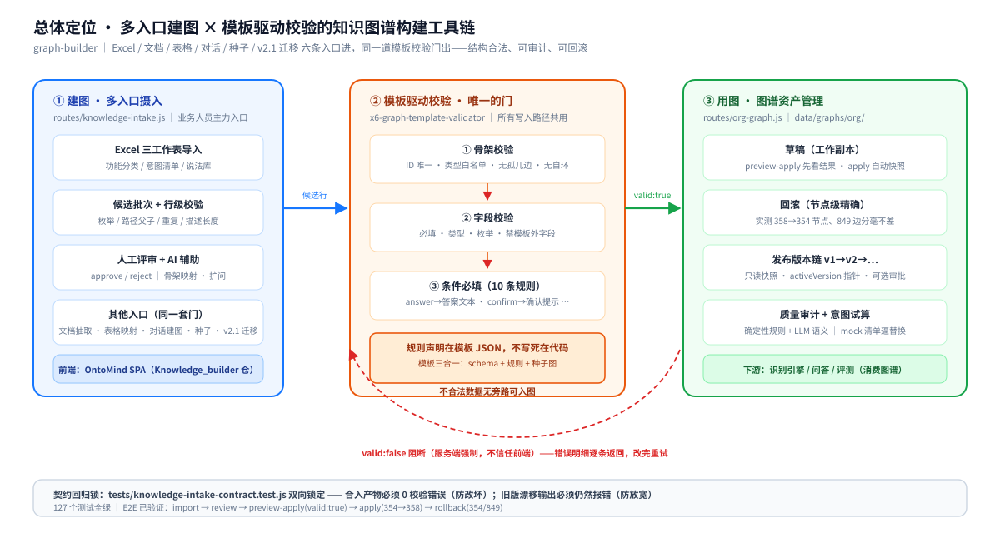

三个读点：

1. **建图（左）** — 六条入口按原料形态选：Excel 摄入审核流（图中主体，人工评审 + AI 辅助）、文档抽取、表格确定性映射、Agent 对话建图、种子起步、v2.1 迁移——原料形态不同，入图纪律相同；
2. **校验门（中）** — 模板三段管线是**唯一的门**：候选行、AI 抽取、表格映射、Agent 生成、手工保存全部过同一套校验器，`valid:false` 服务端强制阻断、错误明细逐条返回；
3. **用图（右）** — 合入草稿可回滚、发布走版本链、审计逼出 mock 占位；底部红环是本工具链的灵魂：不合法数据永远进不了图。

再往下钻一层——校验门背后的模板生态：**13 张业务模板、五类图谱、一个引擎**（意图图谱是打样，其余类型同样已真实发布）：


> 每个阶段由哪些代码承载、校验器内部怎么工作，见[架构文档](docs/architecture.md)；RSI 侧的进程拓扑见[RSI V2 架构说明](docs/intent-rsi-v2-architecture.md)。

## 系统架构

**结论：建图侧是一个 Node 进程、四层结构、一个数据目录；进化侧多一个可选的 Python Agent 进程。routes 只做 HTTP 适配，测量权威留在 Node。**

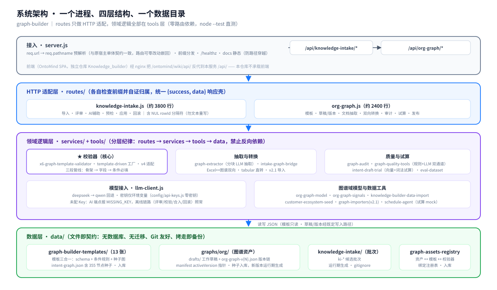

一次请求的路径：

1. **① 接入** — `server.js` 把 `req.url` 解析为 `req.pathname`（与原宿主单体一致的契约），按前缀分发给 7 组路由处理器，各自检查自己的前缀并自证"归不归我管"。`/ontomind/wiki/api/*` 在分发前被归一化成 `/api/*`（历史 `web/dist` 的兼容层）。
2. **② 适配** — `routes/` 解析参数 / multipart / JSON body，调用 tools 层，统一 `{ok, ...}` 或 `{ok:false, error}` 响应壳。
3. **③ 落盘** — 全部状态落 `data/` 下的 JSON 文件；模板只读，草稿/版本/批次/RSI 状态经既定写入路径落盘。

| 层 | 承载 | 关键点 |
| --- | --- | --- |
| 入口 | `server.js` | pathname 预解析、7 组路由分发 + RSI 前缀兼容层、`/assets/` SPA 托管、根路径 302、`/healthz`、docs 静态（含路径穿越防护）、`requestTimeout=30min`（SSE 长任务） |
| 路由层 | `routes/knowledge-intake.js`（约 3800 行）、`routes/org-graph.js`（约 2400 行）、`routes/intent-graph*.js`、`routes/intent-rsi.js`（202 KB） | 摄入、图谱资产、编辑器、自动建图与 RSI 意图进化的全部端点 |
| 运行时层 | `routes/rsi-production-runtime.js`（175 KB）+ 20 个 `rsi-*.js` | 进化循环、策略台账、测量策略、资产谱系、门禁；**无第三方 npm 依赖** |
| 引擎层 | `routes/intent-evaluator-v2.js`（274 KB）、`scripts/rsi-engine-score.js` | 打分由独立子进程执行，Node 通过 `spawn` 传 `--graph/--cases/--out`；离线确定性引擎可跑，在线通道需密钥 |
| Agent 层（可选进程） | `services/rsi-agent/`（Python 3.11 + openjiuwen 0.1.19） | `create_deep_agent` + SKILL.prompt + 5 个 HTTP 工具；FastAPI 暴露 `/v1/tasks/{propose,attribute}`，默认 :18132 |
| 工具层 | `tools/` 17+ 个模块 | 校验器（3 个）、LLM 客户端、文档抽取、质量审计、双向转换、模板 schema 对齐；**零路由依赖**，`node --test` 直测 |
| 数据层 | `data/` | 14 张模板 + 图谱存储 + RSI 种子/版本/快照；运行期生成物 gitignore |

> 分层纪律（routes → services → tools → data，禁止反向依赖）、判定表（一个新需求该落在哪一层）、模块内部细节——见[架构文档](docs/architecture.md)。

## RSI 意图进化：V2 是 Agent + Skill，不是 Node 调度层

<p align="center">
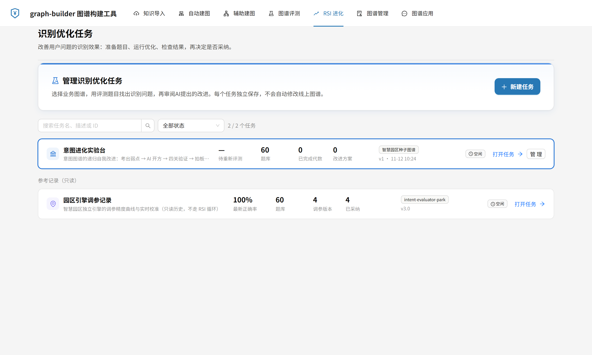
</p>

**先纠正一个容易看错的结论**：`routes/intent-rsi.js`（202 KB）和 20 个 `rsi-*.js` 是**调度 / 持久化 / 测量 / 门禁层**，不是推理主体。V2 的提案大脑在 `services/rsi-agent/`——一个 Python 进程里的 openjiuwen DeepAgent，SKILL 正文作为 `system_prompt` 注入，5 个 HTTP 工具回读 Node 状态。V1 才是 Node 内 `rules|model` 决策 + 轻量打分。

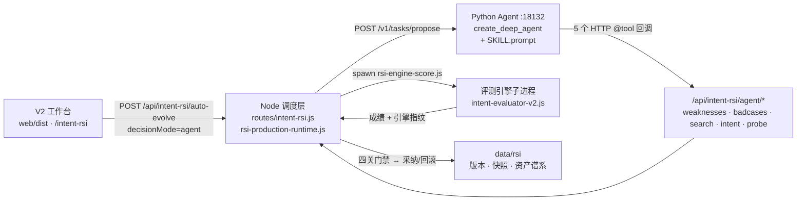

| 组件 | 文件 | 职责 |
|------|------|------|
| 提案 / 归因大脑 | `services/rsi-agent/app/agent_factory.py`、`tools.py`、`skills/{proposal,attribution}/SKILL.prompt` | `create_deep_agent` 建 Agent，SKILL 作 `system_prompt`，5 个 `@tool` 通过 `httpx` 回调 Node |
| 工具桥 | `routes/intent-rsi.js` 的 `/agent/*` 五个端点 | 只读暴露弱点、坏例、意图检索、意图详情、反事实探针；`probe_query` 把草案真应用到引擎再复测 |
| 调度与权威 | `routes/intent-rsi.js`、`routes/rsi-production-runtime.js` | 任务/分支/快照状态、SSE 事件流、评分子进程、策略台账、采纳门禁。**服务端测量永不经过模型** |
| 测量 | `scripts/rsi-engine-score.js` → `routes/intent-evaluator-v2.js` | 独立进程打分，输出带 `engineSha/protoRev/engineMode` 指纹；模型或召回通道降级时整次测量作废 |
| 前端 | `web/dist/`（V2 SPA）、`tools/intent-rsi-lab.html`（V1 实验台） | V2 覆盖任务、自动进化、候选对比、谱系与成绩轨迹；V1 直接看原始响应 |

**一次 `agent` 模式闭环**：工作台发 `/auto-evolve`（SSE）→ Node 组装 payload 调 Agent 的 `/v1/tasks/propose` → Agent 按 SKILL 指令用 `list_weaknesses` / `list_badcases` / `search_intents` / `inspect_intent` 调研，用 `probe_query` 做反事实验证后才交卷 → Node 拿到提案后 spawn 评测子进程，跑四关门禁，通过才落版本。闭环保证来自**工具反馈**，不是 prompt 纪律。

**Skill 为什么叫 `.prompt` 而不是 `.md`**：Anthropic 的 Agent Skills 以带 YAML frontmatter 的 `SKILL.md` 为入口，靠 progressive disclosure 让 Agent 按需读取正文与附加文件。本仓库不同——openjiuwen.harness 会按扩展名注册 parser 接管 `.md` 读取，workspace 之外的读取被拦截；因此这里用 `.prompt` 走原生文件系统，并由 `app/skill_texts.py` 把 SKILL 正文**烧录成 Python 常量**注入 `system_prompt`（`config.py:preload_skill_texts()` 在 import openjiuwen 之前预读）。代价是：改进 Skill 必须重跑 `gen-skill-texts.js` 并重建镜像，拿不到官方「按需加载、上下文近乎无界」的收益；换来的是容器与 WSL2 bind mount 视图陈旧时指令仍可靠加载。

**已知契约冲突（继承自源仓）**：`docs/intent-rsi-audit-2026-10-19.md:215` 记录 SKILL 曾授权 A6–A8 结构级算子，而 Node 侧 `routes/rsi-reasoning.js` 的校验只认 A1–A5；`services/rsi-agent/tests/test_tools_contract.py` 已把 proposal SKILL 约束为只教可执行算子（`A6_ambiguity_cluster_expand`，禁 `A6_add_intent`/`A7_merge_intent`/`A8_relation_edit`）。改动 Skill 前先读这两处。

> 完整链路、端点契约、环境变量、部署拓扑与已知限制见 [RSI V2 架构说明](docs/intent-rsi-v2-architecture.md)；9 份历史设计与审计文档见 `docs/intent-rsi-*.md`。

<p align="center">
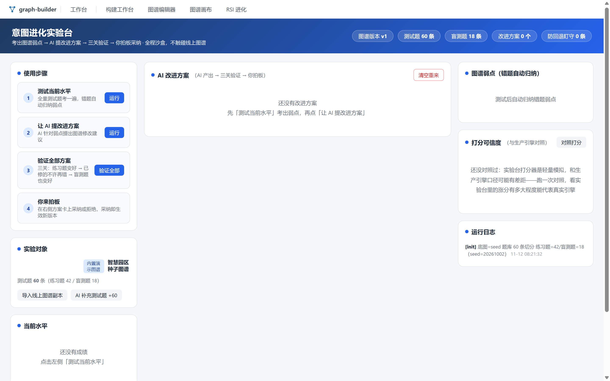
</p>

## 摄入流水线

**结论：导入即逐行校验、评审逐行定夺、预检先看结果、应用带快照、回滚节点级精确——每个阶段有明确的守门人和产物。**

> 这是六条建图入口中的第 1 条（Excel 摄入审核流，业务人员主力路径）；其余五条（文档抽取 / 表格映射 / Agent 对话 / 种子 / v2.1 迁移）不走批次评审，直接产出图谱文档后过同一套模板校验、走草稿 → 预检 → 发布，见开头[建图方式表](#)。

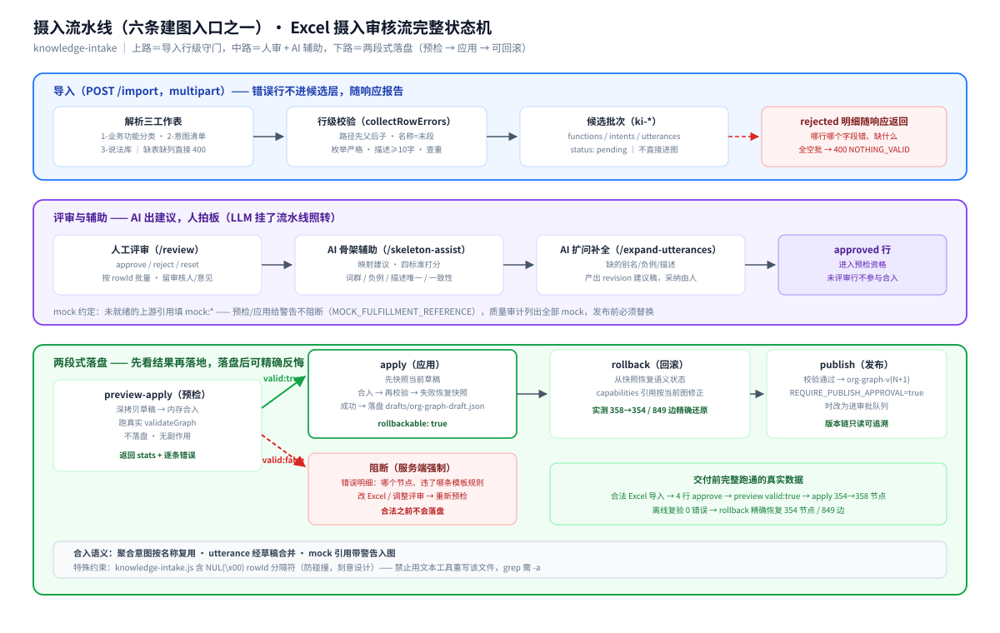

```
Excel（三工作表）──import──▶ 候选批次（行级校验：枚举/路径父子/重复/描述长度）
      │
      ▼
   人工评审（approve / reject / reset，按 rowId 批量）──AI 辅助──▶ 骨架映射 / 扩问补全（建议稿，人说了算）
      │
      ▼
preview-apply：内存合入草稿副本 ──▶ 真实 validateGraph ──▶ valid:false 阻断（无副作用）／valid:true 出统计
      │
      ▼
   apply 落盘草稿（自动快照，rollbackable）──▶ 发布 org-graph-v{N+1}（可选审批队列）
```

这条流水线不是纸面设计——本仓库交付前完整跑通过一遍真实链路：合法 Excel 导入 → 4 行 approve → `preview-apply` 返回 `valid:true` → apply 后草稿 354→358 节点、离线复验 0 错误 → rollback 后 354 节点 / 849 边精确还原。127 个核心测试锁定这条链路的每个契约。

## 快速开始

### 本地运行（Node ≥ 18）

```bash
git clone https://github.com/wanshoulu/graph-builder.git
cd graph-builder && npm install && npm start
```

打开 <http://127.0.0.1:3013/> —— 根路径 302 到统一工作台 `/auto-build`（辅助导航在 `/tools/index.html`）。改端口用 `PORT=4013 npm start`；需要 AI 辅助时 `cp .env.example .env` 填 `DEEPSEEK_KEY` 等（不填也能跑，见[常见问题](#常见问题)）。

<p align="center">
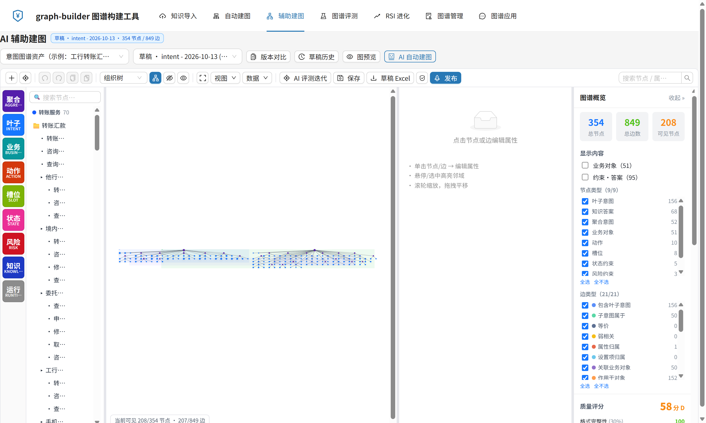
</p>

### 打开 RSI 意图进化

只用 Node 服务就能看状态、任务、历史与 V1 实验台：

```bash
curl http://127.0.0.1:3013/api/intent-rsi/state     # 自动从种子初始化 default/v1/main
# 浏览器：/intent-rsi（V2 工作台）  ·  /tools/intent-rsi-lab.html（V1 实验台）
```

需要 `agent` 决策模式时再启动 Python Agent（独立进程，默认 :18132）：

```bash
cd services/rsi-agent && pip install -r requirements.txt
RSI_AGENT_API_BASE_URL=http://127.0.0.1:3013/api/intent-rsi/agent \
  uvicorn app.main:app --host 0.0.0.0 --port 18132
# 回到仓库根，另开一个终端：RSI_AGENT_URL=http://127.0.0.1:18132 npm start
```

两端地址必须互指：Node 用 `RSI_AGENT_URL` 找 Agent，Agent 用 `RSI_AGENT_API_BASE_URL` 回调 Node 的 `/agent/*` 工具桥。容器部署时这两个值都要换成服务名，不能写 `localhost`。

### 跑起来后你会看到

1. `curl http://127.0.0.1:3013/api/health` 返回 `{"ok":true,"service":"graph-builder",...}` 与 7 组 API 前缀、`rsiAgent` 地址、`spa` 是否已构建。
2. `curl http://127.0.0.1:3013/api/org-graph/assets` 返回意图图谱等资产清单（模板版本、节点/边类型齐全）。
3. 浏览器打开 `/tools/workbench.html?autoload=1` 自动载入草稿，点「① 三段校验」→「② 质量报告」→「③ 保存草稿」→「④ 发布版本」，每一步的响应与请求日志都在页面上。
4. `curl -F "file=@docs/intent-graph-excel-template.xlsx" http://127.0.0.1:3013/api/knowledge-intake/import` 得到批次号——用模板里自带的示例行即可走通 Excel 摄入审核流；其余五条见开头建图方式表。
5. 按上面的[摄入流水线](#摄入流水线)走 review → preview-apply → apply → rollback，`GET /api/org-graph/load?asset=intent-graph&kind=draft` 能看到草稿节点数随 apply / rollback 增减。
6. `GET /api/intent-rsi/state` 返回种子状态（60 题：42 练习题 / 18 隐藏考）；`POST /api/intent-rsi/tasks/create` 建任务后可走 baseline / propose / evaluate-proposal / adopt。

### 我要了解架构和 Schema

→ 读 [docs/intent-graph-schema-v4.md](docs/intent-graph-schema-v4.md)

| 我想了解 | 看哪里 |
|---------|--------|
| 整体架构和识别流程 | 第 4 章 |
| 图谱数据结构（节点/边/资源） | 第 7–10 章 |
| 从零开始建图谱 | 第 13 章 |
| 完整 JSON Schema | 附录 A |

### 我要修改 Excel 模板

```bash
cd docs && python gen_excel_template.py   # 改生成脚本后重新生成 xlsx
```

## 开发与测试

测试**全部离线运行，不需要任何 API Key**。1.1 起口径分三层，如实列出：

```bash
npm run test:core    # 127 / 127 全绿：建图侧 10 个测试文件，可作为 CI 门禁
npm run test:rsi     # RSI 18 个测试文件：181 通过 / 13 失败（继承源仓，见下）
npm test             # 全量 321：308 通过 / 13 失败（= 127 + 194）
npm run test:contract # 契约回归锁：摄入输出必须 0 校验错误 + 防倒退反向用例
```

**13 个失败不是剥离引入的**：在源单体 `/d/project/vscode` 跑同一批 `tests/rsi-*.test.js`，结果同样是 181/13，失败名单逐条一致。根因是运行时后来加了「`rules` 决策模式必须注入 `propose` 服务」的早期校验（`routes/rsi-production-runtime.js:954`），而 7 个测试 fixture 仍显式传 `propose: undefined` 走 LLM 路径；其余是断言与新版测量策略的数值差异。修它需要改写测试语义，本次剥离不做业务改动，如实保留。另有一例时序相关用例偶发 flaky，两次全量跑分别得到 13 / 14 个失败。

Python 侧 `services/rsi-agent/app/*.py` 已通过 `python -m py_compile`；`tests/test_tools_contract.py` 需要 `httpx`（`requirements.txt` 已列）与 pytest，本机未装故未执行。前端改动后重建产物：`npm run build:web`（在 `web/` 内 `npm install && npm run build`）。

改动从哪下手、分层约定、加一张新图谱资产的步骤——见[开发与测试指南](docs/development.md)。

## 仓库结构

```
graph-builder/
├── server.js                    # 入口：7 组路由分发 + RSI 前缀兼容层 + SPA 托管 + 根路径 302
├── config/api-keys.js           # 模型路由注册表（含 RSI 评测默认 qwen3.7-flash）
├── middleware/auth.js           # JWT 认证（SKIP_AUTH=true 免登录，默认开发模式）
├── routes/
│   ├── knowledge-intake.js      # Excel 摄入工作流
│   ├── org-graph.js             # 图谱资产：模板/草稿/版本/抽取/审计/试算/发布
│   ├── intent-graph-editor.js   # 意图图谱编辑器
│   ├── intent-graph-autobuild.js# 自动建图
│   ├── intent-rsi.js            # RSI：35 个端点 + /agent/* 工具桥（调度层）
│   ├── rsi-production-runtime.js# RSI 进化运行时：SSE / 分支 / 门禁 / 策略台账
│   ├── rsi-*.js                 # RSI 私有模块 20 个（测量/学习/归因/谱系…）
│   └── intent-evaluator-*.js    # 评测引擎 v2 / 图 / 园区（评分子进程依赖）
├── scripts/                     # rsi-engine-score / calibrate / causal-verify 等（spawn 用）
├── services/
│   ├── intent-draft-trial.js    # 意图试算（向量召回 + 词法裁决）
│   └── rsi-agent/               # Python Agent：app/*.py + skills/{proposal,attribution}/SKILL.prompt
│                                # + Dockerfile / requirements.txt / tests / gen-skill-texts.js
├── web/                         # V2 React SPA：src/（116 文件）+ dist/（预构建产物）+ vite.config.ts
├── tools/                       # 领域工具库 + 独立前端（单文件应用）
│   ├── index.html               # 门户：建图入口、RSI 章节、名词表、工具导航
│   ├── workbench.html           # ★ 图谱构建工作台：校验→质检→保存→发布→回滚
│   ├── intent-rsi-lab.html      # RSI V1 实验台（+ appbar.js）
│   ├── intent-graph-editor.html / graph-intent-visual.html / graph-eval.html / wiki-graph.html
│   ├── vendor/                  # vis-network 9.1.2 / G6 / d3 本地构建，零 CDN
│   ├── x6-graph-template-validator.js / template-driven-graph-validator.js / intent-graph-schema.js
│   ├── llm-client.js            # 共享 LLM 客户端
│   └── …（graph-extractor / intake-graph-bridge / graph-audit / org-graph-model 等）
├── data/
│   ├── graph-builder-templates/ # 13 张业务模板 + template.intent.v2.json（引擎 schema 基准）
│   ├── graph-builder-samples/   # 3 份样例 CSV
│   ├── graphs/                  # 种子草稿 + demo.json + menu-tree + 版本清单 / FAQ 种子
│   ├── rsi/                     # RSI 种子：rsi-graph.v1 / rsi-eval-cases(,imported) / park-history
│   │                            # + 9 个空运行期目录（.gitkeep；快照/断点/产物全部 gitignore）
│   └── knowledge-intake/        # 摄入批次（运行期生成，gitignore）
├── tests/                       # 10 个建图测试（127 用例）+ 18 个 RSI 测试（194 用例）
└── docs/                        # 规范 + 9 份 RSI 设计/审计文档 + 24 张架构图 + 7 张真实截图
```

## 独立前端

剥离后不需要 AI Harbor 门户、OntoMind SPA、nginx 同源代理或 Java 后端，`npm start` 后浏览器直接打开：

| 页面 | 路径 | 作用 | 后端依赖 |
|------|------|------|---------|
| 门户 | `/tools/index.html` | 名词表、六条入口、RSI 章节、模板生态、工具导航、服务自检 | `/api/health` |
| **统一工作台（主入口）** | `/auto-build`（根路径直达） | OntoMind 图谱构建 SPA：知识导入 / 自动建图 / 辅助建图 / 图谱评测 / RSI 进化 / 图谱管理六个模块 | 全部 API 路由族 |
| **RSI V1 实验台** | `/tools/intent-rsi-lab.html` | 单文件：状态、导入快照、基线、提案、评测、采纳、回滚的原始响应 | `/api/intent-rsi/*` |
| **图谱构建工作台** | `/tools/workbench.html?autoload=1` | 载入草稿 → 三段校验 → 质量报告 → 保存 → 发布 → 历史回滚 | `/api/org-graph/*`、`/api/knowledge-intake/batches` |
| 意图图谱编辑器 | `/tools/intent-graph-editor.html` | 专家手工建模、schema 校验、版本导出、组织图谱视图 | `/api/intent-graph/*`、`/api/intent-graph-autobuild/*` |
| 图谱画布 | `/tools/graph-intent-visual.html` | vis-network 交互可视化、业务域/动作/枢纽分栏 | 无（纯前端） |
| 图谱评测 | `/tools/graph-eval.html` | 评测明细统计与对比 | 无（纯前端） |
| 知识图谱展示 | `/tools/wiki-graph.html` | 按类型着色、层级过滤、节点详情 | `/api/graph/data`、`/api/org-graph/*` |

<p align="center">
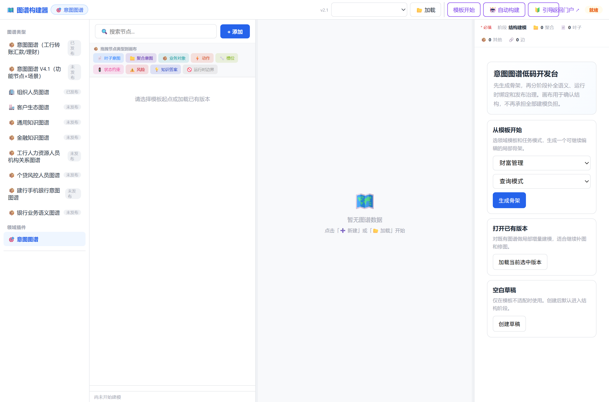
</p>

**独立化改造清单**：默认端口 `3013`；根路径 302 到统一工作台 `/auto-build`；`/tools/`、`/docs/`、`/assets/`、`/data/graphs/` 静态映射并做路径穿越防护；SPA 非 API 路径兜底回 `web/dist/index.html`；`/ontomind/wiki/api/*` 归一化到 `/api/*`；`server.requestTimeout=30min` 支撑 SSE 长任务；`vis-network` / `G6` / `d3` 全部本地化；`/favicon.ico` 与 `/vite.svg` 返回 204。

## 为什么这样剥离（设计决策与代价）

| 决策 | 代价 |
|------|------|
| 以已有后端工具链为骨架，不重写路由 | 保留两个大路由文件（摄入 199 KB / 资产 146 KB）带来的复杂度；换来 127 个测试契约与真实链路数据一条不丢。 |
| 只纳入能在本仓跑通的单文件页面 | 放弃 `x6-graph-builder.html`：它依赖 26 个 `knowledge-*.js` 与 `/api/knowledge-builder/*`，后者又依赖 181 KB 的 runtime 路由和十余个运行时模块，硬搬会留下大量 404。 |
| 补齐编辑器与自动建图两组路由 | 自动建图 `generate` 依赖 LLM 密钥，未配置时降级；`data/graphs/menu-tree.json` 只带 5 条示例候选，需替换真实菜单树才能用于生产。 |
| 只带模板与种子，排除 29 MB 级存量图谱与 RSI 的 1186 个运行期文件 | 编辑器版本列表与进化历史初始为空；换来仓库约 20 MB、干净 clone 后立即可跑。RSI 侧 `checkpoints/` 单目录就有 2.0 GB，不带是硬约束。 |
| 单文件 HTML + 本地 vendor，不引入 Vite/React（建图侧） | 无构建链、开箱即用；代价是没有组件复用、前端路由与权限模型。V2 RSI 工作台是例外——它本来就是 React SPA，只能带预构建产物。 |
| **RSI 整包搬 `routes/rsi-*.js` 20 个模块 + 评测引擎链，不裁剪** | 二级/三级互相 require（`rsi-production-runtime` → `rsi-optimization` → `rsi-learning`/`rsi-strategy`…），只搬顶部 11 个会在评分子进程里崩。代价是引入约 1 MB 运行时代码，换来 `/baseline` 评测链路真跑通。 |
| **RSI 前端保留历史 `web/dist`，用服务端前缀兼容层抹平差异** | `server.js` 多一段 `/ontomind/wiki/api/* → /api/*` 归一化与旧工具页回落重定向；源码 `web/src` 已改 `BASE="/api"` 但产物未重建，二者靠兼容层保持一致。改源码后需自行 `npm run build`。 |
| **Python Agent 做成可选进程，不塞进 Node** | 保持 Node 侧零第三方依赖、无密钥也能看界面；代价是 `agent` 决策模式需要额外装 `openjiuwen==0.1.19` 等 Python 依赖、配两个互指的地址环境变量。 |
| **SKILL 用 `.prompt` 且烧录成 Python 常量** | 绕开 openjiuwen.harness 对 `.md` 的 parser 接管与 WSL2 bind mount 视图陈旧；代价是放弃 Anthropic 式 progressive disclosure，改 Skill 必须重跑生成脚本并重建镜像。 |
| **13 个 RSI 历史失败测试原样保留** | `npm test` 不是全绿；代价由 `npm run test:core`（127/127）承担门禁职责，失败原因写在 README 而不是删测试掩盖。 |

## 已知限制

- **默认免鉴权**：`SKIP_AUTH=true` + 绑定 `127.0.0.1`。这是本机开箱体验的取舍，对外暴露前必须设 `SKIP_AUTH=false` + `JWT_SECRET` 并在反代层做访问控制。
- **AI 能力需密钥**：映射、抽取、扩问、节点审核、自动建图生成在未配置 `DEEPSEEK_KEY` 等密钥时返回明确错误；确定性通道（导入、评审、模板校验、应用、回滚、表格映射）不受影响。
- **RSI 基线在无密钥时会被门禁拒绝**：评分子进程能跑完打分（实测 58 题、strict 19% / relaxed 55.2%），但向量/模型通道降级会让 `/baseline` 返回 400「本次测量不作为方案收益或无收益的证据」。这是测量策略的正确行为，不是故障；要拿到有效基线需配 `QWEN_KEY` / `DEEPSEEK_KEY`。
- **Python Agent 未内置运行时**：`agent` 决策模式与 `/agent/*` 工具桥需先按 `services/rsi-agent/requirements.txt` 安装依赖并启动 :18132；无运行中 Agent 代次时 `/api/intent-rsi/agent/weaknesses` 返回 500 属预期降级。本机 `python -m py_compile` 通过，契约测试因缺 `httpx`/pytest 未执行。
- **RSI 13 个测试失败继承自源仓**：运行时与测试 fixture 版本不同步，源仓与独立仓失败名单完全一致；`npm run test:core` 为全绿门禁。详见[开发与测试](#开发与测试)。
- **`web/dist` 与 `web/src` 有一行 BASE 差异**：历史产物写死 `/ontomind/wiki/api`，源码已改 `/api`，靠 `server.js` 兼容层工作；历史「图谱应用」子菜单的 4 个单体工具页链接被重定向回门户。重建 dist 后这些兼容分支可删。
- **Skill 与 Node 侧算子契约曾冲突**：`docs/intent-rsi-audit-2026-10-19.md:215` 记录 SKILL 授权 A6–A8 但 `rsi-reasoning.js` 只认 A1–A5；现由 `test_tools_contract.py` 约束为只教可执行算子。改 Skill 前先核对两处。
- **外部 Agent 端点未内置**：`/api/org-graph/builder-agent/*`、`/trial-agent/*` 默认指向 `BUILDER_AGENT_URL` / `TRIAL_AGENT_URL`，独立部署时若未启动对应服务，这两组端点不可用。
- **历史数据未随仓上传**：存量意图图谱、评测大文件、发布版本链、草稿历史与 RSI 的快照/断点/资产产物均不在仓库内；`data/graphs/` 只保留一个 354 节点种子草稿、一份 18 节点演示图和 5 条示例候选；`data/rsi/` 只保留 3 份种子 + 园区轨迹。画布页、评测页、展示页读取的 `intent-graph-graph.json` / `intent-graph-bundle.json` / `embeddings-cache.json` 均为**小体积示例数据**，向量缓存为空是刻意保留的降级状态。
- **写操作无二次保护**：工作台的保存/发布直接调用写端点，服务端只有模板校验与文件锁，没有审批流以外的权限模型；`REQUIRE_PUBLISH_APPROVAL=true` 可开启审批队列。RSI 的采纳/回滚同样无权限模型。
- **未做统一入口**：本项目与其余拆分出来的工作台各自独立端口，没有总导航；AI Harbor `3000` 仍以 iframe 加载站内副本，不在本仓库职责内。

## 常见问题

**没有模型 Key 能体验吗？** 能，且不止一半：导入、评审、模板校验、预检、应用、回滚、发布、审计的确定性通道全部离线可用；RSI 的状态、任务、优化能力清单、策略台账、V1/V2 界面也都能打开，评分子进程可跑完打分。缺的是 AI 骨架映射、扩问补全、语义抽取、语义试算，以及**需要有效证据的基线/采纳结论**。

**RSI V2 到底是不是 Node 写的？** 不是。Node 侧 `routes/intent-rsi.js` + `rsi-production-runtime.js` 是调度、持久化、测量与门禁层；提案大脑是 `services/rsi-agent/` 的 Python DeepAgent，SKILL.prompt 作为 `system_prompt`，5 个 HTTP 工具回读 Node。V1 才是 Node 内的 `rules|model` 决策。

**Agent 起不来，V2 工作台还能用吗？** 能。不启动 :18132 时，`rules`/`model` 决策模式、任务管理、状态、历史、候选对比与成绩轨迹都可用；只有 `agent` 决策模式和 `/agent/*` 工具桥不可用。

**我的行为什么被拒了？** 速查最高频的四条：功能全路径必须 `父/子` 斜杠分级且**先父后子**；功能名称必须与路径末段一致；业务描述至少 10 字；枚举值严格匹配（客户分类、安全分级 L1-L4、意图类型"查询/办理/…"、执行模式带后缀如 `knowledge-only-知识应答`）。完整规则见 [API 参考](docs/api.md)。

**为什么我的批次 preview-apply 报错？** 这正是这道门在干活：`validation.errors` 逐条列出哪个节点违反模板的哪条规则（字段缺失 / 枚举非法 / 条件必填未满足）。改 Excel 或评审结论后重试，**合法之前服务端不会落盘**。

**数据存在哪、怎么备份？** 全部在 `data/` 一个目录：模板 + 图谱草稿/版本 + 摄入批次 + RSI 状态/版本/快照，拷走即备份；`drafts/history/`、批次目录、`data/rsi/{artifacts,checkpoints,drafts,logs,tasks,versions,snapshots}` 是运行期生成物，真正的资产是 `graph-builder-templates/`、`graphs/org/` 与 `data/rsi/` 的四份种子 JSON。

**想加一张自己的图谱（不是意图图谱）？** 加一份模板 JSON（含 node_types / edge_types / 校验规则 / 种子图）+ 在资产注册表登记一行——校验器、草稿管理、版本发布、审计全部复用，零代码。步骤见[开发指南](docs/development.md)。

**生产部署要注意什么？** 三件事：`SKIP_AUTH=false` + `JWT_SECRET`（默认免登录仅限开发）；模型密钥走环境变量不进镜像；分块抽取单请求可达 11 分钟、RSI 自动进化是 SSE 长连接（`requestTimeout=30min`），反代调大读超时并关闭缓冲。完整清单见[部署指南](docs/deployment.md)。

## 文档

- [系统架构与技术方案](docs/architecture.md) — 术语、两层子系统流程、模板校验机制、数据契约、设计决策（含代价）与已知限制
- [RSI V2 架构说明](docs/intent-rsi-v2-architecture.md) — Agent + Skill 完整链路、端点契约、环境变量、部署拓扑、已知契约冲突
- [API 参考](docs/api.md) — 全部端点（含 `/api/intent-rsi/*`）、Excel 三工作表格式、错误码速查
- [意图图谱 Schema V4.1](docs/intent-graph-schema-v4.md) — 主规范：节点/边/资源字典/校验规则/开发流程（13 章 + 3 附录）
- [开发与测试指南](docs/development.md) — 环境、三层测试口径、分层约定、常见改动入口
- [部署指南](docs/deployment.md) — 环境变量、Python Agent、Docker、Nginx 同源反代、生产清单
- `docs/intent-rsi-*.md` — 9 份 RSI 设计/评审/审计报告（overview、joint-evolution、product-redesign、audit-2026-10-19 等）
- [docs/diagrams/](docs/diagrams/) — 24 张架构图：工具链 5 张 + V4 规范 19 张
- [docs/images/](docs/images/) 与 [docs/screenshots/](docs/screenshots/) — 真实运行截图（1422×854 @2x，浅色主题）：hero 统一工作台、AI 辅助建图、图谱管理、RSI 进化，及 raw-API 工作台、门户、编辑器、RSI V1 实验台

## 版本

| 版本 | 说明 |
|------|------|
| **独立部署版 1.1.1**（当前） | 对齐 Harbor 最新版代码（org-graph +7 端点 / intake +460 行 / tools 7 文件 / 模板新命名 / 11 资产真实数据 21MB / active 评测图谱）；根路径 302 到统一工作台 `/auto-build`；`/api/graph-builder/tools/*` 逐节点 AI 审核挂载；主题统一浅色；7 组 API；SPA 六页实测 0 异常；测试 328 pass（14 fail 为源仓既有历史债） |
| **独立部署版 1.1** | 并入 RSI V2 完整链路（Node 调度层 20 模块 + 评测引擎 + Python Agent+Skill + V1/V2 前端 + 种子）；6 组 API；补齐 `template.intent.v2.json`，模板漂移检测 `ok:true`；4 页无头浏览器实测 0 异常 / 0 HTTP≥400；核心测试 127/127 |
| **独立部署版 1.0** | 自 AI Harbor / OntoMind 剥离出可独立运行的前端与 4 组路由；默认 :3013、零 CDN；127 测试全绿；5 张真实截图 |
| **工具链 1.0** | 自 ai-harbor 单体独立成库（GitCode 版，纯 API）；修复 4 处摄入↔模板契约漂移；E2E 全链路验证 |
| 图谱规范 V4.1 | 功能节点 + 意图场景模型；skillBinding 一等公民；V4 适配器契约；Excel 一体化导入 |
| 图谱规范 2.1 | 历史运行版本（`tools/graph-importers/` 保留 v2.1 导入兼容） |

## 许可证

[MIT](LICENSE)
