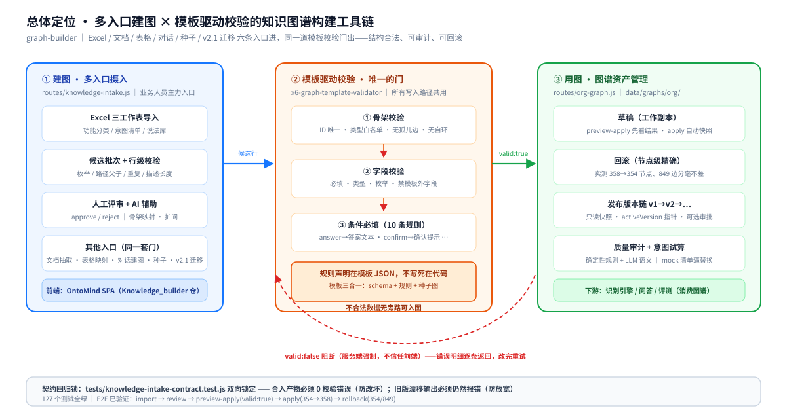
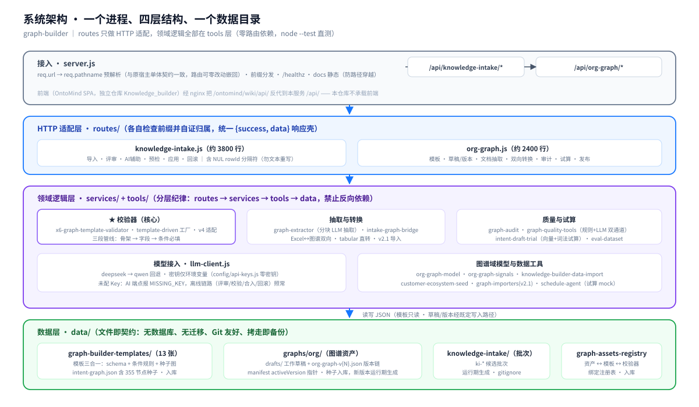
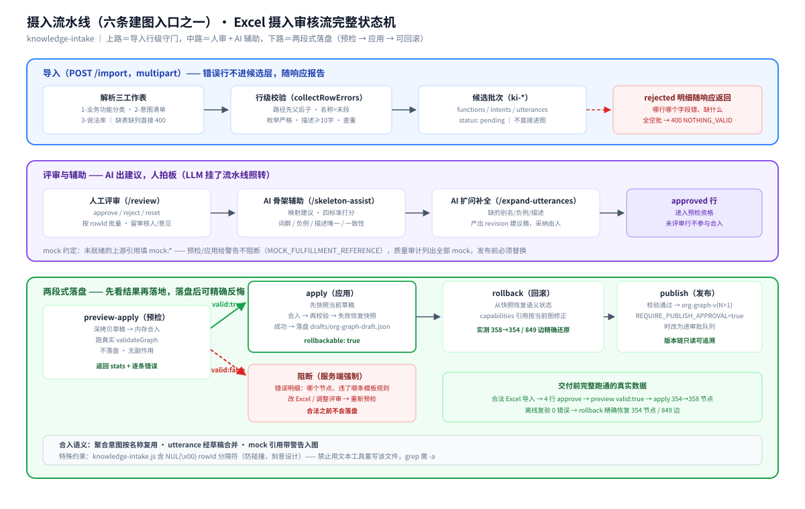
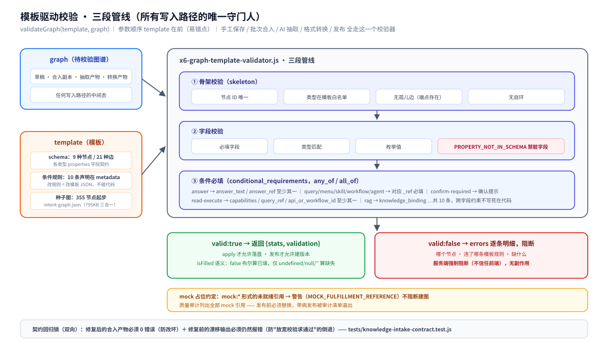

# graph-builder 系统架构与技术方案

> 本文是唯一的**技术规范文档**：定义系统的组成边界、两条核心链路的逐步流程、模板校验机制、数据与接口契约、设计决策及其代价。规格表述与代码冲突时，以代码为准并回来修本文——校验规则唯一权威：`tools/x6-graph-template-validator.js`；模板字段唯一权威：`data/graph-builder-templates/*.json`（意图打样主模板 intent-graph.json）；V4 映射唯一权威：`tools/intent-graph-schema.js`。

## 这份文档讲什么（先看这段）

| 你是谁 / 你想干嘛 | 读哪里 |
| --- | --- |
| 第一次接触，想知道系统是什么 | [README](../README.md) → 回来看 §2、§4 |
| 要讲清「导入→评审→预检→应用→发布」怎么落代码 | §4、§5，管线总览见 [README 摄入流水线](../README.md#摄入流水线) |
| 我的行为什么被校验器拒了 | §6 |
| 要改代码、加功能 | §3 摸清边界，再读 [development.md](development.md) |
| 要部署、运维 | [deployment.md](deployment.md)，本文 §8 |
| 评审方案、质疑某个设计 | §7（为什么）+ 附录 A（决策与代价）+ 附录 B（诚实清单） |

四份文档分工：**README** 讲是什么怎么跑；**本文**讲怎么设计的、为什么、边界在哪；**api.md** 讲端点与字段格式；**development.md** 讲怎么改怎么测。同一件事不在两份文档里重复定义，只链接。意图图谱本身的业务规范（节点语义、场景模型、识别侧召回裁决）是独立领域文档：[intent-graph-schema-v4.md](intent-graph-schema-v4.md)。

## 目录

- **第一部分 基础概念**：[1 术语定义](#1-术语定义) · [2 系统组成总览](#2-系统组成总览) · [3 为什么是这套架构](#3-为什么是这套架构)
- **第二部分 架构与方案设计**：[4 知识摄入子系统](#4-知识摄入子系统knowledge-intake) · [5 图谱资产子系统](#5-图谱资产子系统org-graph) · [6 模板驱动校验（核心机制）](#6-模板驱动校验核心机制) · [7 数据与存储设计](#7-数据与存储设计)
- **第三部分 接口契约**：[8 端点与契约纪律](#8-端点与契约纪律)
- **附录**：[A 设计决策记录](#附录-a设计决策记录) · [B 已知限制与边界](#附录-b已知限制与边界)

---

# 第一部分 基础概念

## 1. 术语定义

### 1.1 图谱与模板

| 术语 | 一句话定义 |
| --- | --- |
| **图谱资产（asset）** | 一个可独立管理的图谱实例：绑定一份模板 + 一条草稿 + 一条版本链（如 `intent-graph`） |
| **模板（template）** | 三合一文件：schema（节点/边类型与字段契约）+ 校验规则（条件必填）+ 种子图；存 `data/graph-builder-templates/` |
| **草稿（draft）** | 资产的工作副本，一切写入的目标；`data/graphs/org/<asset>/drafts/org-graph-draft.json` |
| **版本（version）** | 发布产生的只读快照，`org-graph-v{N}.json`，版本链由 manifest 的 `activeVersion` 指针管理 |
| **种子图（starter_graph）** | 模板内置的起步图（intent-graph 含 355 节点/849 边），新资产从种子演进而非从零 |
| **条件必填（conditional_requirements）** | 模板里声明的跨字段约束：某字段取某值时其它字段必须满足（any_of / all_of），共 10 条 |

### 1.2 摄入相关

| 术语 | 一句话定义 |
| --- | --- |
| **批次（batch）** | 一次 Excel 导入的候选行集合（functions / intents / utterances 三类），存 `data/knowledge-intake/ki-*` |
| **评审（review）** | 按 rowId 批量 approve / reject / reset——人工是内容的最终守门人 |
| **预检（preview-apply）** | 内存合入草稿副本并跑真实校验，不落盘；valid:false 阻断且无副作用 |
| **应用（apply）** | 批次合入草稿落盘，落盘前自动快照（rollbackable） |
| **回滚（rollback）** | 从快照节点级精确恢复（实测 358→354 节点分毫不差） |
| **mock 占位** | `mock:*` 形式的未就绪引用，校验给警告不阻断；发布前由审计清单逼出替换 |

### 1.3 校验与质检

| 术语 | 一句话定义 |
| --- | --- |
| **三段校验管线** | 骨架（ID/类型/孤儿/自环）→ 字段（必填/类型/枚举/禁模板外字段）→ 条件必填 |
| **isFilled 语义** | `false` 布尔算已填；仅 `undefined/null/''` 算缺失 |
| **骨架自检** | apply/preview 内置的第一道闸：ID 唯一、边端点存在、无自环 |
| **质量审计（audit）** | 确定性规则检查（零 LLM）+ LLM 语义审查双通道；LLM 失败不阻断规则结果 |
| **契约回归锁** | tests 套件：摄入合入产物必须 0 校验错误；**旧版漂移输出必须仍然失败**（防放宽校验的倒退） |

## 2. 系统组成总览

### 2.1 一个进程、两层子系统、一个数据目录

**一句话：一个 Node 进程同时承载两条业务线（多入口知识摄入 / 图谱资产管理），靠前缀路由与文件数据目录解耦——任何一层可独立替换，只要守住契约。**

**建图入口有六条**（详见 §4–§5，README 开头有对照表）：① Excel 摄入审核流（knowledge-intake，人在环上）；② 文档抽取（parse-document → triage → extract，断点续跑）；③ 表格确定性映射（from-tabular，零 LLM）；④ Agent 对话建图（builder-agent 代理到 openjiuwen 8 技能）；⑤ 种子起步（seed，真实/模拟数据一键）；⑥ v2.1 存量迁移（import，importer 注册表可扩展）。六条入口产出不同，过的是同一道模板校验门。



**通用性定位（先立此存照）：本系统不是意图图谱专用工具。** 校验器是通用引擎（`template-driven-graph-validator.js` 由模板 JSON 驱动），意图图谱只是打样——仓库 `data/graph-builder-templates/` 内置 13 张业务模板，覆盖五类：意图（3 张）、组织与人力（3 张）、客户与风控（2 张）、领域知识（3 张）、通用底座（2 张）；另有 1 张 `template.intent.v2.json` 不注册成资产，专供 RSI 评测引擎做 schema 常量对齐与漂移检测。7 个内建资产中 6 个走通用模板校验器，只有 `intent-graph-v4` 因场景模型复杂挂了专用校验器；线上组织人员、客户生态、金融知识、工行 HR、个贷风控、银行语义等非意图图谱均已用同一套引擎发布。全景见 [README 模板生态](../README.md#内置图谱模板库13-张业务模板--1-张引擎基准)。

| 运行单元 | 技术栈 | 职责边界 | 不做什么 |
| --- | --- | --- | --- |
| graph-builder 服务 | Node ≥18 原生 http（无框架） | 摄入 + 图谱资产 + 编辑器/自动建图 + RSI 共 6 组 API 路由；静态托管 `/tools/*` `/docs/*` `/assets/*`；SPA 兜底与 `/ontomind/wiki/api/*` 兼容层 | 不碰身份体系（JWT 校验透传给 middleware）；建图侧不做前端构建链 |
| RSI 调度/测量层 | `routes/intent-rsi.js` + `rsi-production-runtime.js` + 20 个 `rsi-*.js` + 3 个 `intent-evaluator-*.js`；零第三方 npm 依赖 | 任务/分支/快照状态、SSE 事件流、评分子进程、策略台账、四关门禁与采纳权威 | **不做提案推理**——那是 Python Agent 的职责；服务端测量永不经过模型 |
| RSI 评测引擎 | `spawn scripts/rsi-engine-score.js` 独立子进程 | 按 `--graph/--cases/--out` 打分，输出带 `engineSha/protoRev/engineMode` 指纹 | 不写全局状态，只产出结果文件与日志 |
| Python rsi-agent（可选进程 :18132） | Python 3.11 + openjiuwen 0.1.19 + FastAPI | `create_deep_agent` + `SKILL.prompt` 作 `system_prompt` + 5 个 HTTP `@tool`；提案与归因 | **不持有 RSI 状态**（无 document 透传，状态在 Node 的 `rsi-state.json`）；不判定收益 |
| 独立前端（单文件页） | 单文件 HTML + 原生 JS + 本地 vendor（vis-network / G6 / d3） | 门户、构建工作台、编辑器、画布、评测、展示页、RSI V1 实验台 | 不做任何校验决策；不依赖 AI Harbor / OntoMind / nginx 同源代理 |
| RSI V2 工作台 | `web/dist/` React SPA（源码 `web/src/pages/IntentRsiEvolution/`，34 文件） | 任务管理、自动进化 SSE、候选对比、资产谱系、成绩轨迹 | 不做测量；`agent` 模式需 :18132 在线，否则只能用 `rules`/`model` |

> RSI 子系统的完整链路、进程拓扑、工具桥契约与设计代价独立成文：[RSI V2 架构说明](intent-rsi-v2-architecture.md)。本页只保留它在整体架构中的位置。

四层结构与依赖方向的完整展开：



### 2.2 一个需求落在哪层（判定表）

| 需求特征 | 落点 | 理由 |
| --- | --- | --- |
| 校验规则要改（新枚举、新条件） | 模板 JSON | 校验器是通用引擎，规则声明在模板——改代码是错误信号 |
| 新增一种图谱资产 | 模板文件 + 注册表一行 | 引擎与流程全部复用 |
| 新增端点（摄入侧） | routes/knowledge-intake.js | 该域的 HTTP 适配收口 |
| 新增端点（资产侧） | routes/org-graph.js | 同上 |
| 新增 RSI 端点 / 工具桥 | routes/intent-rsi.js | 该域 35 个端点与 `/agent/*` 工具桥统一收口 |
| 改进化循环、门禁、策略台账 | routes/rsi-production-runtime.js + 对应 rsi-*.js | 20 个模块互相 require，必须整包理解后再改 |
| 改 Agent 提案/归因指令 | `services/rsi-agent/skills/**/SKILL.prompt` + 重跑 `gen-skill-texts.js` | 正文被烧录进 `app/skill_texts.py`，只改文件不会生效 |
| 新增可复用算法/工具 | tools/ 新文件 | 领域逻辑层，必须零路由依赖、node --test 直测 |
| 跨域功能（如"审核时顺带改草稿"） | 拆两步，各自走本域端点 | 边界不腐化是契约纪律的一部分 |

## 3. 为什么是这套架构

### 3.1 常见做法的问题

| 常见做法 | 实际后果 |
| --- | --- |
| Excel → 图谱一次性脚本转换 | 合入对错无人知晓；坏数据静默进图，排查成本随图规模指数涨 |
| 校验规则写死在业务代码里 | 每张新图谱改一轮代码；规则与模板两张皮，必然漂移（本仓库独立前就实测漂移了 4 处） |
| apply 前无预检、落盘后靠手改 JSON | 无版本、无审计；改错静默污染 |
| 校验、导入、抽取各写一套校验逻辑 | 同一份图三种判法，"合法"失去意义 |

### 3.2 本方案的回答

- **两段式应用**：preview-apply 在内存里走完整条合入+校验路径，把结果还给用户，确认才落盘——先看结果再落地（§4.3）。
- **模板即规则**：schema、枚举、条件必填全部声明在模板 JSON，校验器是通用引擎；规则改动 = 改数据文件，不碰代码（§6）。
- **单一校验器**：手工保存、批次合入、AI 抽取、文档转换走同一个 `validateGraph`——"不合法数据永远进不了图"由代码结构保证而非口头约定（§6.3）。
- **快照 + 版本链**：apply 自动快照支撑精确回滚；发布走只读版本链，历史可追溯（§4.4、§7）。

---

# 第二部分 架构与方案设计

## 4. 知识摄入子系统（knowledge-intake）

**结论：导入即逐行校验、评审逐行定夺、预检先看结果、应用带快照、回滚节点级精确——全流程状态机与真实跑通数据见下图。**



### 4.1 Excel 导入：三工作表与行级守门

`POST /api/knowledge-intake/import`（multipart）解析后逐行校验，**错误行不进候选层**、随响应报告：

- `1-业务功能分类`：功能全路径 `父/子` 斜杠分级且**先父后子**（父未登记即拒）、功能名称 = 路径末段、业务描述 ≥10 字、客户分类/安全分级/状态严格枚举；
- `2-意图清单`：所属功能全路径必须本批次已登记、意图类型中文枚举（查询/办理/管理/咨询/投诉/营销/取消/转账/还款）、答案形态/热度/状态枚举；执行模式带后缀（`knowledge-only-知识应答` 等 4 种）；
- `3-说法库`：意图标识须可解析到本批次意图行。

一个批次三种命运：`hasValid` 全空 → 400 拒收；部分行错 → 错误行入 rejected 报告，合法行入候选；全部合法 → 正常候选。

### 4.2 评审与 AI 辅助：人说了算

评审端点按 rowId 批量写 `status`（approve/reject/reset）+ 审核意见 + 审核人。AI 辅助（skeleton-assist / expand-utterances / node-review）产出的是**建议稿与修订记录**（revision），采纳与否由人决定；LLM 挂了辅助不可用、流水线照转。

### 4.3 预检与应用：两段式落盘

```
preview-apply:
  草稿副本 ← 深拷贝当前草稿
  批次 approved 行合入副本（聚合意图复用/新建、意图节点、边、capabilities 标签）
  validateGraph(模板, 副本)            ← 真实校验器，不是简化版
  ├ valid:false → 返回 errors 明细，无任何落盘（阻断，服务端强制）
  └ valid:true  → 返回 {stats, validation}

apply:
  快照当前草稿 → 合入 → validateGraph
  ├ 失败 → 恢复快照，报错
  └ 成功 → 落盘 + 记录 rollbackable
```

合入语义：聚合意图按名称复用（`aggregatesReused`）、utterance 经草稿合并（不在 tree 显式列出，apply 时并入）、`mock:*` 引用照常入图带警告。

### 4.4 回滚与发布

- **rollback**：从 apply 前快照恢复。快照里的 `capabilities` 引用按当前图状态修正——恢复的是**语义状态**而非字节级拷贝（决策见附录 A）。
- **发布**：`POST /api/org-graph/publish` 校验通过才写 `org-graph-v{N+1}`；`REQUIRE_PUBLISH_APPROVAL=true` 时改为进 publish-requests 审批队列。

## 5. 图谱资产子系统（org-graph）

| 能力 | 端点族 | 说明 |
| --- | --- | --- |
| 资产与版本 | `/assets` `/status` `/load` `/save` `/publish` | manifest 指针 + 版本链；save 自动盖 `template_ref` |
| 草稿历史 | `/draft-history` `/draft-restore` | 草稿级快照与恢复 |
| 文档→图谱 | `/parse-document` `/document-triage` `/extract` `/extract-progress` `/fill-gaps` `/resolve-entities` | docx/pdf/表格解析 → 分诊 → 分块 LLM 抽取（单请求最长 11 分钟，块级进度可查） |
| 格式互转 | `/import` `/export` `/intake-excel-to-graph` `/graph-to-intake-excel` `/from-tabular` | 摄入 Excel ↔ 图谱双向、v2.1 兼容导入（importer 注册表：新数据源 = 一个模块 + 注册一行）、CSV/JSON 表头映射确定性成图（零 LLM）——所有入口过同一校验器 |
| Agent 对话建图 | `/builder-agent/*`（代理） | 代理到 openjiuwen graph-builder-agent（8 技能）；对话生成/质检/填充/消解；Node 侧仅 `/audit-stream` SSE 自实现 |
| 种子起步 | `/seed` | 一键灌入内置数据：org-people 157 人 mock（seed=42 可复现）/ customer-ecosystem 25 家真实画像 + 40 条关系 |
| 试算 | `/trial` `/trial/add-utterance` | 向量召回 + 词法裁决（mock 公司数据内置） |
| 质量审计 | `/audit` `/eval-dataset` | 确定性规则 + LLM 语义双通道；mock 引用清单逼出替换 |

## 6. 模板驱动校验（核心机制）

### 6.1 三段管线



```
validateGraph(template, graph)        ← 参数顺序：template 在前（易错点！）
  ① 骨架：节点 ID 唯一 / 类型在模板白名单 / 边端点存在（无孤儿）/ 无自环
  ② 字段：必填 / 类型（string·array·object·number·boolean）/ 枚举 /
          PROPERTY_NOT_IN_SCHEMA（禁止模板外字段——脏数据无处藏）
  ③ 条件必填：模板 metadata.conditional_requirements 声明的跨字段规则
```

**这三段对任何模板都成立。** 10 条条件必填是意图图谱打样模板的规则数；generic-knowledge 等简单模板可以为 0 条——管线本身不感知"意图"概念，规则全部来自模板文件。

### 6.2 条件必填的十条规则（意图图谱打样模板声明，代码不写死）

| 触发条件 | 要求 |
| --- | --- |
| 交付形态 = answer | `answer_text` / `answer_ref` 至少其一（any_of） |
| 交付形态 = query / menu / skill / workflow / agent | 对应 `_ref` 必填（all_of） |
| 执行模式 = confirm-required | `requires_confirmation` |
| 执行模式 = read-execute | `capabilities` / `query_ref` / `api_or_workflow_id` 至少其一（any_of） |
| 确认策略 = before_execute | `confirmation_prompt` |
| 交付形态 = rag | `knowledge_binding` |

### 6.3 单一门面：所有写入路径共用一个校验器

手工 save、批次 preview/apply、AI 抽取落稿、Excel↔图谱转换、发布——全部走 `validateGraph` + `createTemplateDrivenValidator` 骨架自检。这是结构保证，不是约定。

**契约回归锁**：`tests/knowledge-intake-contract.test.js` 双向锁定——修复后的合入产物必须 0 错误（防"改坏了不知道"），**修复前的漂移输出必须仍然报错**（防"放宽校验求通过"的倒退）。

### 6.4 历史教训：四处契约漂移

本仓库独立前实测发生过 4 处摄入代码与模板的漂移（scenes 应为 JSON 字符串、answer 交付漏参考答案、confirm-required 漏确认标记、V4.1 槽位字段名漂移）——都是"规则写代码里、模板改了代码没跟上"的典型病症，也是本架构把规则收口到模板的直接动因。修复过程与回归锁见 git 历史（ai-harbor 仓 8da4402）。

## 7. 数据与存储设计

### 7.1 目录布局

```
data/
├── graph-builder-templates/     # 13 张模板（入库）：intent-graph.json 是打样主模板（schema+10 条件规则+355 节点种子），其余 12 张各有 schema/规则/种子
├── graphs/org/                  # 图谱资产存储
│   ├── org-graph-manifest.json  # 顶层清单（activeVersion 指针）
│   ├── org-graph-v{N}.json      # 已发布版本（只读）
│   └── intent/
│       ├── org-graph-manifest.json
│       ├── org-graph-v{N}.json
│       └── drafts/org-graph-draft.json   # 工作草稿（apply 的目标；drafts/history 为运行期生成物）
├── graph-assets-registry.json   # 资产注册表：资产 ↔ 模板 ↔ 校验器绑定
└── knowledge-intake/            # 摄入批次（运行期生成，gitignore）
```

### 7.2 运行期 vs 仓库期

| | 入库（Git） | 运行期生成（gitignore） |
| --- | --- | --- |
| 内容 | 13 张模板、资产注册表、种子草稿、两个 manifest | 批次目录、drafts/history、extract-cache、publish-requests、发布版本 v{N} |
| 特点 | 只读基线，clone 即可跑通全流程 | 用户数据，拷走即备份 |

### 7.3 特殊约束：NUL 字节

`routes/knowledge-intake.js` 用 `\x00` 做 rowId 生成的分隔符（`sha12(ref + '\0' + kind)`），是**刻意的防碰撞设计**（24 处，全部在字符串字面量里）——该文件会被 grep 判为二进制（需 `grep -a`），**禁止用文本工具重排/重写此文件**，会静默损坏分隔符。

## 8. 端点与契约纪律

全部端点、请求/响应格式、Excel 列定义、错误码——见 [api.md](api.md)，本文不重复。

**契约纪律（改哪里必须同步哪里）**：

| 改动 | 必须同步 |
| --- | --- |
| 模板字段/枚举/条件规则 | 模板 JSON + `tests/` 契约用例 + Excel 生成脚本（docs/gen_excel_template.py）+ api.md 列定义 |
| 端点行为 | api.md |
| 校验器语义 | x6-graph-template-validator.test.js + knowledge-intake-contract.test.js（两侧都要过） |
| 数据目录布局 | 本文 §7 + development.md |

---

# 附录

## 附录 A：设计决策记录

| 决策 | 为什么 | 代价（接受什么） |
| --- | --- | --- |
| 模板三合一（schema+规则+种子图一个 JSON） | 一份文件一个真相源；新资产零代码接入 | 单文件较大（intent-graph 795KB）；模板作者要懂全部三种语法 |
| 校验规则不写代码里 | 独立前实测 4 处代码↔模板漂移；规则收口模板后漂移在测试里当场暴露 | 模板表达力有限——复杂程序化规则仍需引擎扩展（当前未需要） |
| preview/apply 两段式而非直接落盘 | 业务人员先看合入统计与校验结果再确认，零惊吓 | 每次 apply 两次校验（预检 + 落盘），超大图有秒级开销（当前量级无感） |
| 回滚恢复语义状态而非字节快照 | 快照中的 capabilities 等引用要与当前图一致，字节还原可能产生孤儿引用 | 恢复逻辑多一层修正；极端并发下理论窗口（单进程部署无感） |
| `false` 算已填 | 布尔 false 是合法业务值（如"无需确认"）；按"非空即填"判断会把合法值误报缺失 | 使用者需理解 isFilled 语义（文档已写明） |
| mock 占位给警告不阻断 | 建图不被上游系统就绪阻塞；审计清单逼出发布前替换 | mock 引用若忘记替换会带病发布——审计的 mock 清单是发布前的强制检查项 |
| JSON 文件存储，不引入数据库 | 图谱是版本化文档集合，天然适合文件 + Git；无迁移、可整体搬迁 | 无索引/事务；超大图全量读写变慢（当前 355 节点量级无感） |
| Node 原生 http，无框架 | 与原宿主单体的路由自检契约零改动平移；依赖面最小（仅 xlsx/formidable/jsonwebtoken/mammoth/pdf-parse） | 无中间件生态，横切逻辑（认证）手工接线 |
| 前端独立仓库不随库发布 | SPA 有独立构建链与发布节奏（Knowledge_builder）；本仓库专注后端契约稳定 | 联调需两仓配合（nginx 同源反代已固化，见 deployment.md） |
| 保留 NUL 分隔符设计 | rowId 跨 kind 防碰撞已在线上验证；改它需要迁移全部历史批次 rowId | 文件被判二进制，工具链需 `grep -a` 特殊处理（已写入 §7.3 提醒） |

## 附录 B：已知限制与边界

1. **无鉴权默认开启**：`SKIP_AUTH=true` 是默认值（开发友好），生产必须显式关闭并配 `JWT_SECRET`——middleware 只做 JWT 校验，无用户体系、无登录端点（依赖宿主/网关注入）。
2. **批次/草稿并发无锁**：单进程下先后请求自然串行；多实例部署同一数据目录会产生写冲突——扩多实例前必须先收口写路径（与 wiki-builder 的库级锁同性质问题）。
3. **AI 辅助的可用性随模型波动**：skeleton-assist 等端点在模型异常时直接报错，不会降级为"伪 AI 结果"——离线可用的是评审/校验/合入链路，不是 AI 功能本身。
4. **文档抽取依赖 LLM 质量**：分块抽取是"LLM 读文档提图谱"，幻觉边界由模板校验兜底（结构合法性有保证），**事实准确性无保证**——抽取产物必须过人工评审。
5. **Excel 格式严格匹配**：三工作表列头、枚举值不宽容（错一个字拒收）——这是刻意的，宽松导入把成本转移给下游排查；模板文件 + 下拉校验是官方填法。
6. **版本链不可变但 manifest 可手改**：`org-graph-v{N}.json` 只读靠约定而非权限；manifest 的 activeVersion 指针可手工回拨（回滚已发布版本的操作方式，也是风险点）。
7. **单请求长任务**：分块抽取单请求可达 11 分钟——反代必须调大读超时（deployment.md 已写）；中断续跑依赖 extract-progress/checkpoint 机制。
8. **试算的向量通道是可选增强**：未配 embedding key 时词法通道照常，跨措辞召回弱（与 wiki-builder 混合检索同构的取舍）。
