# 手机银行意图图谱架构设计规范与 Schema 定义

| 项目 | 内容 |
|------|------|
| 文档状态 | 已评审通过，大规模开发按本文档执行 |
| 版本 | 4.1 |
| 更新日期 | 2026-09-24 |
| 变更摘要 | V4.0 首次接入运行时发现 4 项架构/schema 缺陷，本次修订补齐：① skillBinding 一等公民表达（§8.2/§8.6/§10.4）；② action 字段与 IntentConstraint 枚举对齐规范（§8.6）；③ requiredSlots 格式与转换规则（§8.6）；④ V4 适配器接口契约（§12.4）；详见附录 D |
| 相关文档 | [V2 架构文档（当前运行版本）](intent-graph-architecture-and-schema.md) ｜ [数据生成经验手册](intent-graph-data-generation-playbook.md) |

## 这份文档讲什么（先看这段）

手机银行 App 里，用户会说"帮我查下工资卡余额"、"怎么开基金定投"这样的话。意图图谱就是一份**知识图谱数据文件**，它回答三个问题：

1. 用户说的每类话，对应哪个业务动作？（识别）
2. 这个动作需要用户提供什么信息？（补槽）
3. 这个动作由哪个系统功能来完成？（执行）

本文档定义这份**知识图谱的结构**（Schema）和**怎么组织数据**（分层规则、开发流程）。

### V4 结构概述

V4 意图图谱是一张**有向图**，不是一棵简单的分类树。它包含三种要素：节点、边、资源字典。

- **节点（Node）**：只有一种节点——功能节点。分类节点（领域 → 功能组）负责业务分组，叶子节点是最小不可再分的业务功能。任意层级的节点声明了**意图场景**（查询/办理/问答…）就直接服务用户——意图的真正粒度 = 功能 × 场景（见第 8 章）。
- **边（Edge）**：分三类（见第 9 章）——① 层级边（父→子，构成分类树骨架，藏在 `parent_intent_id` 字段里）；② 横切关系边（跨分支的 `same_as` / `confusable_with` / `related_to`，写在 `relations` 数组里）；③ 资源引用边（节点→资源的引用，写在 `bindings` 字段里）。
- **资源字典（Resource Registry）**：系统能力、常见问答、风控策略的集中登记表。菜单路径、技能、FAQ、系统能力这些**资源不占图上的位置**，在字典里定义一次，被节点通过 `bindings` 引用（见第 10 章）。

一句话概括：**V4 意图图谱 = 一张以分类树为骨架的有向图 + 一本资源字典。**

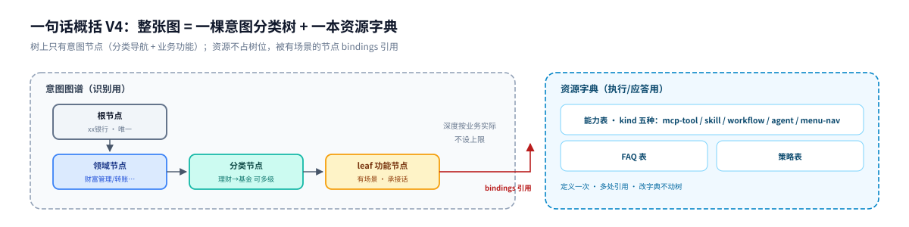

---

## 目录

**第一部分 基础概念**
- [1. 术语定义](#1-术语定义)
- [2. 节点层级详解（root / domain / category / leaf）](#2-节点层级详解)
- [3. 为什么需要意图图谱（作用与价值）](#3-为什么需要意图图谱作用与价值)

**第二部分 架构与方案设计**
- [4. 识别架构：多路召回 + 裁判模型裁决](#4-识别架构多路召回--裁判模型裁决)
- [5. 应用方案设计：应用如何使用和继承意图图谱](#5-应用方案设计应用如何使用和继承意图图谱)
- [6. 图谱结构设计](#6-图谱结构设计)

**第三部分 Schema 定义**
- [7. 图谱文件顶层结构](#7-图谱文件顶层结构)
- [8. Node 定义（四类节点）](#8-node-定义四类节点)
- [9. Edge 定义（三类关系）](#9-edge-定义三类关系)
- [10. 资源注册表](#10-资源注册表)
- [11. 校验规则](#11-校验规则)

**第四部分 图谱开发**
- [12. 开发流程（六个阶段 + 导入工具法）](#12-开发流程六个阶段--导入工具法)
- [13. 从 0 到 1：首个图谱怎么落地](#13-从-0-到-1首个图谱怎么落地)

**附录**
- [附录 A：JSON Schema](#附录-ajson-schema)
- [附录 B：完整示例文件](#附录-b完整示例文件)
- [附录 C：关键设计决策与与已验证实现的对照](#附录-c关键设计决策与与已验证实现的对照)
- [附录 D：V4.0 首次接入运行时的架构缺陷与修订记录](#附录-dv40-首次接入运行时的架构缺陷与修订记录)

---

# 第一部分 基础概念

> **阅读提示**：本规范采用**功能节点 + 意图场景模型**——树的每个节点是一个业务功能（叶子=最小不可再分功能）；意图的真正粒度是"功能 × 场景"（查询/办理/问答…），场景声明在节点上、块内容挂在场景下（见第 8 章）。任意层级的节点都可以有场景——"转账服务"挂 DO 场景即成统一入口。

## 1. 术语定义

### 1.1 树的通用术语（先统一叫法）

意图图谱的主体是一棵树。以下是与普通树结构一致的通用叫法，全文按此使用：

| 术语 | 英文 | 含义 | 图谱中的例子 |
|------|------|------|-------------|
| 根节点 | root | 全树唯一的起点，没有父节点 | `xx银行`（整棵树最顶上那一个） |
| 父节点 | parent | 直接上一级节点 | "基金定投"的父节点是"基金" |
| 子节点 | child | 直接下一级节点 | "理财"的子节点有"基金"、"存款" |
| 兄弟节点 | sibling | 同一个父节点的节点 | "开通定投"和"查定投记录"互为兄弟 |
| **非叶子节点** | internal node | 有子节点的节点，也叫内部节点。包括根节点、领域节点、分类节点——**也可以声明意图场景直接服务用户**（如"转账服务"挂办理场景做统一入口） | "财富管理"、"理财"、"转账服务" |
| **意图场景** | scene | 用户对某个功能的一种意图（查询/问答/办理/修改/撤销…）。**意图的真正粒度 = 功能 × 场景**；块内容挂在场景下，别名/负例在场景间互配 | "基金定投"的 QUERY/DO/ASK 三场景 |
| **叶子节点** | leaf | 没有子节点的节点，位于树梢。**= 最小不可再分的业务功能**（如"基金定投"这个功能）；该功能的查询/办理/问答意图以场景形式声明在节点上 | "基金定投"、"银行卡挂失" |
| 深度 | depth | 从根节点到该节点经过的边数。根节点深度为 0 | "开通基金定投"深度为 4 |
| 子树 | subtree | 某个节点和它的全部后代 | "理财"子树包含基金、存款及其下所有叶子 |
| 分支 | branch | 从某个非叶子节点往下的整条路径 | 财富管理 → 理财 → 基金 |

**本规范的节点角色（node_role）与通用术语的对应关系：**

| node_role 取值 | 中文名 | 属于 | 一句话说明 |
|---------------|--------|------|-----------|
| `root` | 根节点 | 非叶子节点 | 银行 App 总入口，全图只有一个 |
| `domain` | 领域节点 | 非叶子节点 | 一级业务分类，如"转账服务"、"财富管理" |
| `category` | 分类节点 | 非叶子节点 | 领域下面的功能分组，如"理财 → 基金"，**可以有很多层**——按业务实际深浅决定，层数不限制 |
| `leaf` | 叶子节点 | —— | 最小不可再分的业务功能（没有下级节点）；意图粒度 = 功能 × 场景，见 8.2 |

> 树形角色：**非叶子节点 = root + domain + category；叶子节点 = leaf（最小不可再分的业务功能，没有下级）。** node_role 四种角色只表层级类型，不代表固定三级——domain 只有一级，category 可以任意多层嵌套。意图粒度：**业务意图 = 功能节点 × 意图场景**（scenes，如查询/办理/问答）——任意层级的节点声明了 scenes 就直接服务用户，见 8.2。

### 1.2 识别相关术语

| 术语 | 含义 |
|------|------|
| 召回 | 从几百上千个功能节点里，快速找出和用户这句话相关的几个候选 |
| 别名 (aliases) | 用户对同一个业务的多种说法。比如"查余额"这个业务：`查余额`、`卡里还有多少钱`、`看看余额` |
| 召回词 (recallTerms) | 单个关键词，比如 `余额`、`可用余额` |
| 召回词组 (recallTermSets) | 必须同时出现的多个词，比如 `["基金","定投","开通"]` 三个词都有才算命中 |
| 负例 (negativeExamples) | 长得像但**不应该**命中本意图的话。比如"查定投记录"是"开通基金定投"的负例 |
| 词法打分 | 按别名/召回词命中情况算分：别名精确命中 110 分（最高）、别名包含 75 分、召回词组 100 分、单个召回词 90 分、负例命中扣 160 分。60 分以下丢弃 |
| 语义召回 | 用向量相似度补充候选，按排名赋分 108/104/100/96，永远压不过词法精确命中。词法最高分 ≥100 时跳过语义召回 |
| 图谱扩召 | 词法命中后沿图谱边扩召兄弟意图，分数 = 种子分 × 边权重（0.65/0.60/0.55），封顶 80。每种子最多扩 2 个，全图最多 4 个 |
| 裁判模型（LLM 裁决） | 大模型只在候选集合里挑一个最终答案，不允许编造集合外的意图。全文"裁判模型"与"LLM 裁决"是同一概念 |

### 1.3 执行相关术语

| 术语 | 含义 |
|------|------|
| 槽位 (slot) | 完成业务需要用户补充的信息。转账需要：收款人、金额。槽位定义在场景的 `task_binding.slotContract` 里 |
| **能力 (capability)** | 意图对应的**可执行能力**，统一在资源注册表登记、用 `bindings.capabilities` 引用。能力的载体有五种（kind 字段区分）：`mcp-tool`（调 MCP 工具，最常用）、`skill`（技能编排）、`workflow`（工作流）、`agent`（智能体）、`menu-nav`（菜单直达，只导航不执行） |
| 执行模式 (executionMode) | 四种：`read-execute` 查询类直接执行；`confirm-required` 办理类必须用户确认；`knowledge-only` 咨询类只回答不执行；`multi_intent` 一句话多个事。执行模式声明在**场景**上（默认由 scene_type 推导）；任意层级节点都可以有场景；纯分类节点导航词命中产生的 `navigation_only`（频道直达）由 menu-nav 能力承载 |
| FAQ | 咨询类意图的答案内容，定义在资源注册表，场景用 `knowledge_binding.answerRefs` 引用 |
| 策略 (policy) | 风控和合规规则，比如"首次买理财必须先做风险测评" |

### 1.4 治理相关术语

| 术语 | 含义 |
|------|------|
| digest | 文件的 SHA256 摘要。发布时算一次写进文件，引擎启动加载时重算比对，防止文件被改 |
| 校验规则 | 发布前必须通过的检查，全部是程序自动检查，不靠人眼（见第 11 章） |
| 悬空引用 | bindings 里写了一个资源 id，但资源注册表里查不到。属于错误，禁止发布 |
| 改图不改码 | 识别错了，改图谱数据（加别名、加负例）来修正，不改代码 |

---

## 2. 节点层级详解

本章逐层讲清楚四种节点：什么算、放什么内容、怎么判断一句话该建成哪层。

### 2.1 层级总览

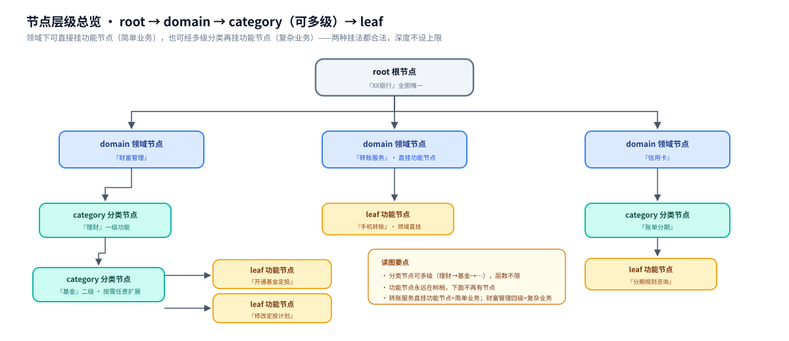

读图说明：
- 领域节点下面**可以直接挂叶子**（转账服务 → 手机转账），也可以挂分类节点后再挂叶子（财富管理 → 理财 → 基金 → 叶子）
- 分类节点**可以多级**（理财 → 基金），层数按实际业务定，规范不限制
- 叶子节点永远在树梢，下面不会再有节点

### 2.2 root 根节点

| 项目 | 说明 |
|------|------|
| 是什么 | 整棵树的起点，代表这家银行的手机银行 |
| 数量 | **全图有且只有一个** |
| 放什么 | 只有 id 和名称，不放任何业务内容 |
| 作用 | 让整棵树有唯一的根，方便遍历和统计；不参与识别 |

### 2.3 domain 领域节点

| 项目 | 说明 |
|------|------|
| 是什么 | 一级业务分类，对应银行怎么划分自己的业务条线 |
| 怎么定 | 参照两个来源取并集：① App 首页的一级频道（财富、转账、信用卡…）② 银行的业务部门划分 |
| 典型例子 | 转账服务、财富管理、信用卡、贷款服务、生活服务、账户管理 |
| 数量参考 | 一家银行通常 8~15 个领域 |
| 放什么 | `scope_in`（哪些表达属于本领域）、`scope_out`（容易混进来的外领域表达）、导航词（如"理财"）|
| 有无场景 | **无 scenes** = 纯分类路标（只配 scope+导航词）；**有 scenes** = 直接服务用户（如"转账服务"挂 DO 场景做统一入口，见 8.2）|

### 2.4 category 分类节点

| 项目 | 说明 |
|------|------|
| 是什么 | 领域下面的功能分组，对应 App 菜单的中间层级 |
| 怎么定 | 跟着 App 菜单走。菜单有几层就建几层：`财富 → 理财 → 基金` 就是领域 → 一级分类 → 二级分类 |
| 可以多级吗 | **可以，层数不限制**。基金再分"债券基金/指数基金"就继续往下建 |
| 典型例子 | 理财、存款、基金、贵金属、账单分期 |
| 放什么 | 和领域节点一样：scope_in / scope_out / 导航词 |
| 不放什么 | 无 scenes 的纯分类节点不放别名、槽位、执行配置（这些都是场景里的内容，见第 8 章）|

### 2.5 leaf 叶子节点

| 项目 | 说明 |
|------|------|
| 是什么 | **最小不可再分的业务功能**。用户的一句话先命中功能（任意层级），再判定场景（查询/办理/问答）——场景声明在节点上，见 8.2 |
| 判断标准 | 问两个问题：① 用户会不会直接这么说？② 它有没有自己独立的说法、参数或执行方式？两个都是"是"，就建叶子节点 |
| 典型例子 | 开通基金定投、查工资卡余额、挂失银行卡、信用卡账单分期怎么收费 |
| 放什么 | 全部识别和执行配置：别名、召回词、负例、槽位、执行模式、资源绑定。字段全表见第 8 章，结构设计见第 6 章 |

### 2.6 怎么判断一句话建成哪一层（判定表）

拿真实例子过一遍判定过程：

| 用户表达 | 判定过程 | 结论 |
|---------|---------|------|
| "我想看看理财" | 是在找功能入口，不是具体业务动作 | 命中"理财"分类节点的导航词，做分类路由加分，不出最终答案 |
| "帮我开个基金定投" | 办理意图，属于"基金定投"功能 | 功能节点"基金定投"的 **DO 场景**（配槽位+确认执行） |
| "定投扣款规则是什么" | 咨询，不执行 | 同一功能节点的 **ASK 场景**（绑 FAQ） |
| "查下工资卡余额" | 查询动作 | "余额查询"功能的 **QUERY 场景**（read-execute） |
| "信用卡怎么还款" | 咨询；而"帮我还款"是执行 | 两个叶子节点：还款咨询（绑FAQ）、信用卡还款（confirm-required），互配负例 |
| "转账" | 期望直接进入流程，子型差异可流程内澄清 | "转账服务"（domain）挂 **DO 场景**做统一入口 + 子型节点挂细化场景，见 8.2 |

**常见错误**：

| 错误 | 后果 | 正确做法 |
|------|------|---------|
| 把"余额查询"和"明细查询"混在一个场景 | 用户说"查明细"拿到余额，答非所问 | 两个功能节点（或同功能两个 QUERY 细分场景），互写负例 |
| 把一个功能拆成一堆兄弟叶子（查X/开X/X规则各建一个） | 功能碎片化，菜单/策略/对象配置重复 | 一个功能节点 + 多个场景（见 8.2） |
| 给分类节点配了别名 | 分类节点抢了叶子的候选位 | 分类节点只配导航词（见第 11 章校验规则第 10 条） |
| 每个菜单建一层节点，菜单改版图谱全乱 | 维护成本高 | 层级跟业务走，不机械照抄菜单 |

### 2.7 深度和规模参考

| 指标 | 参考值 | 说明 |
|------|--------|------|
| 叶子节点深度 | 通常 2~4 | 简单业务 2 级（领域→叶子），复杂业务 4 级（领域→理财→基金→叶子）|
| 深度上限 | **不设上限** | 业务需要多深就建多深。超过 5 级时审计会给一条提示（建议考虑拆成独立领域），仅是提示，不拦截 |
| 叶子 : 分类 | 约 3 : 1 | 来自 V2 实测（96 个菜单组展开 304 个意图）。可用来估算工作量 |
| 一个分类下直挂叶子 | 建议 ≤ 12 | 超过 12 个考虑加一层子分类，否则翻起来费劲 |

## 3. 为什么需要意图图谱（作用与价值）

### 3.1 传统方案的问题

把用户的一句话映射到银行业务，行业里试过三类做法，各有硬伤：

| 传统方案 | 怎么做 | 问题 |
|---------|--------|------|
| **关键词规则** | 给每个业务配一堆关键词，命中哪个算哪个 | ①说法覆盖不完——用户说"卡里还剩多少"，关键词只有"余额"就漏了；②规则之间互相打架——"查信用卡账单"同时命中"信用卡"和"账单"两组规则；③改一处动全身，规则越加越乱，没人敢删旧规则 |
| **纯语义向量** | 把意图标签和描述都向量化，用户话算相似度取最近 | ①近似业务分不开——"查余额"和"查明细"的描述向量距离很近，错分高发；②**黑盒不可审计**——错了一单，说不清为什么错、改哪里能好；③加一个新意图，全库向量要重算，旧意图的边界悄悄变化，回归不可控 |
| **大模型直接分类** | 把几百个意图塞进 prompt 让 LLM 选 | ①上下文塞不下——上千意图时 prompt 爆炸；②**幻觉**——LLM 会编出意图清单里没有的业务；③每次改意图清单要重新调 prompt，效果不稳定；④每句话都要跑一次大模型，慢且贵 |

三个方案共同的根子问题：**业务知识藏在代码规则里、藏在向量里、藏在 prompt 里——没有一份看得见、改得动、可校验的业务语义资产**。

### 3.2 图谱为什么行

意图图谱把"银行有哪些业务、用户会怎么说、每个业务要什么参数、靠什么执行"全部写成**一份显式的数据文件**，问题就解开了：

| 传统方案的问题 | 图谱怎么解 |
|---------------|-----------|
| 关键词覆盖不完、互相打架 | 别名/召回词/负例/混淆对**全部显式声明**在场景的召回块里，且有全图唯一性校验——同一说法只归一个场景，歧义说法直接剔除（校验规则第 5 条） |
| 语义召回分不开近似业务 | 近似意图互写**负例**（−160 分强压制）和**消歧提示**，裁判模型拿到的判别材料是业务专家写的，不是模型自己猜的 |
| LLM 幻觉、prompt 不稳定 | LLM 降级为**裁判**：只在高分候选（通常 3~8 个）里选择，图谱里没有的意图永远选不出来；prompt 由图谱数据自动拼装，不手写维护 |
| 黑盒不可审计 | 每次识别可归因到具体别名命中/负例压制/裁判理由；改一条别名立刻见效，评测回归立刻验证 |
| 知识藏在代码里 | 业务语义全部在数据文件里：**改图不改码**——新增业务、修正错误都只改数据 |

再加一条结构优势：**树形分级 + 资源引用**让上千意图可组织（分类导航）、可扩展（业务域独立增长互不干扰）、可复用（一个能力被多个意图引用）。

### 3.3 一次建设，多处消费

图谱是一份资产，消费方不止识别引擎一个：

| 消费方 | 用图谱的什么 |
|--------|-------------|
| 对话引擎（识别+澄清+执行路由） | 全部：召回素材、槽位契约、执行模式、能力引用 |
| 评测系统 | 意图清单 + 混淆对自动生成测试用例，回归验证每次改动 |
| 运营/客服工作台 | 意图图谱导航浏览：每个业务有哪些说法、挂了什么 FAQ，一目了然 |
| App 搜索/推荐 | 导航词和菜单路径做搜索直达 |
| 数据分析 | 用户 query 命中意图的分布 = 业务需求热度图 |

**一句话总结价值：把"听懂用户的话"这件事，从代码和模型黑盒，变成一份可评审、可校验、可版本化、可继承的业务资产。**

---

# 第二部分 架构与方案设计

## 4. 识别架构：多路召回 + 裁判模型裁决

**系统总架构图**：

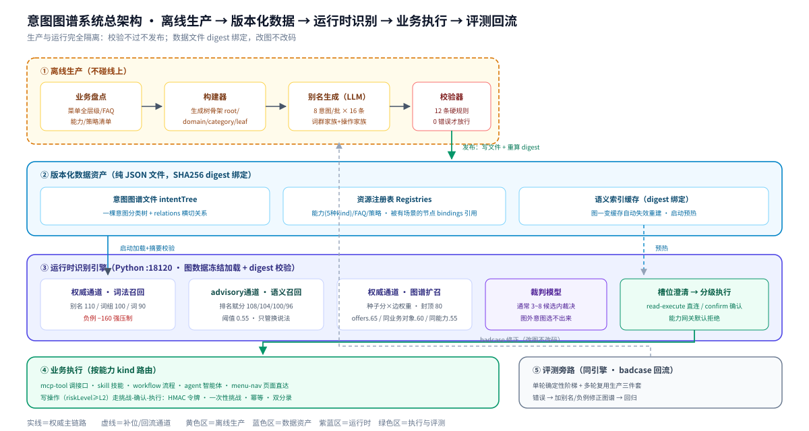

**识别主逻辑图**（两通道召回 + 裁判裁决 + 分数梯度 + 权威捷径）：


本章由粗到细分五层：先一句话，再看主逻辑图，再拆开两通道召回，再看系统全景，最后到一次查询的每一步。**如果只看一节，看 4.2。**

### 4.1 一句话架构

> 用户的一句话进来，**词法召回**（含图谱扩召）找精确命中，**语义召回**兜底换说法，两路候选合并后交给**裁判模型**在候选里裁决出唯一意图，然后按该意图的执行配置走能力或答案。词法得分够高（≥100）时直接跳过语义召回；候选分差够大（≥100 或最高分 ≥180）时跳过裁判模型直接锁定。

### 4.2 主逻辑：多路召回 + 裁判模型裁决

这是整个系统的主逻辑，也是当初的设计出发点：

主逻辑图见本章开头的「识别主逻辑图」。

为什么这么设计：

| 设计点 | 原因 |
|--------|------|
| 两通道互补，不串行 | 词法管不住换种说法，语义分不清近似业务。词法精确命中（110）永远压着语义（108），语义只扩候选不改判 |
| 图谱扩召是词法的延伸 | 命中种子后沿图谱边扩召兄弟意图，分数按种子分×边权重衰减，封顶 80——不作为独立通道跑 |
| 裁判只在候选内选 | 大模型不直接从全库猜（会幻觉），只在召回给出的几个候选里挑——图谱里没有的意图永远选不出来 |
| 分数够高就跳裁判 | 最高分 ≥180 或前两名分差 ≥100 时直接锁定，不调大模型——省延迟，大多数精确命中走这条路 |
| 词法够强就跳语义 | 词法最高分 ≥100 时跳过语义召回——别名写准了就不需要向量兜底 |

### 4.3 两通道召回分别怎么工作

**第一通道：词法召回 + 图谱扩召（权威通道）**

拿用户的话逐字比对每个有 scenes 的节点的召回素材。素材就写在图谱的召回块里，这路好不好用**完全取决于图谱数据质量**：

| 素材 | 命中方式 | 得分 |
|------|---------|------|
| 别名 aliases（精确） | 用户话与别名完全一致（归一化后双向子串相等） | 110 |
| 别名 aliases（包含） | 一方包含另一方 | 75 |
| 召回词组 recallTermSets | 组内词全部出现 | 100 |
| 召回词 recallTerms | 单词出现 | 90 |
| 页面菜单 menuKey | 用户当前页面菜单上下文匹配 | +35 |
| 页面 Tab | 用户当前 Tab 上下文匹配 | +12 |
| 负例 negativeExamples | 出现即扣分 | −160 |

> **丢弃阈值**：总分低于 60 的候选直接丢弃，不进候选集。页面菜单/Tab 加分是叠在别名/词组命中分上的上下文加权。

**图谱扩召**（词法命中后的结构扩散）：

词法命中的候选作为"种子"，沿图谱边做 2-hop 扩散，发现词法没打中但图上强关联的兄弟意图。扩召候选分数 = `int(种子分 × 边权重)`，封顶 80：

| 边类型 | 权重 | 含义 |
|--------|------|------|
| 同菜单兄弟（offers / path 前缀共享） | 0.65 | 最强：同菜单下的兄弟功能 |
| 同业务对象（businessObjects 共享） | 0.60 | 同域对象的功能 |
| 同能力（bindings.capabilities 共享） | 0.55 | 同编排器处理的功能 |

每个种子最多扩召 2 个，全图最多扩召 4 个。扩召候选也必须 ≥60 分才保留。

**第二通道：语义召回（advisory 通道，管换说法）**

用户说"我卡里还剩多少"，图谱里别名恰好只有"卡里还有多少钱"——字面对不上。这路把每个意图的 title + 别名 + 描述各自独立算成向量（多向量模型），用户新话也算成向量，比相似度补进候选。

| 排名 | 得分 | 说明 |
|------|------|------|
| 第 1 名 | 108 | 压在词法精确命中（110）之下 |
| 第 2 名 | 104 | |
| 第 3 名 | 100 | |
| 第 4 名 | 96 | |

> **触发条件**：词法最高分 < 100 时才触发语义召回（弱召回机制）。词法够强就不跑语义，省 embedding 延迟。**相似度阈值** 0.55（余弦），低于此分不进候选。最多 4 个候选。

| 通道 | 性质 | 分数范围 | 最多候选 | 数据来源 |
|------|------|---------|---------|---------|
| 词法 + 扩召 | 确定性，图谱声明驱动 | 60~110（扩召封顶 80） | 8 + 4 | 召回块别名/词组/负例 + 图谱边 |
| 语义 | 概率性，向量相似度驱动 | 96~108 | 4 | title + 别名 + 描述的向量 |

**候选合并与裁决**：

两通道候选合并去重后（最多 12 个，通常 3~8 个），按以下规则裁决：

| 情况 | 裁决方式 |
|------|---------|
| 最高分 ≥ 180（如 FAQ 精确匹配、服务端引导等权威来源） | 直接锁定，跳过裁判模型 |
| 前两名分差 ≥ 100 | 直接锁定第一名，跳过裁判模型 |
| 候选竞争（分差 < 100） | 交裁判模型，结合消歧提示（disambiguationHints）做最终选择 |

裁判模型只能从候选集内选，不能引入图谱里没有的意图。

**识别两步走（功能 × 场景）**：① **功能定位**——召回在"功能节点"维度打分（任意层级的节点，只要声明了 scenes 就参与；"转账"命中"转账服务"domain 的 DO 场景别名即进统一流程）；② **场景判定**——同一功能内按场景别名细分（"查定投"→QUERY、"开定投"→DO，场景间负例互配）。纯分类节点（无 scenes）只做导航兜底：频道级表达命中导航词 → menu-nav 频道直达（delivery `navigation_only`）。

> **口径说明**：参考实现（第 5 章 AI-native-Mobile-Bank）的文档写的是"三路召回"（词法 + 相似问向量 + 描述向量）——运行时实际将相似问向量和描述向量合并为单一语义通道（多向量模型：title + aliases + description 各自独立成向量后按意图取 max），图谱扩召作为词法通道的延伸。本文档按运行时实际架构描述为"两通道"。

### 4.4 系统全景（生产到评测五个环节）

上面讲的是运行时识别。图谱文件本身从哪来、怎么更新？加进生产侧，就是系统全景（**见本章开头的「系统总架构图」**）。三条主线看那张图：

1. **生产线**（① → ②）：业务盘点 → 生成骨架 → LLM 产别名 → 自动校验 → 发布。校验不过不许发布。
2. **消费线**（③ → ④）：引擎启动加载图谱 → 用户提问 → 两通道召回 + 裁决 → 按执行模式走能力或 FAQ。
3. **回流线**（⑤）：评测发现的错误，通过加别名/负例修正图谱数据，不改代码。

### 4.5 一次查询的完整流程（最细粒度）

用户问"卡里还有多少钱"，引擎内部每一步：

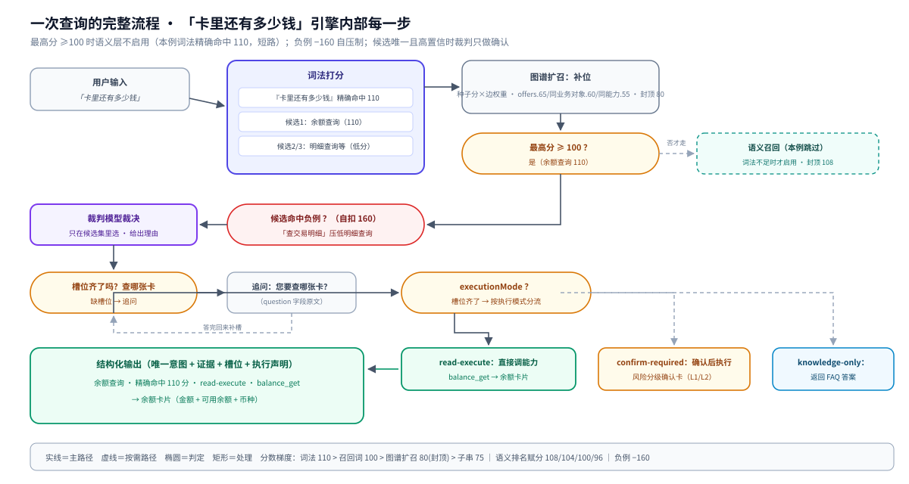

分数设计的意图：**词法精确命中（110）永远排在语义（108）前面**，图谱扩召封顶 80 不翻盘。图谱里别名写得越准，词法越够用，大多数精确命中直接走权威捷径（≥180 或分差 ≥100），不调裁判模型。

## 5. 应用方案设计：应用如何使用和继承意图图谱

第 4 章讲识别。本章讲**应用侧**：以 [AI-native-Mobile-Bank](https://gitcode.com/wangkun_123/AI-native-Mobile-Bank) 参考实现为准——**以意图图谱驱动的智能体作为第一交互范式**：用户一句话表达复合意图，系统完成 **意图识别 → 歧义澄清 → 风险分级确认 → 受控交易执行** 全流程闭环。核心原则不变：**应用不解读图谱文件——图谱只被运行时消费，应用消费结构化输出**。

### 5.1 总览：五容器架构

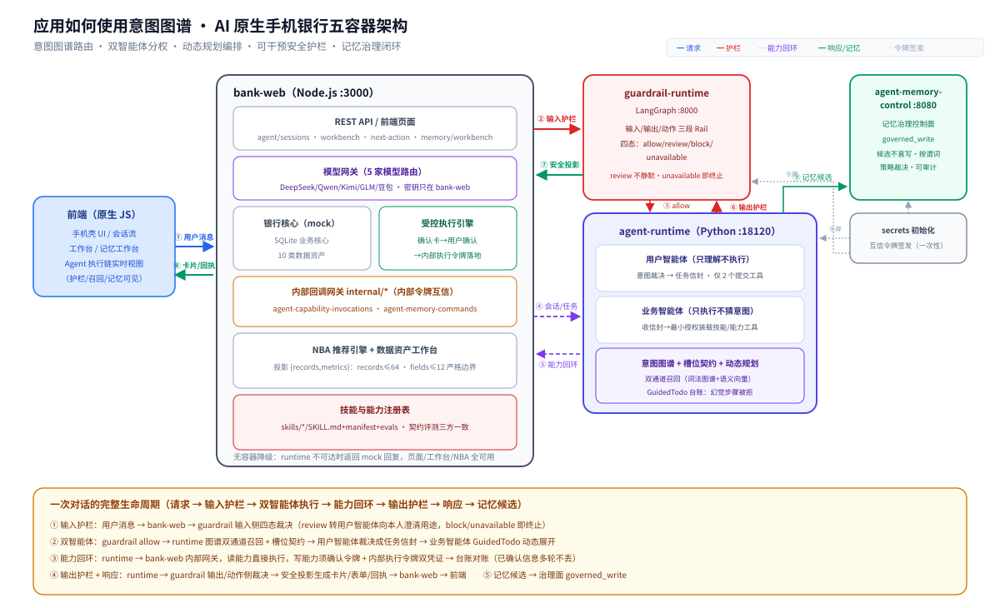

| 容器 | 技术 | 职责 |
|------|------|------|
| **bank-web** | Node.js :3000 | 前端页面 / REST API / 银行核心（mock）/ 模型网关（5 家路由，密钥只在 bank-web）/ NBA 推荐 / 数据资产工作台 / 受控执行 |
| **agent-runtime** | Python :18120 | 双智能体 / 意图图谱 / 槽位契约 / 动态规划 / 确认检查点 |
| **guardrail-runtime** | LangGraph :8000 | 输入/输出/动作三段 Rail，四态裁决 |
| **agent-memory-control** | Python :8080 | 记忆治理控制面（候选/裁决/受控写入） |
| secrets 初始化 | 一次性 | 为运行时/护栏/记忆面签发互信令牌 |

对话端点：`POST /api/ai-bank/v1/agent/sessions/:id/messages`；技能执行需要的业务能力经 `internal/agent-capability-invocations` 回环 bank-web（内部令牌互信）；全程产生 agent-trace（前端右侧执行链实时可见：护栏裁决、意图召回、记忆召回）。

**先看一段真实对话**（仓库代码的真实运行记录——跨域复合意图"查余额+两笔转账"，8 轮全自动）：

| 轮 | 用户说 | 系统行为 |
|------|--------|---------|
| 1 | 查余额，给张三李四转100 | 识别 1 查询 + 2 转账的跨域组合；金额分摊歧义 → 反问「每人 100 / 合计 100」 |
| 2 | 每人100元 | 歧义消解，两笔各绑 100 → 追问查询账户 |
| 3 | 用工资卡尾号6217 | 尾号精确匹配 → 出余额卡片，**转账任务保留不丢** |
| 4 | 本人确认办理 | 生成风险分级确认卡（L1） |
| 5 | 确认 | 第一笔受控执行，返回电子回单；台账推进第二笔 |
| 6 | 用工资卡 | 收款人李四是**首次收款** → 弹收款人安全补录表单，已确认信息全保留 |
| 7 | 提交表单 | 校验通过 → L2 确认卡 |
| 8 | 确认 | 第二笔执行成功，任务全部完成 |

全程没点过任何菜单——澄清、确认、表单、回执全部由智能体按**图谱语义和风险策略**自主驱动，中途任何一步被打断，上下文不丢。

### 5.2 一次对话的生命周期（五步）

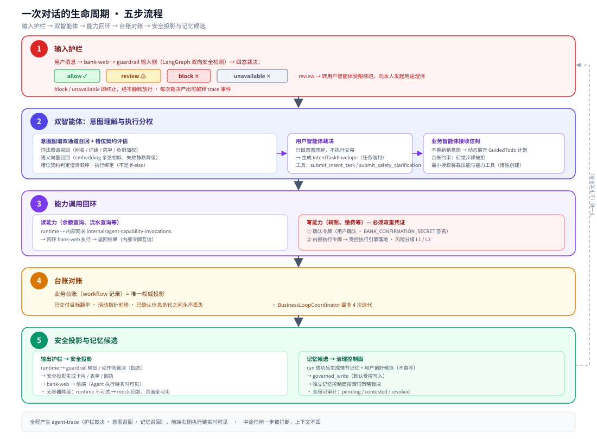

1. **输入护栏**：用户输入进 bank-web，先过三段 Rail 的输入侧（LangGraph 双向安全检测），四态裁决；review 转用户智能体受限续跑，向本人发起用途澄清。
2. **双智能体**：运行时做意图图谱双通道召回 + 槽位契约评估，用户智能体裁决成任务信封；业务智能体按信封动态展开 GuidedTodo 计划（台账约束，幻觉步骤被拒）。
3. **能力调用回环**：读能力（余额查询等）经内部网关回环 bank-web 直接执行；**写能力（转账等）必须持确认令牌 + 内部执行令牌双重凭证才被放行**。
4. **台账对账**：业务台账（workflow 记录）是唯一权威投影——已交付目标翻平、活动指针前移，已确认信息多轮之间永不丢失。
5. **安全投影与记忆候选**：回复经安全投影生成卡片/表单/回执；记忆候选提交治理控制面（governed_write，默认不直接写入）。

### 5.3 意图图谱 = 唯一路由权威

图谱在应用侧的地位（参考实现当前跑 v2.1 schema：526 节点 / 722 边；**本文档定义的 V4 是它的演进目标**——意图收敛为分类树、资源归入注册表）：

- **加一个新业务 = 图谱里登记一个意图节点 + 一个技能包，不改编排代码。**
- 意图节点声明式携带：别名/召回词、易混意图（confusableIntents）、负例（negativeExamples）、必填槽位、槽位契约（澄清顺序 + 执行绑定）、技能绑定（带 sha256 摘要）、任务形态策略、风险级——全部是本规范第三部分定义的字段。
- **双通道召回**：词法图谱召回（别名/词/词组/页面菜单/负例加权）+ 语义向量召回（embedding 余弦相似，失败静默降级）。前端实时显示"召回 N 个候选 · 图谱版本"。
- **图谱语义驱动的澄清**：金额分摊歧义、账户指代歧义、缺槽位，都由槽位契约判定并生成澄清，**不是 if-else**。

技能与能力注册表配套：`skills/*/`（SKILL.md 提示词 + manifest.json 契约 + evals.json 评测样例）；运行时契约评测集 pytest 校验**意图-技能-能力三方契约一致**（`npm run test:runtime`）。

### 5.4 双智能体：理解与执行分权

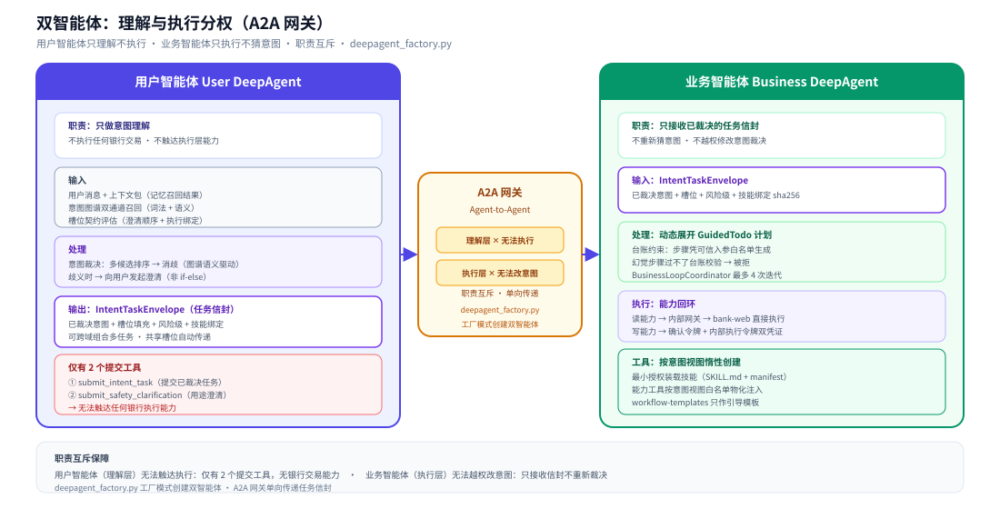

| | 用户智能体 User DeepAgent | 业务智能体 Business DeepAgent |
|------|------|------|
| 职责 | **只做意图理解**，不执行任何银行交易 | **只接收已裁决的任务信封**（IntentTaskEnvelope），不重新猜意图 |
| 工具 | 仅 `submit_intent_task` / `submit_safety_clarification` 两个提交工具 | 按意图视图**惰性创建**，最小授权装载技能与能力工具 |
| 协作 | 经 A2A 网关，职责互斥：理解层无法触达执行，执行层无法越权改意图（`deepagent_factory.py`） | |

### 5.5 动态规划：台账驱动的受控编排

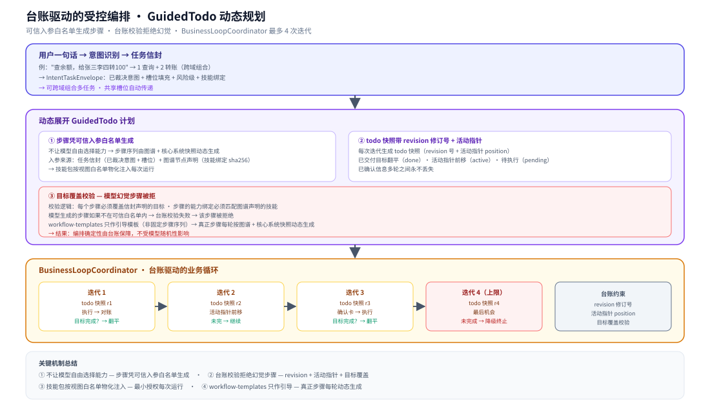

- 一句话解析成任务信封（可跨域组合多任务、**共享槽位自动传递**）后，运行时把已裁决目标**动态展开**为 GuidedTodo 计划——不让模型自由选择能力，步骤凭可信入参白名单生成。
- 业务循环由台账驱动（BusinessLoopCoordinator，最多 4 次迭代）：todo 快照带 revision 修订号与活动指针，配目标覆盖校验——**模型幻觉出的步骤过不了台账校验**。
- 技能包按视图白名单物化注入每次运行；workflow-templates 只作引导模板，真正的步骤序列每轮按图谱与核心系统快照动态生成。

### 5.6 可干预安全护栏（guardrail-runtime）

- **三段 Rail**（输入/输出/动作）由独立护栏服务提供（LangGraph，internal token 鉴权）；金融安全策略 `finance-safety-v2` + 通用词表 `general-lexicon-v1`（6 类可编辑词表文件）。
- **四态判定** `allow / review / block / unavailable`：**review 不静默**——转用户智能体受限续跑，向本人发起用途澄清，用户可回应放行；**unavailable 即终止**——检测器异常时安全停止，绝不静默放行。
- 每次裁决产出可解释 trace 事件（"安全 Rail 判别 · 允许继续 · 策略 xxx"）；词表与策略均为**声明式数据文件**，可编辑、可扩展、可审计。

### 5.7 记忆闭环：召回 → 候选 → 治理 → 审计

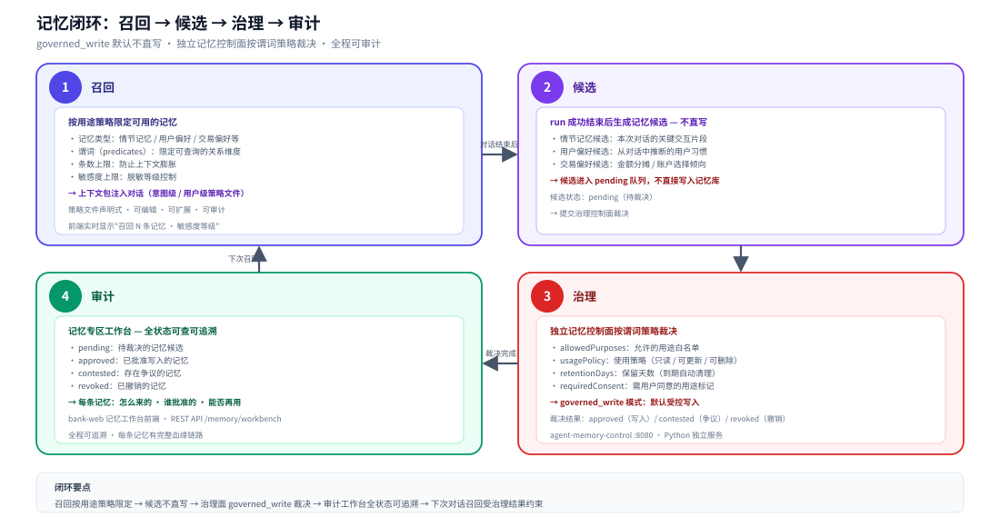

- **召回**：按用途策略限定可用的记忆类型、谓词、条数与敏感度上限（意图级/用户级策略文件），上下文包注入对话。
- **候选**：run 成功结束后生成情节记忆与用户偏好候选，**不直写**。
- **治理**：独立记忆控制面按谓词策略裁决（allowedPurposes / usagePolicy / retentionDays / requiredConsent），**governed_write** 模式默认受控写入。
- **审计**：记忆专区工作台可查 pending / contested / revoked 全状态——每条记忆怎么来的、谁批准的、能否再用，全程可追溯。

### 5.8 受控执行与降级

- **资金操作受控执行**：确认卡 → 用户确认（`BANK_CONFIRMATION_SECRET` 签名）→ execution-engine 以内部执行令牌落地；风险分级（L1/L2）由图谱意图节点的风险级声明驱动。
- **无容器降级**：`AI_BANK_AGENT_RUNTIME_URL` 未配置或容器不可达时，对话接口返回降级 mock 回复；页面、工作台、数据资产、NBA 全部可用——前端/产品可独立演示。
- **数据资产边界**：10 类用户数据资产（持仓/账单/流水/画像/贷款/收款人/商户优惠/卡设置等）前端投影统一 `{records, metrics}` 且严格边界（records ≤ 64、fields ≤ 12）。

### 5.9 应用继承图谱的三条纪律

1. **不解读图谱**：应用（前端+bank-web）只消费运行时的结构化输出。图谱换版本、改结构，应用无感。
2. **不写业务特判**：加业务 = 图谱登记节点 + 技能包；澄清/确认/风险分级全部由图谱语义和策略字段驱动，不写 if-else。
3. **契约评测三方一致**：意图-技能-能力的绑定关系由 pytest 契约评测守护（`npm run test:runtime`），图谱改了技能没跟上会直接测试失败。

## 6. 图谱结构设计

**图谱本体结构图**（树 + 资源字典 + 三类关系）：

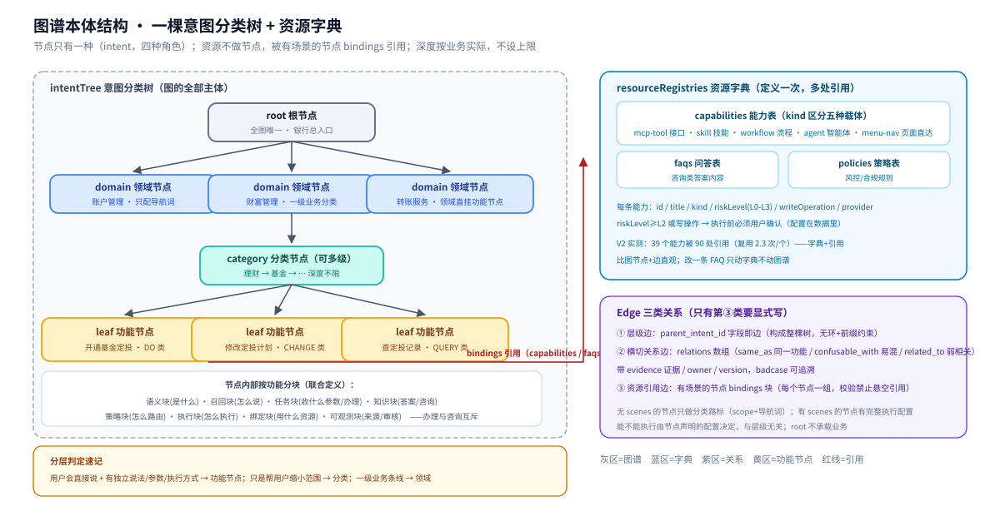

### 6.1 分类树全景（示例）

以一家典型银行为例，展示树的完整形态（规模缩小示意）：

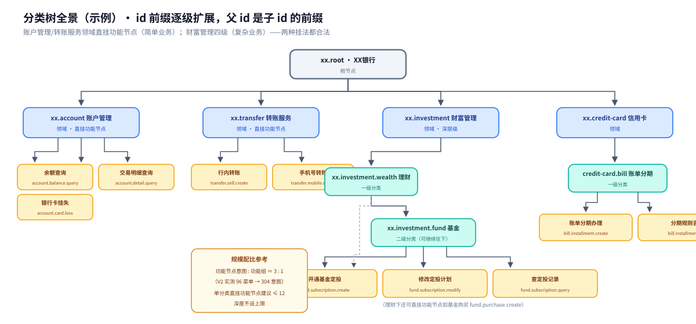

四个领域展示了两种挂法：账户管理和转账服务的业务简单，领域直接挂叶子（2 级）；财富管理的业务深，领域 → 理财 → 基金 → 三个叶子（4 级）。**两种挂法都是合法的，层级深度按业务实际深浅决定，不设上限——category 可以任意多层嵌套。每个功能节点都有它的上级（root 除外），叶子节点没有下级。**

### 6.2 领域详细架构图（财富管理领域展开）

下图展示一个领域内部怎么组织，以及有场景的节点怎么挂资源：

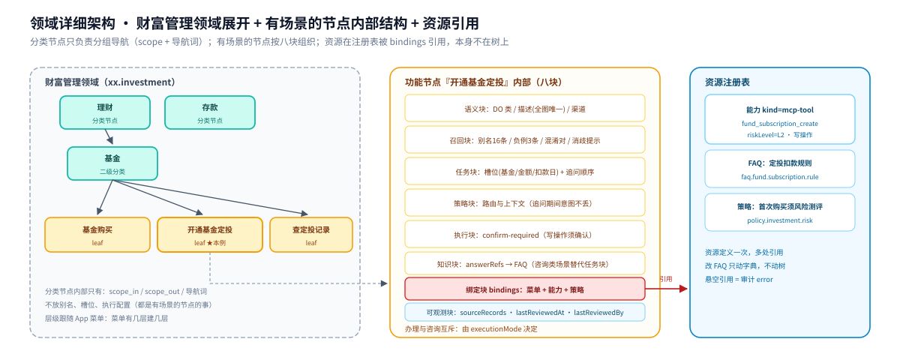

要点：
- 分类节点只负责分组和导航，内部只有 scope 和导航词
- 有场景的节点内部按场景分成几个块（第 8 章详解）
- 有场景的节点通过 `bindings` 字段引用资源注册表里的条目，**资源本身不在树上**

### 6.3 ID 和 path 命名

**id 从根到叶子逐级扩展，父节点的 id 一定是子节点 id 的前缀：**

```
xx.root                              根节点
xx.investment                        领域：财富管理
xx.investment.wealth                 分类：理财
xx.investment.fund                   分类：基金
xx.investment.fund.subscription      叶子前的分组段（可省）
xx.investment.fund.subscription.create    叶子：开通基金定投
xx.investment.fund.subscription.modify    叶子：修改定投计划
```

**path 用中文名，与层级一致，由构建器自动生成：**

```
财富管理/理财/基金/基金定投
```

两条硬规则（程序校验）：子节点 id 必须以父节点 id 开头；path 必须与父节点链拼出来的一致。

### 6.4 渠道差异

同一个业务在不同渠道（App / 电话 / 微信 / 网点）的差异，分两处表达：

| 差异类型 | 放哪里 | 例子 |
|---------|--------|------|
| 这个意图在哪些渠道可用 | 场景 `semantic_definition.channels` | `["app", "wechat"]` |
| 不同渠道调不同接口 | 资源注册表（能力按渠道建多条） | App 走 `balance_get_v2`，电话走 `balance_get_ivr` |

不建渠道层级的节点。

---

# 第三部分 Schema 定义

## 7. 图谱文件顶层结构

一个图谱就是一个 JSON 文件：

```json
{
  "schemaVersion": "4.0",
  "graphId": "ccb-mobile-bank-intents",
  "version": "3.0.0",
  "bank": "CCB",
  "appSurface": "mobile-app",
  "publishedAt": "2026-09-23T00:00:00+08:00",
  "intentTree": [ ],
  "relations": [ ],
  "resourceRegistries": { },
  "digest": "sha256:..."
}
```

| 字段 | 类型 | 必填 | 说明 |
|------|------|:---:|------|
| `schemaVersion` | 固定 `"4.0"` | 是 | 版本标识 |
| `graphId` | string | 是 | 图谱标识 |
| `version` | string | 是 | 语义化版本号 `X.Y.Z` |
| `bank` / `appSurface` | string | 是 | 银行标识 / 应用标识。**多银行 = 多个图谱文件**（一银行一文件），id 前缀 {prefix} 各文件内统一（如 ccb. / demo.），互不干扰 |
| `publishedAt` | 时间 | 是 | 发布时间 |
| `intentTree` | 数组 | 是 | **所有意图节点平铺在这里**，层级靠 `parent_intent_id` 表示（不用嵌套写法，方便程序定位和做 diff） |
| `relations` | 数组 | 否 | 横切关系（9.2） |
| `resourceRegistries` | 对象 | 是 | 资源字典：capabilities / faqs / policies / skillBindings（第 10 章） |
| `digest` | string | 是 | SHA256 摘要 |

## 8. Node 定义：功能节点 + 意图场景

**核心模型（本规范最重要的一节）：树的每个节点是一个业务功能；意图场景（scenes）是每个节点可声明的复数属性——查询、问答、办理、修改、撤销等；块内容挂在场景下。**

```
功能节点（任意层级；叶子 = 最小不可再分的功能）
├── 身份字段：id / title / node_role / parent_intent_id / path
├── 边界声明：scope_in / scope_out / navigationTerms
├── 功能级绑定：menu（菜单路径）/ businessObjects / 功能级 policies
└── scenes[]（意图场景——有场景的节点直接服务用户）
    ├── 场景 QUERY 查询：场景别名+负例 → read-execute → 查询能力
    ├── 场景 DO 办理：场景别名+负例 → 槽位契约 → confirm-required → 办理能力+策略
    └── 场景 ASK 问答：场景别名 → knowledge-only → FAQ 答案
```

三个关键推论：

1. **意图的真正粒度是"功能 × 场景"，不是节点**。"基金定投"是**一个**功能节点（叶子），"查定投/开定投/定投规则"是它的三个场景——不再把一个功能碎片化成四五个兄弟叶子。
2. **任意层级的节点都可以有场景**。"转账服务"（domain）直接声明 DO 场景即成统一转账入口——**不需要"聚合节点"这种特殊概念**（此前的补丁被场景制自然取代）。
3. **同功能内的场景消歧天然精准**：别名挂在场景级——"查定投"归 QUERY 场景、"开定投"归 DO 场景，互为对方的负例；跨功能的消歧仍走混淆对/消歧提示。

本章展开：8.1 公共字段 → 8.2 场景定义 → 8.3 结构图 → 8.4~8.10 场景内的七个块 + 8.10b 功能级可观测块 → 8.11 完整示例。三类关系见第 9 章。

### 8.1 节点公共字段（所有层级）

| 字段 | 类型 | 必填 | 约束 | 说明 |
|------|------|:---:|------|------|
| `id` | string | 是 | `^[a-z0-9.-]+$`，全局唯一；子节点 id 必须以父节点 id 为前缀 | 命名规则见 6.3 |
| `title` | string | 是 | 非空，中文 | 功能名 |
| `node_role` | enum | 是 | `root` / `domain` / `category` / `leaf`——**只表层级**：domain=一级业务条线，category=功能分组（可多级），leaf=最小不可再分功能 | 层级角色 |
| `parent_intent_id` | string\|null | 是 | 指向存在的节点；根节点为 null；全图无环 | 父节点引用 |
| `path` | string | 是 | 构建器按父链生成 | 中文路径，如 `财富管理/理财/基金/基金定投` |
| `scope_in` | string[] | 是（root 除外） | ≥1 条 | 属于本功能的表达——审计新功能该挂哪 |
| `scope_out` | string[] | 否 | — | 容易混进来但不属于的表达 |
| `navigationTerms` | string[] | 否 | 每条 ≥2 字 | 导航词：命中只给本子树加分，不做终判 |
| `bindings`（功能级） | object | 建议 | menu 建议都填 | **功能级共享绑定**：`menu`（菜单路径）/ `businessObjects` / 功能级 `policies`——同功能所有场景共用 |
| `observability` | object | 否 | — | **功能级可观测块**（8.10b）：来源追溯、最后审核记录——同功能所有场景共用 |
| `scenes` | array | 否 | 见 8.2 | **意图场景数组。声明了 scenes 的节点直接服务用户（业务功能节点）；没声明的只做分类路标**。root 不允许 scenes |
| `lifecycle` | enum | 否 | `active` / `inactive` / `deprecated`；默认 `active` | **节点生命周期状态**。适配器读取此字段过滤非活跃意图（`active` 以外的节点不参与召回）。V4.1 新增——V4.0 缺失导致退役节点仍被召回 |

> node_role 只回答"挂在树哪一层"；**是不是业务意图由"有无 scenes"决定**——两个维度正交。"转账服务"（domain）有 scenes 就是统一入口；"理财"（category）没 scenes 就是纯分类。

### 8.2 意图场景（scenes）：意图的真正粒度

每个场景是"用户对某个功能的一种意图"，类型复用语义枚举：

| scene_type | 场景 | 默认执行模式（可覆盖） | 典型内容 |
|-----------|------|-------------|---------|
| `QUERY` | 查询 | read-execute | 查询能力、少量可选槽位（账户选择） |
| `ASK` | 问答/咨询 | knowledge-only | FAQ 答案 |
| `DO` | 办理/开通 | confirm-required | 办理槽位契约、办理能力、风控策略 |
| `CHANGE` | 修改/设置 | confirm-required | 修改槽位、变更能力 |
| `CANCEL` | 撤销/关闭 | confirm-required | 撤销能力 |
| `TRANSFER` / `REPAY` / `HELP` | 转账/还款/帮助 | 按业务 | 专用场景 |

**场景的字段（块挂在场景下）：**

| 字段 | 必填 | 说明 |
|------|:---:|------|
| `scene_type` | 是 | 上表枚举之一；同节点内不得重复。**运行时映射规则**：`scene_type` 直接作为 V2 引擎的 `action` 字段值（`IntentConstraint.action` 要求大写枚举 `ASK`/`QUERY`/`DO`/`CHANGE`/`CANCEL`/`HELP`），不要用 `task_binding.actionCode`（小写）替代 |
| `retrieval_profile` | 是 | **场景级召回块**（8.5）：本场景的别名/召回词/负例——"查定投"归 QUERY、"开定投"归 DO，同功能场景间互配负例 |
| `semantic_definition` | 是 | **场景级语义块**（8.4）：场景描述（全图唯一性在**场景维度**校验）、userGoal |
| `task_binding` | 条件 | 办理/查询类场景必填（8.6）：槽位契约、actionCode、skillBinding |
| `knowledge_binding` | 条件 | ASK 场景必填（8.7）：answerRefs/answerType——FAQ 唯一引用源 |
| `decision_policy` | 否 | 场景级路由策略（8.8） |
| `execution_binding` | 是 | 场景级执行块（8.9）：executionMode 默认由 scene_type 推导 |
| `bindings` | 条件 | **场景级绑定**：capabilities（办理/查询场景必填）+ 场景级 policies；menu/businessObjects 在功能级共享，不重复写 |

> **V4.1 修订**：`scene_type`（大写）与 `task_binding.actionCode`（小写）是两个不同维度的字段——`scene_type` 是意图语义类型，映射到 V2 `action`；`actionCode` 是任务执行编码，用于 `task_binding` 内部的动作细分。两者不可混用。V4.0 未明确此映射关系，导致适配器实现时误用 `actionCode` 值导致 `IntentConstraint` 校验失败。

**互斥规则（场景内，校验第 7/8 条）**：每个场景要么 task_binding（QUERY/DO/CHANGE/CANCEL/TRANSFER/REPAY），要么 knowledge_binding（ASK/HELP）——由该场景的 executionMode 决定；与节点层级无关。

**怎么决定功能切分与场景设置：**

| 判断 | 建法 |
|------|------|
| 用户对某功能的意图可分成查询/办理/问答几类 | 一个功能节点 + 多个 scenes（**首选**——功能内聚，场景消歧天然精准） |
| 两个"功能"其实只是同一功能的两种说法 | 合并为一个节点两个场景，别建两个叶子 |
| 子型间槽位/流程差异巨大（行内 vs 跨行转账） | 父功能节点挂统一 DO 场景（统一入口），子型作为子节点各挂自己的细化场景（用户明确说子型时直接命中） |
| 只是频道/页面入口 | 无 scenes 的纯分类节点 + 功能级 menu 绑定（或 menu-nav 能力） |

### 8.3 功能节点 × 场景 结构图

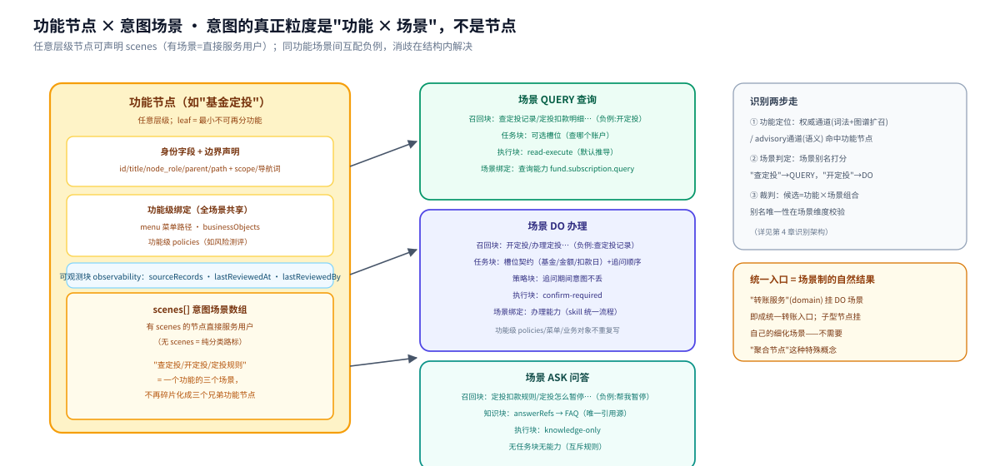

**功能级与场景级的分工：**

| 层 | 放什么 | 为什么 |
|------|--------|--------|
| 功能级（节点上） | 身份/边界/导航词 + menu/businessObjects/功能级 policies + scenes 数组 | 同功能所有场景共享：菜单路径、业务对象、通用风控 |
| 场景级（scenes 元素） | 召回块（场景别名/负例）+ 语义块 + 任务块或知识块 + 策略块 + 执行块 + 场景级 capabilities | 每个意图场景自己的识别素材与执行路径 |

**聚合节点（无 scenes 的分类节点）的结构**——能不能执行由声明决定，与层级无关；纯分类节点复用八块结构但只填身份/边界/导航词：

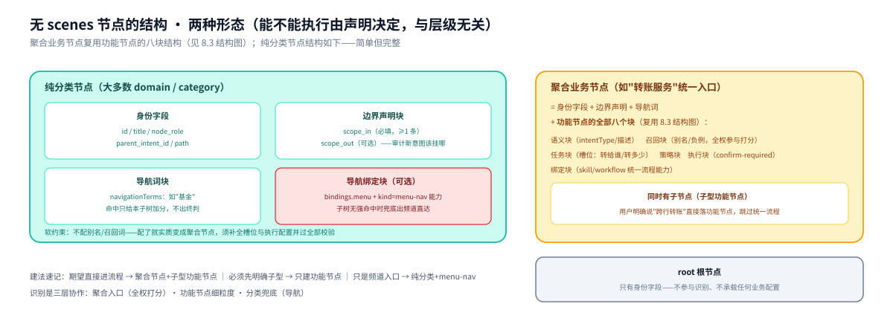

### 8.4 semantic_definition 语义块（场景级）

| 字段 | 类型 | 必填 | 约束 | 说明 | 示例 |
|------|------|:---:|------|------|------|
| `intentType` | enum | 是 | ASK / QUERY / DO / CHANGE / CANCEL / HELP / TRANSFER / REPAY——**与 scene_type 一致**（冗余字段，构建器从场景带入，便于单场景独立消费） | 场景类型 | `DO` |
| `userGoal` | string | 建议 | 一句话 | 用户想达成什么（给评审和裁判模型看） | `开通基金定投，按期自动扣款` |
| `description` | string | 是 | ≥8 字；**全场景不重复**（校验第 4 条，唯一性在场景维度） | 本场景的业务描述。进语义向量索引，重复会拉低召回精度 | `在手机银行开通基金定投计划，设置扣款卡、扣款日和金额后按期自动申购。` |
| `channels` | enum[] | 否 | app / phone / wechat / branch / overseas；省略=全渠道 | 本意图在哪些渠道可用 | `["app","wechat"]` |
| `confusableIntents` | string[] | 建议 | 引用本图场景（`节点id#场景` 记法） | 易混场景清单，给裁判模型"命中 A 时也要对照 B"的材料。v2.0 放节点顶层、v2.1 放语义块（`confusable_intents`，线上验证位置）——V4 沿 v2.1 放语义块 | `["node.transfer.cross#DO"]` |
| `disambiguationHints` | string[] | 建议 | 每条一句话 | 消歧规则文字，给裁判模型。v2.0 是顶层字符串、v2.1 是语义块 `disambiguation_hints` 数组——V4 沿 v2.1 | `["说开通且对象是定投计划归本场景；说修改的归修改场景"]` |

### 8.5 retrieval_profile 召回块（场景级）

| 字段 | 类型 | 必填 | 约束 | 说明 | 示例 |
|------|------|:---:|------|------|------|
| `aliases` | string[] | 是 | ≥3 条（建议 8~16 条）；每条 2~24 字；无连续 3 位以上数字；**全图不重复——唯一性在场景维度**（校验第 5/6 条） | **本场景**的用户说法（对应 v2.0 的 `aliases`；v2.1 的 `utterance_view`，含义相同）。同功能其他场景的说法自动成为候补负例素材；覆盖不同词群和操作态 | `["开定投","开通定投","基金定投怎么开","办理基金定投"]` |
| `recallTerms` | string[] | 建议 | 每条 2~40 字 | 单个关键词，子串命中 90 分 | `["定投","定期定额"]` |
| `recallTermSets` | string[][] | 否 | 每组 2~4 个词 | 词组，全部出现 100 分 | `[["基金","定投","开通"]]` |
| `negativeExamples` | string[] | 建议 | ≥2 条；不得与自己的别名/召回词重叠 | 负例，命中扣 160 分，挡最容易混进来的话。同功能其他场景的说法是天然负例素材（场景间互配） | `["查定投记录","修改定投金额"]` |
| `semanticView` | string[] | 否 | 每条 2~12 字 | 语义扩展词（v2.1 `semantic_view`）：按语义族扩展，兜住换说法——别名只收录标准说法，语义视图补口语变体 | `["定期投资","自动申购","攒基"]` |
| `objectView` | string[] | 否 | — | 对象词（v2.1 `object_view`）：本场景涉及的业务对象词，对象歧义时参与加权 | `["定投计划","基金","扣款卡"]` |
| `actionView` | string[] | 否 | — | 动作词（v2.1 `action_view`）：动作歧义时参与加权 | `["开通","设置","办理"]` |
| `viewWeights` | object | 否 | 各视图权重 ∈ (0,1) 且和为 1 | 多视图加权（v2.1 `weights`）。参考值 utterance 0.28 / semantic 0.20 / object 0.18 / action 0.16（线上调优值），余额给词法词组；省略时用全局默认权重 | `{"utterance":0.28,"semantic":0.20,"object":0.18,"action":0.16}` |
| `semanticPriority` | integer | 否 | ≥0；默认 0 | **语义优先级**（V4.1 新增）。适配器读取此字段写入 `IntentCandidate.semantic_priority`，用于多候选排序时同分情况下的优先级打破。V4.0 缺失导致同分候选无优先级区分 | `5` |

### 8.6 task_binding 任务块（办理/查询类场景填）

| 字段 | 类型 | 必填 | 约束 | 说明 | 示例 |
|------|------|:---:|------|------|------|
| `slotContract.slots` | object[] | 是 | 最多 16 个 | 槽位清单，每个槽位见下表 | 见下表 |
| `slotContract.clarificationOrder` | string[] | 是 | 与 slots 的 key 一一对应 | 追问顺序，缺槽时按此顺序逐个问 | `["fundCode","amount","deductDate"]` |
| `slotContract.extractionKeys` | string[] | 否 | — | 允许从用户原话直接抽取的槽位 | `["amount"]` |
| `slotContract.capabilityBindings` | string[] | 否 | 引用能力表 id | **槽位级能力绑定**（V4.1 新增）。适配器从此字段读取 `capability_bindings`，而非 `scene.bindings.capabilities`。V2 引擎的 `IntentCandidate.capability_bindings` 溯源到此 | `["ccb.fund.subscription.flow"]` |
| `slotContract.executionBinding` | object | 否 | 见下方说明 | **槽位执行绑定**（V4.1 新增）。V2 `_project_slot_contract()` 要求 `slotContract` 含 `executionBinding` 子键，含 `{capabilityId, requiresConfirmation}`。适配器 `_safe_slot_contract()` 检查此键是否存在，缺失则返回 None（不抛异常） | `{"capabilityId":"ccb.fund.subscription.flow","requiresConfirmation":true}` |
| `slotContract.version` | string | 否 | — | 槽位契约版本（V2 `_project_slot_contract` 读取此字段）。V4.1 新增 | `"1.0.0"` |
| `actionCode` | enum | 是 | ask / query / apply / open / close / change / cancel / transfer / repay / guide | 动作编码（默认值由 intentType 推导，见下方三者关系表）。v2.1 `task_binding.action.action_code` 同义。**注意**：`actionCode` 是小写值，仅用于 task_binding 内部的动作编码，**不可**映射到 V2 引擎的 `action` 字段（`IntentConstraint.action` 要求大写枚举）。运行时 `action` 字段由 `scene_type`（大写）映射 | `apply` |
| `skillBinding` | object | 办理/查询场景建议 | 技能绑定：`{skillId, version, digest}`。指向 skillBindings 注册表（§10.4）中的技能定义。**运行时依赖**：`business_profile.py` 的 `skill_id_for_task()` 通过 `candidate.skill_binding.skill_id` 路由到对应的域适配器（如 `bank.transfer-remittance` → transfer_adapter）。skillBinding 为 None 时域适配器路由失败，抛出 `ValueError("no graph-bound ambiguity projector is registered")` | `{"skillId":"bank.transfer-remittance","version":"1.0.1","digest":"sha256:..."}` |
| `stateConstraints` | object[] | 否 | — | 状态前置条件：执行前需满足的业务状态（如"定投计划状态=活跃"）。v2.1 `task_binding.state_constraints` 同义 | `[{"field":"planStatus","op":"eq","value":"active"}]` |
| `riskConstraints` | object[] | 否 | — | 风险约束数组：执行前需通过的风控检查（如"单笔限额≤5万"）。v2.1 `task_binding.risk_constraints` 同义；v2.0 顶层 `riskLevel` 是简化版 | `[{"ruleId":"pol.transfer.limit","params":{"max":50000}}]` |
| `executionPrecondition` | string | 否 | 一句话 | 执行前置条件文字描述，给裁判模型判断"能不能做"用。v2.1 `task_binding.execution_precondition` 同义 | `账户状态正常且未被冻结` |

> **V4.1 修订 — requiredSlots 格式与转换规则**：V2 引擎的 `IntentCandidate.required_slots` 是**字符串列表**（slot name），不是完整 slot 对象。V4 的 `slotContract.slots` 是完整对象数组，适配器转换时必须提取 `name` 字段且仅取 `required=true` 的槽位：
>
> ```python
> required_slots = [
>     s.get("name", s.get("slotId", ""))
>     for s in slotContract.slots
>     if s.get("required", False)
> ]
> ```
>
> V4.0 未定义此转换规则，导致适配器直接传完整 slot 字典列表，运行时槽位匹配失败。

> **V4.1 修订 — skillBinding 架构缺陷**：V4.0 的设计决策"技能已并入能力表（kind=skill），不再单列"（§9.3 原文）移除了 V2 的 HANDLED_BY 边和 skill 节点。但运行时 `business_profile.py` 仍依赖 `skill_binding.skill_id` 做域适配器路由——这是 V4.0 最严重的架构缺陷。V4.1 将 `skillBinding` 恢复为 task_binding 的一等公民字段，并新增 skillBindings 注册表（§10.4）。

**单个槽位（slots 数组元素）的字段：**

| 字段 | 类型 | 必填 | 说明 | 示例 |
|------|------|:---:|------|------|
| `slotId` | string | 是 | 全图唯一（如 `slot.account.reference`） | 槽位规范 id（沿用 v2.0） |
| `name` | string | 是 | camelCase | 槽位名（v2.0 用 name；v2.1 等价字段 key） |
| `label` | string | 建议 | 中文 | 展示名（追问表单标题用） |
| `type` | enum | 是 | string / money / date / account_reference / payee_reference / card_reference / boolean | 值类型 |
| `required` | boolean | 是 | — | 是否必填 |
| `extractionKeys` | string[] | 建议 | — | 从用户话里抽取的本槽位关键词族（如 accountName/accountReference/maskedAccountNo） |
| `question` | string | required 时必填 | ≤40 字 | 缺槽追问话术 |
| `resolverCapabilityId` | string | 建议 | 引用能力表 | 解析槽位值的能力（如"我的工资卡"→具体账户 id） |
| `resolvedField` | string | 否 | — | resolver 返回的取值字段（如 accountId） |

### 8.7 knowledge_binding 知识块（ASK/HELP 场景填）

FAQ 的**唯一引用源**（校验第 7/11 条）：节点其他任何位置不得再出现 FAQ 引用。

| 字段 | 类型 | 必填 | 约束 | 说明 | 示例 |
|------|------|:---:|------|------|------|
| `answerRefs` | string[] | 是（ASK/HELP） | 非空；引用 faqs 表 | 答案来源 FAQ 清单（对应 v2.1 的 `knowledge_binding.knowledge_refs`） | `["faq.fund.subscription.howto"]` |
| `answerType` | enum | 是 | faq / rag | faq=直接引用注册表答案；rag=按 ragScope 检索生成 | `faq` |
| `answerPolicy` | enum | 否 | `direct_answer_or_recommend_entry`（默认）/ `single_best` | 多条命中时怎么答。`direct_answer_or_recommend_entry`（直接答一条 + 推荐相关入口）是 v2.1 `answer_policy` 线上验证值，建议默认 | `direct_answer_or_recommend_entry` |
| `ragScope` | object | 否 | answerType=rag 时必填 | RAG 检索范围限定（知识库 id / 文档标签），防止跨域串答。v2.1 `rag_scope` 同义 | `{"libraries":["wealth-faq"]}` |

### 8.8 decision_policy 策略块（场景级）

| 字段 | 类型 | 必填 | 约束 | 说明 | 示例 |
|------|------|:---:|------|------|------|
| `defaultDecision` | enum | 否 | answer / execute_or_route / clarify / reject | 默认裁决动作。v2.1 `decision_policy.default_decision` 同义 | `execute_or_route` |
| `lowConfidence` | enum | 否 | clarify / recommend / reject；默认 clarify | 候选合并后仍低置信的处理。v2.1 `decision_policy.low_confidence_strategy` 同义 | `clarify` |
| `askDoBoundaryStrategy` | string | 否 | 一句话 | ASK/DO 边界策略：用户问"怎么转账"是答还是执行（如 `preserve_ask_do_candidates_and_confirm_before_execution`）。v2.1 `decision_policy.ask_do_boundary_strategy` 同义 | `preserve_ask_do_candidates_and_confirm_before_execution` |
| `clarifyQuestions` | string[] | 否 | ≤3 条 | 低置信追问话术。v2.1 `decision_policy.clarify_questions` 同义 | `["您是想查定投持仓，还是办理定投？"]` |
| `rejectPolicy` | enum | 否 | soft / hard | 图谱兜不住时的话术口径。v2.1 `reject_policy` 同义 | `soft` |
| `supportedShapes` | enum[] | 否 | `single_intent` / `multi_intent` / `parallel`；默认 `["single_intent"]` | **支持的任务形状**（V4.1 新增）。适配器读取此字段构建 V2 `TaskPolicy.supported_shapes`。V4.0 缺失导致 `_project_task_policy` 读到空列表 | `["single_intent"]` |
| `orchestrationHint` | enum | 否 | `single` / `parallel-safe` / `sequential`；默认 `parallel-safe` | **编排提示**（V4.1 新增）。适配器读取此字段同时构建 `TaskPolicy.mode` 和 `orchestrationMode`。**兼容转换**：V2 `_project_orchestration_mode` 只接受 `deterministic`/`agent`，适配器 `_safe_orchestration_mode()` 将 V4 的 `parallel-safe`/`sequential`/`single` 映射为 `deterministic` | `parallel-safe` |
| `contextPolicy.retainOnClarification` | boolean | 否 | 默认 true | 追问期间已抽到的槽位要不要保留。v2.0 `contextPolicy.retainOnClarification` 同义 | `true` |
| `contextPolicy.allowIntentSwitch` | boolean | 否 | 默认 false | 追问期间是否允许切换到其他意图。v2.0 `contextPolicy.allowIntentSwitch` 同义 | `false` |
| `contextPolicy.resumable` | boolean | 否 | 默认 true | **是否可恢复**（V4.1 新增）。V2 `_project_context_policy()` 读取此键构建 `ContextPolicy.resumable`。V4.0 缺失此字段，但 V2 引擎用默认值 true 兜底——V4.1 显式定义以便覆盖 | `true` |

### 8.9 execution_binding 执行块（场景级）

| 字段 | 类型 | 必填 | 约束 | 说明 | 示例 |
|------|------|:---:|------|------|------|
| `executionMode` | enum | 是 | read-execute / confirm-required / knowledge-only / multi_intent | 执行模式，默认由 scene_type 推导（8.2 表），可显式覆盖。v2.0 顶层 `executionMode` 同名同义。v2.1 另有 `route_type`（navigation/api/workflow/dialogue）从"落地载体"角度描述——mode 管**要不要确认**，route 管**走哪种载体**，两者可并存 | `confirm-required` |
| `routeType` | enum | 否 | navigation / api / workflow / dialogue | 落地载体类型。v2.1 `execution_binding.route_type` 同义；`readiness=planned` 时自动降级为 navigation | `workflow` |
| `navigationPath` | string | 否 | — | 标准 App 导航路径。v2.1 `execution_binding.standard_navigation_path` 同义 | `首页>投资>基金>基金定投` |
| `altNavigationPaths` | string[] | 否 | — | 备用导航路径（不同入口）。v2.1 `execution_binding.source_navigation_paths` 同义 | `["首页>全部>基金>定投"]` |
| `apiOrWorkflowId` | string | 否 | — | 对接的 API 或工作流 id（对应 bindings.capabilities 里的能力）。v2.1 `execution_binding.api_or_workflow_id` 同义 | `ccb.fund.subscription.flow` |
| `readiness` | enum | 是 | ready / planned | 能力是否已接好。planned 场景只出导航兜底（menu-nav），不出执行入口（对应 v2.1 的 `route_readiness`） | `ready` |
| `requiresConfirmation` | boolean | 否 | 默认 = (executionMode == confirm-required) | 执行前是否要用户确认；riskLevel ≥ L2 的能力强制 true | `true` |
| `riskLevel` | enum | 否 | `L0` / `L1` / `L2` / `L3`；默认 `L1` | **场景风险等级**（V4.1 新增）。适配器从 execution_binding 读取此字段写入 `IntentCandidate.risk_level`。V4.0 只在能力注册表（§10.1）定义了 riskLevel，场景级缺失导致适配器只能硬编码默认值 `L1` | `L2` |
| `orchestrationMode` | enum | 否 | single / parallel / sequential；默认 single | 多能力编排方式 | `single` |

### 8.10 bindings 场景级绑定块

| 字段 | 类型 | 必填 | 约束 | 说明 | 示例 |
|------|------|:---:|------|------|------|
| `capabilities` | string[] | 办理/查询场景必填 | 引用能力表 id；建议 ≤6 个 | 本场景落地用的能力。menu/businessObjects 不在这里——在功能级共享（8.1），场景不重复写 | `["ccb.fund.subscription.flow"]` |
| `policies` | string[] | 否 | 引用 policies 表 | 场景级风控策略（如投资风险测评拦截），叠加在功能级 policies 之上 | `["pol.investment.risk-survey"]` |

### 8.10b observability 可观测块（功能级）

**不是场景级**——挂在功能节点上，因为同一个节点的来源追溯对各场景通用。v2.1 有独立的 `observability` section；v2.0 无此字段（靠顶层 `source` 对象简化记录）。

| 字段 | 类型 | 必填 | 说明 | 示例 |
|------|------|:---:|------|------|
| `sourceRecords` | object[] | 否 | 来源记录清单：每条记录追溯该节点定义的来源（菜单截图、需求文档、业务确认人） | 见下 |
| `lastReviewedAt` | string | 否 | 最后人工审核日期（ISO 8601） | `"2026-09-17"` |
| `lastReviewedBy` | string | 否 | 最后审核人 | `"张三"` |

**sourceRecords 数组元素：**

| 字段 | 类型 | 说明 | 示例 |
|------|------|------|------|
| `type` | enum | menu_screenshot / requirement_doc / user_log / expert_interview | `menu_screenshot` |
| `ref` | string | 来源标识（文件路径/文档链接/日志 query） | `screenshots/app-v3.2/fund-subscription.png` |
| `note` | string | 备注 | `App 3.2 版菜单结构` |

### 8.11 示例：一个功能节点的三个意图场景（基金定投）

```json
{
  "id": "ccb.wealth.fund.subscription",
  "title": "基金定投",
  "node_role": "leaf",
  "parent_intent_id": "ccb.wealth.fund",
  "path": "投资理财/基金/基金定投",
  "scope_in": ["定投", "定期定额", "基金定投"],
  "scope_out": ["基金申购", "基金赎回"],
  "bindings": {
    "menu": { "path": "首页>投资>基金>基金定投" },
    "businessObjects": ["fund", "subscription_plan"]
  },
  "observability": {
    "sourceRecords": [
      { "type": "menu_screenshot", "ref": "screenshots/app-v3.2/fund-subscription.png", "note": "App 3.2 版菜单结构" },
      { "type": "requirement_doc", "ref": "需求文档-基金定投-v2.docx", "note": "业务方确认的槽位和风控规则" }
    ],
    "lastReviewedAt": "2026-09-17",
    "lastReviewedBy": "wealth-team"
  },
  "scenes": [
    {
      "scene_type": "QUERY",
      "semantic_definition": {
        "userGoal": "查看定投计划执行情况",
        "description": "查询本人名下基金定投计划的持仓金额、扣款记录和执行状态。",
        "confusableIntents": ["ccb.wealth.fund.trade#QUERY"],
        "disambiguationHints": ["说查定投归本场景；查单笔基金交易记录归基金交易查询功能"]
      },
      "retrieval_profile": {
        "aliases": ["查定投", "我的定投", "定投记录", "定投扣了多少", "看下定投计划"],
        "recallTerms": ["定投", "定期定额"],
        "recallTermSets": [["查", "定投"], ["定投", "记录"]],
        "semanticView": ["持仓", "扣款", "执行情况"],
        "objectView": ["定投计划", "基金"],
        "actionView": ["查", "看"],
        "negativeExamples": ["开定投", "开通基金定投", "基金定投怎么开"]
      },
      "task_binding": {
        "slotContract": {
          "slots": [
            { "slotId": "slot.subscription.reference", "name": "subscriptionReference", "label": "定投计划",
              "type": "string", "required": false,
              "extractionKeys": ["planName", "fundName"],
              "question": "您要查哪个定投计划？",
              "resolverCapabilityId": "ccb.wealth.resolve-subscription", "resolvedField": "subscriptionId" }
          ],
          "clarificationOrder": ["subscriptionReference"]
        },
        "actionCode": "query"
      },
      "execution_binding": { "executionMode": "read-execute", "readiness": "ready", "routeType": "api", "navigationPath": "首页>投资>基金>基金定投" },
      "bindings": { "capabilities": ["ccb.fund.subscription.query"] }
    },
    {
      "scene_type": "DO",
      "semantic_definition": {
        "userGoal": "开通基金定投，按期自动扣款",
        "description": "在手机银行开通基金定投计划，设置扣款卡、扣款日和金额后按期自动申购。",
        "confusableIntents": ["ccb.wealth.fund.subscription#CHANGE"],
        "disambiguationHints": ["说开通且对象是定投计划归本场景；说修改金额或暂停的归修改场景"]
      },
      "retrieval_profile": {
        "aliases": ["开定投", "开通定投", "办理基金定投", "基金定投怎么办理", "设置定期定额投资"],
        "recallTerms": ["定投", "定期定额"],
        "recallTermSets": [["基金", "定投", "开通"]],
        "semanticView": ["定期投资", "自动申购", "攒基"],
        "objectView": ["定投计划", "基金", "扣款卡"],
        "actionView": ["开通", "设置", "办理"],
        "viewWeights": { "utterance": 0.28, "semantic": 0.20, "object": 0.18, "action": 0.16 },
        "negativeExamples": ["查定投记录", "修改定投金额", "暂停定投"]
      },
      "task_binding": {
        "slotContract": {
          "slots": [
            { "slotId": "slot.fund.code", "name": "fundCode", "label": "基金",
              "type": "string", "required": true,
              "extractionKeys": ["fundName", "fundCode"],
              "question": "您要定投哪只基金？",
              "resolverCapabilityId": "ccb.wealth.resolve-fund", "resolvedField": "fundId" },
            { "slotId": "slot.amount.per-period", "name": "amountPerPeriod", "label": "每期金额",
              "type": "money", "required": true,
              "extractionKeys": ["amount"],
              "question": "每期定投多少元？" },
            { "slotId": "slot.account.deduct-card", "name": "deductCard", "label": "扣款卡",
              "type": "account_reference", "required": true,
              "extractionKeys": ["accountName", "maskedAccountNo"],
              "question": "用哪张卡扣款？",
              "resolverCapabilityId": "ccb.account.resolve-reference", "resolvedField": "accountId" },
            { "slotId": "slot.date.deduct-day", "name": "deductDay", "label": "扣款日",
              "type": "date", "required": true,
              "question": "每月几号扣款？" }
          ],
          "clarificationOrder": ["fundCode", "amountPerPeriod", "deductCard", "deductDay"]
        },
        "actionCode": "apply"
      },
      "execution_binding": { "executionMode": "confirm-required", "readiness": "ready", "requiresConfirmation": true, "routeType": "workflow", "navigationPath": "首页>投资>基金>基金定投", "apiOrWorkflowId": "ccb.fund.subscription.flow" },
      "bindings": { "capabilities": ["ccb.fund.subscription.flow"], "policies": ["pol.investment.risk-survey"] }
    },
    {
      "scene_type": "ASK",
      "semantic_definition": {
        "userGoal": "了解定投规则与费用",
        "description": "解答基金定投的起购金额、扣款规则、手续费和暂停方式等常见问题。",
        "disambiguationHints": ["只问规则不办理归本场景；说开通的直接进 DO 场景"]
      },
      "retrieval_profile": {
        "aliases": ["基金定投规则", "定投手续费多少", "定投起购金额", "定投可以暂停吗"],
        "recallTerms": ["定投", "定期定额"],
        "negativeExamples": ["开定投", "办理基金定投", "查定投记录"]
      },
      "knowledge_binding": {
        "answerRefs": ["faq.fund.subscription.rule", "faq.fund.subscription.fee", "faq.fund.subscription.pause"],
        "answerType": "faq",
        "answerPolicy": "direct_answer_or_recommend_entry"
      },
      "execution_binding": { "executionMode": "knowledge-only", "readiness": "ready" }
    }
  ],
  "owner": "wealth-team"
}
```

看这个示例注意五点：

1. **一个功能节点承载三个意图场景**——不再碎片化成"查定投/开定投/定投规则"三个兄弟叶子
2. **menu/businessObjects/policies 在功能级**：三个场景共享菜单路径、业务对象和风险测评策略；DO 场景没有重复写 policies
3. **场景间互配负例**："查定投记录"是 DO 场景的负例、"开定投"是 QUERY 场景的负例——同功能消歧在结构内解决
4. **executionMode 由 scene_type 推导**（QUERY→read-execute、DO→confirm-required、ASK→knowledge-only），示例里的显式写法便于阅读，构建器可省略默认值
5. ASK 场景无 bindings（answerRefs 是 FAQ 唯一引用源）；"帮我暂停定投"是 ASK 的负例——那是 CHANGE 场景（本例未建，可按需加第四个场景）

## 9. Edge 定义（三类关系）

传统图谱里节点之间靠边连接。V4 把边分成三类，**只有第三类需要显式写出来**：

| 边类型 | 表达方式 | 数量级 | 写在哪 |
|--------|---------|--------|--------|
| ① 层级边（父→子） | `parent_intent_id` 字段 | 每个节点一条（根除外），构成整棵树 | 节点字段里，不用单独写 |
| ② 横切关系边（节点↔节点） | `relations` 数组 | 少量（几十条） | 文件顶层 relations 数组 |
| ③ 资源引用边（节点→资源） | `bindings` 字段 | 每个有 scenes 的节点一组 | 节点的 bindings 块 |

### 9.1 层级边：parent_intent_id

| 属性 | 值 |
|------|------|
| 方向 | 父节点 → 子节点，严格单向 |
| 起点 | 必须是存在的意图节点（任意角色） |
| 终点 | 当前节点；根节点没有父（null） |
| 约束 | 全图无环（必须是树）；子节点 id 必须以父节点 id 为前缀（校验第 1/3 条） |
| 隐含语义 | 分类导航归属：子树共享父的 path 前缀，用于路径加分和图谱扩召 |

层级边**不单独写在文件里**——`parent_intent_id` 字段本身就是这条边。这样树的结构和节点的定义合为一体，不会出现"节点删了边还在"的不一致。

### 9.2 横切关系边：relations

树上的父子关系已经用 `parent_intent_id` 表达了。但有些关系是**跨分支**的（两个意图分属不同子树），放在文件顶层的 `relations` 数组里：

```json
{
  "id": "rel.ccb.transfer.self.same-as.interbank",
  "type": "same_as",
  "from": "ccb.transfer.self.create",
  "to": "ccb.transfer.interbank.create",
  "evidence": "业务确认两者是同一功能的两个入口（2026-09 评审记录）",
  "owner": "transfer-team",
  "version": "batch-11"
}
```

**关系边字段定义：**

| 字段 | 类型 | 必填 | 说明 |
|------|------|:---:|------|
| `id` | string | 是 | `rel.{from}.{type}.{to}` 简写 |
| `type` | enum | 是 | 三种：`same_as`（同一功能）、`confusable_with`（容易混淆，帮裁决消歧）、`related_to`（弱相关） |
| `from` / `to` | string | 是 | 两端的节点 id（可带 `#场景` 后缀指向具体场景），必须存在 |
| `relation_category` | enum | 否 | hierarchy / semantic / constraint / knowledge / execution / clarification（沿用 v2.1 六类） |
| `status` | enum | 否 | active / inactive / deprecated（治理生命周期） |
| `weight` / `priority` | number | 否 | 打分权重与裁决优先级（默认 1 / 100） |
| `evidence` | string | 建议 | 这条关系为什么成立（评审记录/评测错误），出问题时追溯用 |
| `condition` | string | 否 | 触发条件（关系何时生效） |
| `owner` / `version` | string | 建议 | 谁在哪一批加的 |

如果只是声明"和某场景易混淆"，写在场景语义块的 `confusableIntents` 字段里就行，不必建 relation。relations 用于**需要证据记录**的场景（same_as 合并、评测驱动的混淆治理）。

### 9.3 资源引用边：bindings

有 scenes 的节点到资源的引用关系，全部收在 `bindings` 块里（技能绑定 `skillBinding` 作为 task_binding 的一等公民字段声明在场景上，见 §8.6；技能元数据定义在 skillBindings 注册表，见 §10.4；执行入口仍可同时在 capabilities 表中以 `kind: "skill"` 登记）：

| 字段 | 类型 | 什么时候必填 | 说明 |
|------|------|-------------|------|
| `menu` | `{ path }` | 建议都填 | App 菜单路径，用 `>` 分隔，用于打分加分和给用户指路 |
| `capabilities` | id 数组 | 声明执行配置的节点必填 | 引用能力表（五种 kind：mcp-tool/skill/workflow/agent/menu-nav）；纯咨询场景必须为空 |
| ~~`faqs`~~ | — | **已移除** | FAQ 引用统一走 knowledge_binding.answerRefs（消除双写，见 8.7） |
| `policies` | id 数组 | 有风控约束才填 | 引用策略表 |
| `businessObjects` | 字符串数组 | 可选 | 业务对象名，直接写字符串 |

两条硬规则：**写在这里的每个 id 必须能在资源注册表里查到**（查不到就是悬空引用，校验第 9 条，禁止发布）；**root 节点不允许有 bindings/scenes**（校验第 10 条），其他层级的节点有 scenes 就有场景级 bindings、无 scenes 的纯分类节点只有功能级 menu 绑定。

为什么引用边用字段不用 relations：资源引用是每个有 scenes 的节点**必有**的结构性配置（几百上千条），放进 relations 数组会让它膨胀成最大集合、淹没真正需要治理的横切关系；字段写法让"这个意图用什么资源"一眼可见，diff 也干净。

## 10. 资源注册表

资源注册表放在文件末尾，是三个清单。**资源在这里定义一次，可以被任意多个节点引用。**

### 10.1 capabilities 能力表（统一登记所有可执行能力）

菜单直达、MCP 工具、技能、工作流、智能体——凡是"意图落地时要靠它完成"的东西，都是能力，统一登记在这一张表里，用 `kind` 区分载体：

```json
"capabilities": [
  { "id": "ccb.account.balance.get", "title": "读取账户余额",
    "kind": "mcp-tool", "riskLevel": "L1", "writeOperation": false, "exposure": "model-callable",
    "provider": { "protocol": "mcp", "serverId": "account-tools", "toolName": "balance_get" } },

  { "id": "ccb.fund.subscription.flow", "title": "基金定投办理流程",
    "kind": "skill", "riskLevel": "L2", "writeOperation": true, "exposure": "model-callable",
    "provider": { "entry": "skill://fund-subscription" } },

  { "id": "ccb.investment.risk-survey", "title": "投资风险测评流程",
    "kind": "workflow", "riskLevel": "L1", "writeOperation": false, "exposure": "internal",
    "provider": { "workflowId": "wf-risk-survey-v4" } },

  { "id": "ccb.wealth.advisor", "title": "财富顾问智能体",
    "kind": "agent", "riskLevel": "L1", "writeOperation": false, "exposure": "model-callable",
    "provider": { "agentId": "wealth-advisor", "endpoint": "http://agent-hub/wealth" } },

  { "id": "ccb.account.card-loss.nav", "title": "挂失办理页直达",
    "kind": "menu-nav", "riskLevel": "L0", "writeOperation": false, "exposure": "model-callable",
    "provider": { "route": "/account/card-loss" } }
]
```

**能力表字段定义：**

| 字段 | 类型 | 必填 | 说明 |
|------|------|:---:|------|
| `id` | string | 是 | 全表唯一，节点用它引用 |
| `title` | string | 是 | 中文名 |
| `kind` | enum | 是 | 五种载体：`mcp-tool` / `skill` / `workflow` / `agent` / `menu-nav` |
| `riskLevel` | enum | 是 | L0~L3。L2 及以上或 writeOperation=true 的能力，执行前必须过用户确认 |
| `writeOperation` | boolean | 是 | 是否写操作（转账、开通类为 true）。v2.0 能力节点用 `sideEffect`（none/read/write）三值表达同一件事，V4 简化为布尔 |
| `exposure` | enum | 是 | `model-callable` / `internal`：前者模型可按话术直接调用，后者只能被流程编排调用（v2.0 验证字段——挡住内部能力被用户话术误唤起） | 
| `schemaDigest` | string | model-callable 必填 | 能力输入输出契约的 sha256 摘要（v2.0 验证字段）：契约一变摘要就变，调用方用它检测漂移 |
| `provider` | object | 是 | 按 kind 不同：mcp-tool 填 `protocol/serverId/toolName`；skill 填 `entry`；workflow 填 `workflowId`；agent 填 `agentId`/`endpoint`；menu-nav 填 `route` |

**kind 怎么选（判定表）：**

| 业务落地方式 | kind | 例子 |
|-------------|------|------|
| 调一个系统接口/工具 | `mcp-tool` | 查余额、创建定投计划 |
| 一套多步骤交互由技能承载 | `skill` | 基金定投办理引导 |
| 固定流程引擎里的流程 | `workflow` | 风险测评问卷 |
| 交给智能体对话完成 | `agent` | 财富顾问咨询 |
| 只需要把用户带到某个页面 | `menu-nav` | 挂失页直达（引导类，无执行） |

> menu-nav 是弱能力：意图识别出来后只做页面导航，不执行业务。适合"执行系统还没接好，先给入口"的过渡场景。

### 10.2 faqs 问答表

| 字段 | 类型 | 必填 | 说明 |
|------|------|:---:|------|
| `id` | string | 是 | 唯一，场景用它引用 |
| `question` | string | 是 | 问题（也是匹配素材之一） |
| `answer` | string | 是 | 答案正文 |
| `variants` | array | 否 | 同一 FAQ 的多渠道/多语言变体 |
| `updatedAt` | date | 建议 | 内容更新时间 |

### 10.3 policies 策略表

| 字段 | 类型 | 必填 | 说明 |
|------|------|:---:|------|
| `id` | string | 是 | 唯一 |
| `title` | string | 是 | 策略名 |
| `rules` | string[] | 是 | 规则条目（给执行前校验用，如"首次购买需完成风险测评问卷"） |

为什么用字典不用节点：V2 实测 39 个能力被 90 处引用（平均每个能力被 2.3 个意图使用）。字典 + 引用比图节点 + 边直观，改一条 FAQ 只动字典不动树。

### 10.4 skillBindings 技能绑定表（V4.1 新增）

**V4.1 修订**：V4.0 将技能并入 capabilities 表（`kind: "skill"`），移除了 V2 的 HANDLED_BY 边和 skill 节点。但运行时 `business_profile.py` 的域适配器路由（`skill_id_for_task()` → `candidate.skill_binding.skill_id` → `_DOMAIN_ADAPTERS` 查找）依赖 skill binding 做路由决策——这不是"执行入口"问题，而是"域路由"问题，两者是正交的。

skillBindings 注册表登记技能的元数据（版本、摘要、入口），场景通过 `task_binding.skillBinding` 引用：

```json
"skillBindings": [
  {
    "skillId": "bank.transfer-remittance",
    "version": "1.0.1",
    "digest": "sha256:1cb54226f4a6386f205a937a74ea54e1d81a8e25db7290cd0f6e49e66d35433d",
    "title": "转账汇款技能",
    "domainAdapter": "transfer_adapter",
    "entry": "skill://transfer-remittance"
  },
  {
    "skillId": "bank.account-inquiry",
    "version": "1.2.0",
    "digest": "sha256:4346b9046195baf566c55f0a3154579221e0c5fdd633855c3e2df28c80cd064b",
    "title": "账户查询技能",
    "domainAdapter": null,
    "entry": "skill://account-inquiry"
  }
]
```

**技能绑定表字段定义：**

| 字段 | 类型 | 必填 | 说明 |
|------|------|:---:|------|
| `skillId` | string | 是 | 全表唯一，场景用它引用（对应 V2 的 skill 节点 id） |
| `version` | string | 是 | 语义化版本号 `X.Y.Z` |
| `digest` | string | 是 | 技能包的 SHA256 摘要（对应 V2 的 skill 节点 digest），引擎加载时重算比对 |
| `title` | string | 是 | 中文名 |
| `domainAdapter` | string\|null | 否 | 对应的域适配器名称（如 `transfer_adapter`），用于运行时路由；无域适配器的技能填 null |
| `entry` | string | 是 | 技能入口（`skill://` 协议） |

**skillBinding 与 capabilities（kind=skill）的区别：**

| 维度 | `task_binding.skillBinding` | `capabilities`（kind=skill） |
|------|---------------------------|------------------------------|
| 用途 | **域适配器路由**（哪个域适配器处理这个意图） | **执行入口**（调哪个技能包执行） |
| 消费方 | `business_profile.py` → `_DOMAIN_ADAPTERS` 路由 | 执行引擎按 capabilities 引用调技能 |
| 必填性 | 办理/查询场景建议填（不填则域路由失败） | 声明执行配置的节点必填 |
| 粒度 | 一个意图场景对应一个技能绑定 | 一个场景可引用多个能力 |

> **设计说明**：skillBinding 解决的是"这个意图由哪个域适配器处理"的问题（路由层），capabilities(kind=skill) 解决的是"这个意图靠哪个技能包执行"的问题（执行层）。V4.0 将两者混为一谈是架构设计缺陷——域路由和执行入口是正交的两个关注点。

## 11. 校验规则

发布前程序自动检查，全部通过才能发布。**没有任何一条靠人眼：**

| # | 规则 | 违反后果 |
|------|------|---------|
| 1 | id 全局唯一；parent_intent_id 指向存在的节点；整个结构无环（必须是树） | 阻断 |
| 2 | path 与父节点链一致 | 阻断 |
| 3 | 子节点 id 必须以父节点 id 为前缀 | 阻断 |
| 4 | 场景的 description 全图不重复（唯一性在场景维度；重复拉低向量召回精度） | 阻断 |
| 5 | 别名全图不重复（**场景维度**）：同一条说法被两个场景认领，两边都删掉（歧义说法不交给任何一方） | 阻断 |
| 6 | 别名每条 2~24 个字，不含连续 3 位以上数字，不含卡号金额日期 | 阻断 |
| 7 | 咨询场景（ASK/HELP）：knowledge_binding.answerRefs 必填非空、capabilities 必须为空、不能有槽位 | 阻断 |
| 8 | 办理/查询场景（QUERY/DO/CHANGE/CANCEL/TRANSFER/REPAY）：task_binding 与场景级 capabilities 必填 | 阻断 |
| 9 | bindings 里的 id 必须能在资源注册表查到（禁止悬空引用） | 阻断 |
| 10 | 功能节点×场景模型：scenes 只能挂在 root 之外的节点；同节点 scene_type 不得重复；场景内互斥规则由 executionMode 决定；别名唯一性（第 5 条）在场景维度全局校验；root 不得声明 scenes/绑定/导航词以外的任何业务配置 | 阻断 |
| 11 | 任意 bindings（功能级或场景级）不得出现 faqs 字段（FAQ 唯一引用源是场景的 knowledge_binding.answerRefs） | 阻断 |
| 12 | 深度超过 5 级的分支 | 提示（复核是否应拆成独立领域，不拦截） |
| 13 | `task_binding.skillBinding`（如存在）的 `skillId` 必须能在 skillBindings 注册表中查到（禁止悬空引用，同第 9 条原则） | 阻断 |
| 14 | `scene_type` 必须为大写枚举值（`ASK`/`QUERY`/`DO`/`CHANGE`/`CANCEL`/`HELP`/`TRANSFER`/`REPAY`），不可用小写值；`task_binding.actionCode` 必须为小写枚举值，不可用大写值——两者不可混用 | 阻断 |

---

# 第四部分 图谱开发

## 12. 开发流程（六个阶段 + 导入工具法）

**开发流程图**（六阶段闭环 + 业务导入并行路径）：

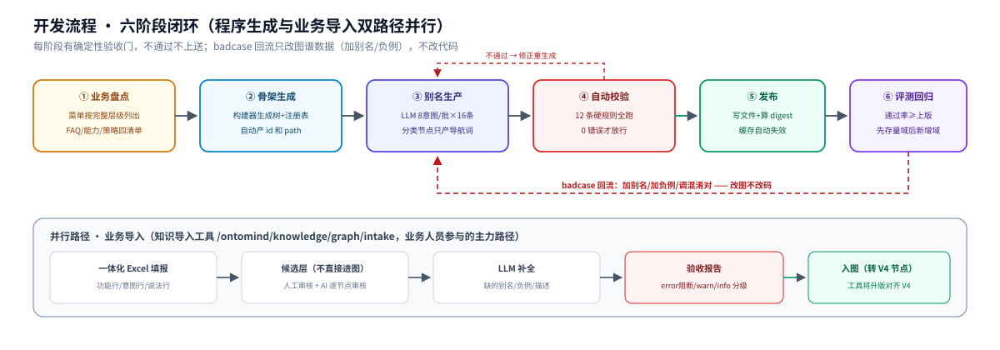

| 阶段 | 做什么 | 完成标准 |
|------|--------|---------|
| ① 业务盘点 | 菜单按完整层级列出（不再只列一级）；FAQ、系统能力、风控规则列成四张清单 | 菜单清单与 App 实际逐项核对一致 |
| ② 骨架生成 | 程序根据清单生成 intentTree（root/domain/category/leaf）和注册表骨架，自动生成 id 和 path | 树结构评审通过 |
| ③ 别名生产 | LLM 按批生成别名和负例；**无 scenes 的纯分类节点只生成导航词，不生成别名**；有 scenes 的节点（含 domain/category）按场景生成别名 | 每个有 scenes 的节点每个场景 ≥ 8 条别名、≥ 2 条负例 |
| ④ 自动校验 | 跑第 11 章全部规则 | 0 错误 |
| ⑤ 发布 | 写图谱文件，计算 digest | digest 三方一致（文件值/重算值/向量缓存绑定值） |
| ⑥ 评测回归 | 跑测试集；识别错误的案例通过加别名/加负例修正图谱 | 通过率不低于上一版本 |

别名生成的具体方法（词群家族覆盖、操作家族覆盖、批次参数）见[数据生成经验手册](intent-graph-data-generation-playbook.md)。

### 12.1 导入工具法：Excel 一体化模板（业务人员参与的主力路径）

六个阶段是骨架，实际落地有两条并行路径：**程序生成**（②③ 由构建器+LLM 完成）和**业务导入**（业务/知识团队用知识导入工具填报）。后者已经沉淀了一套成熟做法（知识导入工具 `/ontomind/knowledge/graph/intake`），大规模开发直接复用：

**一体化 Excel 模板**——业务人员在一张表里填三类行：

| 行类型 | 填什么 | 对应 V4 的什么 |
|--------|--------|---------------|
| 功能行 | 领域/功能组名称、业务说明 | domain / category 节点（含 scope_in/scope_out） |
| 意图行 | 意图名称、意图类型、执行模式、**别名**（逗号分隔）、召回关键词、多词组合、**排除说法**、优先级 | 功能节点的场景（semantic_definition + retrieval_profile） |
| 说法行 | 标问（基准说法，每意图 1 条）+ 扩展问（补充变体，越多越好） | 别名素材（标问即 title 的口语版，扩展问充实 aliases） |

**导入后走"候选层 → 审核 → 入图"三步，不直接进图谱：**

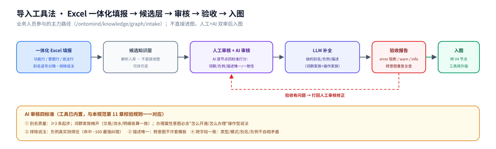

**AI 审核按四个标准逐节点打分（工具已内置，可直接沿用）：**

| 审核项 | 标准 |
|--------|------|
| 别名质量 | ≥3 条起步；覆盖正式名称/口语说法/场景化表达；**词群家族要摊开**（交易/流水/明细各算一族，不许一半以上挤成同义词）；含办理属性的意图必须有"怎么开通/怎么办理"操作型说法 |
| 排除说法 | 负例必须真实挡得住——写"最容易混进来但不是本意图"的查询；命中扣 160 分，是最强纠错手段 |
| 描述唯一 | 每个意图的描述必须跨意图唯一，不许套模板文案（重复会稀释向量召回） |
| 跨字段一致 | 意图类型/执行模式/别名/负例之间不能自相矛盾（如查询类意图配了办理类别名） |

**验收报告自动检查（分级：error 阻断 / warn 提醒 / info 记录）**：说法跨意图重复、别名跨意图重复、描述重复、操作家族缺失、别名长度越界（2~24 字、无连续 3 位数字）——与本规范第 11 章校验规则一一对应。

> **工具升版说明**：知识导入工具当前按早期列模板实现；本规范（V4 schema）定稿后，工具将升版：功能行→domain/category、意图行列对齐七 block、说法行→retrieval_profile、新增能力/FAQ/策略三张资源清单页。升版前，导入产物经转换器进 V4 图谱，填报方法不变。

### 12.2 版本与发布物

| 项目 | 规则 |
|------|------|
| 版本号 | `X.Y.Z` 语义化：结构不变的数据修正升 Z；加字段/加 kind 升 Y；破坏性结构变更升 X |
| digest 覆盖范围 | intentTree + relations + resourceRegistries（键排序紧凑序列化后 SHA256）；发布时写入文件，引擎启动重算比对 |
| 发布产物 | ① 图谱文件本体 ② 语义索引缓存（digest 绑定，图一变自动失效重建）——不需要手工同步 |
| 回滚 | 保留上一版本文件，切 manifest 指向即可；语义索引按 digest 自动匹配旧版 |

### 12.3 两条路径怎么配合

| 场景 | 用哪条路径 |
|------|-----------|
| 全新银行/全新业务域（量大） | 程序生成为主（菜单清单→骨架→LLM 别名），业务导入补场景化说法 |
| 存量知识运营（客服FAQ、话术库） | 业务导入为主（Excel 填报→审核→入图） |
| badcase 修正 | 谁发现谁改：评测回流自动建议，运营在导入工具里改 |

### 12.4 V4 适配器接口契约（V4.1 新增）

存量 V2 图谱迁移到 V4 的整体思路——节点归节点、边归字段、资源归字典，迁移后跑 V4 校验器全量检查：

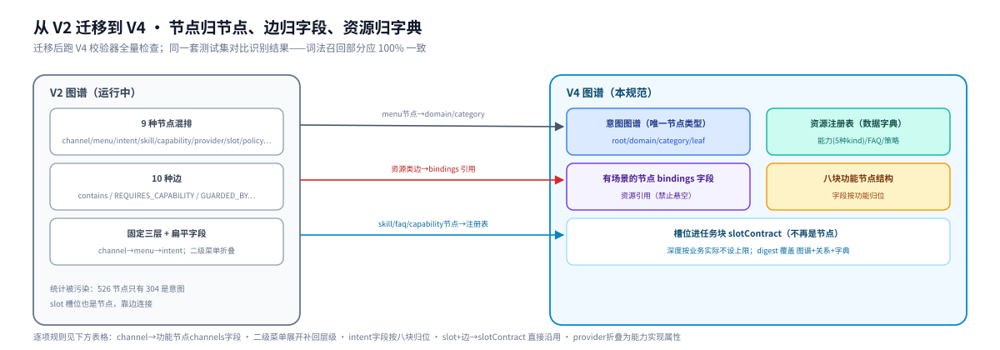

**V4.1 修订**：V4.0 定义了图谱数据结构（节点/边/资源字典），但未定义 V4GraphAdapter 必须实现的完整运行时接口契约。导致 V4 图谱首次接入运行时（`service.py` → `IntentGraphRepository`）时，适配器缺少 `validate_capability_bindings` 方法，agent run 时抛出 `AttributeError`。

V4GraphAdapter 必须实现以下接口，才能无缝替换 V2 `IntentGraphRepository`：

**方法契约：**

| 方法/属性 | 签名 | 调用方 | 说明 |
|-----------|------|--------|------|
| `recall()` | `recall(message, *, page_context, limit, graph_expand) -> list[IntentCandidate]` | `service.py` 主召回 | 词法召回 + 图谱扩召，返回 V2 兼容的 IntentCandidate |
| `iter_active_intents()` | `iter_active_intents() -> list[IntentProjection]` | FAQ 匹配、评测 | 返回所有活跃意图的投影（id/title/aliases/description） |
| `candidate_for_intent()` | `candidate_for_intent(intent_id, *, score, evidence) -> IntentCandidate` | FAQ 路由 | 按 intent_id 构建 candidate（FAQ 精确匹配后走此路径） |
| `action_key_for_intent()` | `action_key_for_intent(intent_id) -> str` | 导航路由 | 返回 `channel.menuId.actionId` 格式的 action key |
| `validate_capability_bindings()` | `validate_capability_bindings(candidates, available_capability_ids) -> None` | `service.py` agent run 前校验 | 校验 candidate 的 capability_bindings 是否在可用能力集合中，缺失则抛 `IntentGraphError` |
| `version` | property `-> str` | service.py | 图谱版本号 |
| `digest` | property `-> str` | service.py | 图谱 SHA256 摘要 |
| `graph_id` | property `-> str` | service.py | 图谱标识 |
| `path` | property `-> Path` | semantic_recall | 图谱文件路径（定位语义索引文件） |
| `action_keys` | property `-> frozenset[str]` | service.py | 全图所有 action key 集合 |
| `intent_graph_identity` | property `-> tuple[str, str]` | service.py | `(version, digest)` 元组 |

**IntentCandidate 字段映射规则（V4 → V2）：**

| V2 IntentCandidate 字段 | V4 数据来源 | 转换规则 |
|------------------------|-------------|---------|
| `intent_id` | V4 leaf 节点的 V2 原始 ID（从 `observability.sourceRecords` 的 `v2-source:` 前缀提取） | 直接使用 V2 ID，不用虚拟 ID |
| `title` | `semantic_definition.userGoal`，回退 `node.title` | 适配器：`sd.get("userGoal", node.get("title", ""))`。V4.0 未定义此映射 |
| `action` | `scene.scene_type` | **直接映射**（大写枚举），不可用 `actionCode` |
| `business_object` | `node.bindings.businessObjects` 或场景级推断 | 适配器 `_extract_business_object()` 构建 |
| `business_object_id` | 适配器内部构建 | 当前固定 `None`（预留字段） |
| `execution_mode` | `execution_binding.executionMode` | 直接映射 |
| `risk_level` | `execution_binding.riskLevel` | 适配器：`eb.get("riskLevel", "L1")`。**V4.1 新增**——V4.0 场景级无此字段，适配器只能用默认值 |
| `required_slots` | `task_binding.slotContract.slots` | 提取 `name` 字段，仅 `required=true` 的 → **字符串列表** |
| `capability_bindings` | `task_binding.slotContract.capabilityBindings` | 适配器：`tb.get("slotContract",{}).get("capabilityBindings",[])`。**V4.1 修正**——V4.0 文档误标来源为 `scene.bindings.capabilities`，实际适配器从 slotContract 读取 |
| `semantic_priority` | `retrieval_profile.semanticPriority` | 适配器：`rp.get("semanticPriority", 0)`。**V4.1 新增** |
| `slot_contract` | `task_binding.slotContract` | 经 `_safe_slot_contract()` → `_project_slot_contract()` 投影。**兼容处理**：适配器先检查 `slotContract.executionBinding` 子键是否存在，缺失则返回 None（V4 场景可不配 executionBinding），避免 `_project_slot_contract` 抛 `KeyError` |
| `skill_binding` | `task_binding.skillBinding` | `{skillId, version, digest}` 经 `_project_skill_binding()` 透传。适配器通过 `_lookup_skill_binding()` 从 V2 映射表查找（硬编码兜底） |
| `task_policy` | `decision_policy.supportedShapes` + `decision_policy.orchestrationHint` | 适配器构建 `{"supportedShapes": dp.get("supportedShapes", ["single_intent"]), "mode": dp.get("orchestrationHint", "parallel-safe"), "maxTasks": 1}`，经 `_project_task_policy()` 投影 |
| `context_policy` | `decision_policy.contextPolicy` | 适配器：`dp.get("contextPolicy", {})`，经 `_project_context_policy()` 投影。读取 `retainOnClarification` / `allowIntentSwitch` / `resumable` 三个子键 |
| `orchestration_mode` | `decision_policy.orchestrationHint` | **兼容转换**：适配器 `_safe_orchestration_mode()` 将 V4 值（`parallel-safe`/`sequential`/`single`）映射为 V2 合法值 `deterministic`；`agent` 原样透传。V2 `_project_orchestration_mode()` 只接受 `deterministic`/`agent`，其余抛 `IntentGraphError` |
| `response_policy` | — | 当前固定 `None`（预留字段） |
| `confusable_intents` | `node.confusableIntents`（节点级） | **V4.1 修正**——V4.0 文档标来源为 `semantic_definition.confusableIntents`（场景级），实际适配器从**节点级**读取 `node.get("confusableIntents", [])`。schema 在 §8.4 定义为场景级字段，适配器做节点级→场景级的兼容兜底 |
| `disambiguation_hints` | `node.disambiguationHints`（节点级） | **V4.1 修正**——同上，适配器从节点级读取 `node.get("disambiguationHints")`。schema 在 §8.4 定义为场景级，适配器做兼容兜底 |
| `menuKey` | 功能级 `bindings.menu` + 父节点 `navigationTerms` | 适配器构建 |
| `lifecycle` | `node.lifecycle` | 适配器：`node.get("lifecycle", "active")`，用于过滤活跃/非活跃意图。**V4.1 新增** |

> **V4.1 兼容性转换说明**：V4 schema 定义的数据结构（如 `orchestrationHint: parallel-safe`）与 V2 引擎运行时消费的合法值（如 `orchestration_mode: deterministic`）之间存在**值域差异**。适配器通过 `_safe_orchestration_mode()` 和 `_safe_slot_contract()` 两个兼容函数做转换——这是 V4.0 schema 未定义的运行时契约。V4.1 将这些转换规则显式写入规范，适配器开发者可对照实现，不再靠"跑起来报错"发现。

> **设计教训**：V4 schema 是纯数据规范，但运行时有一套隐含的接口契约（V2 `IntentGraphRepository` 的 6 个方法 + 5 个属性）。V4.0 没有将这套接口契约显式化，导致适配器实现时只能靠"跑起来报错"来发现缺失——每次 `AttributeError` 都是一个接口盲区。V4.1 将接口契约写入规范，适配器开发可对照清单逐项实现，不再靠试错。

## 13. 从 0 到 1：首个图谱怎么落地

上面六阶段是"怎么干"，这章回答"第一个版本到底先做哪些、做到什么程度能上线"。

### 13.1 最小可用版本（MVP）的范围

第一个版本不需要覆盖全行业务，选一个领域做透就行——**推荐"转账汇款"或"账户查询"**，因为说法多、场景全（查询+办理+问答都有）、能力可执行（能跑通从识别到路由的完整链路）。

| MVP 必须包含的 | 做到什么程度 | 为什么 |
|--------------|------------|--------|
| 功能节点 | 1 个领域、3~5 个功能组、15~30 个叶子节点 | 足够验证树结构和路径前缀召回 |
| 场景声明 | 每个叶子至少 1 个场景（查询/办理/问答之一） | 验证场景制识别两步走 |
| 别名 | 每个场景 ≥ 8 条别名 + ≥ 2 条负例 | 词法召回的最低门槛 |
| 槽位契约 | 办理类场景配齐 slotContract（至少 2 个槽位） | 验证槽位提取和多轮澄清 |
| 能力注册表 | 至少 2 条能力（1 条 menu-nav + 1 条 mcp-tool/skill） | 验证执行路由能跑通 |
| FAQ 注册表 | 至少 5 条 FAQ | 验证问答场景的 answerRefs |
| relations | 2~3 条混淆关系 | 验证消歧逻辑 |

**MVP 不需要做的**：多渠道差异（channels 先全填 `["app"]`）、复杂风控策略（policies 先空）、跨域关系（relations 先只做域内）。

### 13.2 第一个版本的开发顺序

把六阶段拆成具体的操作步骤，按这个顺序做最顺：

```
步骤 1  菜单盘点 → 列出 App 里这个领域的完整菜单层级（截图或抓包，不要凭记忆）
步骤 2  画树      → 在纸或思维导图上画出 root → domain → category → leaf，确认每个叶子是"最小不可再分的功能"
步骤 3  定场景    → 每个叶子标场景类型（QUERY/DO/ASK…），一个叶子可能多个场景
步骤 4  填骨架    → 用构建器或手写 JSON 生成节点骨架（id/path/level/title/scenes[] 的框架）
步骤 5  写别名    → 每个场景写 8~16 条别名 + 2~5 条负例（可 LLM 批量生成 + 人工审核）
步骤 6  配槽位    → 办理类场景写 slotContract（哪些信息需要用户补、怎么提取）
步骤 7  挂资源    → 注册表里加能力/FAQ 定义，场景 bindings 引用
步骤 8  跑校验    → 执行第 11 章全部规则，0 错误才能继续
步骤 9  评测      → 准备 50~100 条测试 query，人工标注期望命中，跑识别看通过率
步骤 10 修正      → badcase 加别名/加负例/调优先级，回到步骤 8
```

> **关键经验**：步骤 5（写别名）是质量决定环节。别名不是翻译——"转账"的别名不是"transfer money"，而是"给我转个账""汇款给朋友""怎么把钱打给别人"这种用户真的会说的口语。建议从客服日志、搜索热词里捞真实说法，比 LLM 凭空生成的有效得多。

### 13.3 评测怎么做

| 环节 | 做法 |
|------|------|
| 测试集来源 | ① 客服对话日志摘 Top 100 query ② 搜索热词 ③ 人工补充边界 case |
| 标注方式 | 每条 query 标注期望命中的功能节点 + 场景（或标注"应拒识"） |
| 自动评测 | 跑识别引擎，对比命中结果与标注，输出：通过率、混淆矩阵、Top 10 badcase |
| 通过门槛 | MVP 首版通过率 ≥ 70% 即可上线试跑；迭代到 ≥ 85% 算合格；≥ 90% 算优秀 |
| 回归节奏 | 每次改图谱数据必须重跑全量测试集，防止改一处坏三处 |

### 13.4 从 MVP 到全量

MVP 验证通过后，按领域逐批扩展。每批走同样的十步流程，但可以并行：

| 扩展策略 | 做法 |
|---------|------|
| 领域分批 | 一个领域一个批次，每批 20~40 个叶子节点 |
| 复用模板 | MVP 沉淀的别名风格、槽位模式、评测流程直接套用到新领域 |
| 跨域校验 | 每加一个领域，跑全图唯一性校验——新别名不能和已有领域的别名冲突 |
| 逐步上渠道 | 全领域跑通后，再按渠道差异化（App/微信/语音的别名和渠道限制） |

### 13.5 常见问题与避坑

| 坑 | 症状 | 解法 |
|------|------|------|
| 叶子不够细 | "账户管理"一个叶子挂了查询+办理+改密+挂失 4 个场景，别名互相打架 | 拆成 4 个叶子：账户查询/账户管理/密码修改/账户挂失 |
| 叶子太碎 | "查活期余额"和"查定期余额"分两个叶子，召回时竞争 | 合并成"余额查询"，用场景或槽位区分活期/定期 |
| 别名太书面 | 别名写的"资金转账服务"，用户说的是"转账" | 别名必须口语化，从真实日志里捞 |
| 负例无效 | 负例写"办理信用卡"但实际没有混淆 | 负例要写**真的会混进来的**说法，从评测 badcase 里找 |
| 场景漏配 | 只配了 DO 场景，用户问"怎么转账"时识别不到 | 每个功能至少检查 QUERY 和 ASK 场景是否需要 |
| 槽位过度 | 查余额的场景也配了 slotContract | 只有需要用户补充信息才能执行的 DO 场景才配槽位 |

---

# 附录

## 附录 A：JSON Schema

（Draft 2020-12 核心约束；完整版随构建器维护）

```json
{
  "$schema": "https://json-schema.org/draft/2020-12/schema",
  "type": "object",
  "additionalProperties": false,
  "required": ["schemaVersion", "graphId", "version", "bank", "appSurface", "intentTree", "digest"],
  "properties": {
    "schemaVersion": { "enum": ["4.0", "4.1"] },
    "graphId": { "type": "string", "minLength": 1 },
    "version": { "type": "string", "pattern": "^\\d+\\.\\d+\\.\\d+$" },
    "intentTree": { "type": "array", "minItems": 1, "items": { "$ref": "#/$defs/intentNode" } },
    "relations": { "type": "array", "items": {
      "type": "object", "additionalProperties": false,
      "required": ["id", "type", "from", "to"],
      "properties": {
        "id": { "type": "string" },
        "type": { "enum": ["same_as", "confusable_with", "related_to"] },
        "from": { "type": "string" }, "to": { "type": "string" },
        "relation_category": { "enum": ["hierarchy", "semantic", "constraint", "knowledge", "execution", "clarification"] },
        "status": { "enum": ["active", "inactive", "deprecated"] },
        "weight": { "type": "number" }, "priority": { "type": "number" },
        "evidence": { "type": "string" }, "condition": { "type": "string" },
        "owner": { "type": "string" }, "version": { "type": "string" }
      } } },
    "resourceRegistries": { "$ref": "#/$defs/registries" },
    "digest": { "type": "string", "pattern": "^sha256:[a-f0-9]{64}$" }
  },
  "$defs": {
    "intentNode": {
      "type": "object", "additionalProperties": false,
      "required": ["id", "title", "node_role", "parent_intent_id", "path"],
      "properties": {
        "id": { "type": "string", "pattern": "^[a-z0-9.-]+$" },
        "title": { "type": "string", "minLength": 1 },
        "node_role": { "enum": ["root", "domain", "category", "leaf"] },
        "parent_intent_id": { "type": ["string", "null"] },
        "path": { "type": "string", "minLength": 1 },
        "navigationTerms": { "type": "array", "items": { "type": "string", "minLength": 2 } },
        "scope_in": { "type": "array", "minItems": 1, "items": { "type": "string" } },
        "scope_out": { "type": "array", "items": { "type": "string" } },
        "bindings": { "$ref": "#/$defs/nodeBindings" },
        "scenes": { "type": "array", "items": { "$ref": "#/$defs/scene" } },
        "observability": { "$ref": "#/$defs/observability" },
        "lifecycle": { "enum": ["active", "inactive", "deprecated"] }
      },
      "allOf": [
        { "if": { "properties": { "node_role": { "enum": ["domain", "category", "leaf"] } } },
          "then": { "required": ["scope_in"] } },
        { "if": { "properties": { "node_role": { "const": "root" } } },
          "then": { "not": { "anyOf": [ { "required": ["scenes"] }, { "required": ["bindings"] } ] } } }
      ]
    },
    "scene": {
      "type": "object", "additionalProperties": false,
      "required": ["scene_type", "semantic_definition", "retrieval_profile", "execution_binding"],
      "properties": {
        "scene_type": { "enum": ["ASK", "QUERY", "DO", "CHANGE", "CANCEL", "HELP", "TRANSFER", "REPAY"] },
        "semantic_definition": { "$ref": "#/$defs/semanticDefinition" },
        "retrieval_profile": { "$ref": "#/$defs/retrievalProfile" },
        "task_binding": { "$ref": "#/$defs/taskBinding" },
        "knowledge_binding": { "type": "object" },
        "decision_policy": { "$ref": "#/$defs/decisionPolicy" },
        "execution_binding": { "$ref": "#/$defs/executionBinding" },
        "bindings": { "$ref": "#/$defs/sceneBindings" }
      }
    },
    "semanticDefinition": {
      "type": "object", "additionalProperties": false,
      "required": ["description"],
      "properties": {
        "intentType": { "enum": ["ASK", "QUERY", "DO", "CHANGE", "CANCEL", "HELP", "TRANSFER", "REPAY"] },
        "userGoal": { "type": "string" },
        "description": { "type": "string", "minLength": 8 },
        "channels": { "type": "array", "items": { "enum": ["app", "phone", "wechat", "branch", "overseas"] } },
        "confusableIntents": { "type": "array", "items": { "type": "string" } },
        "disambiguationHints": { "type": "array", "items": { "type": "string" } }
      }
    },
    "retrievalProfile": {
      "type": "object", "additionalProperties": false,
      "required": ["aliases"],
      "properties": {
        "aliases": { "type": "array", "minItems": 3, "items": { "type": "string", "minLength": 2, "maxLength": 24 } },
        "recallTerms": { "type": "array", "items": { "type": "string", "minLength": 2, "maxLength": 40 } },
        "recallTermSets": { "type": "array", "items": { "type": "array", "minItems": 2, "maxItems": 4, "items": { "type": "string" } } },
        "negativeExamples": { "type": "array", "items": { "type": "string" } },
        "semanticView": { "type": "array", "items": { "type": "string", "minLength": 2, "maxLength": 12 } },
        "objectView": { "type": "array", "items": { "type": "string" } },
        "actionView": { "type": "array", "items": { "type": "string" } },
        "viewWeights": {
          "type": "object", "additionalProperties": false,
          "properties": {
            "utterance": { "type": "number", "exclusiveMinimum": 0, "maximum": 1 },
            "semantic": { "type": "number", "exclusiveMinimum": 0, "maximum": 1 },
            "object": { "type": "number", "exclusiveMinimum": 0, "maximum": 1 },
            "action": { "type": "number", "exclusiveMinimum": 0, "maximum": 1 }
          }
        },
        "semanticPriority": { "type": "integer", "minimum": 0, "default": 0 }
      }
    },
    "executionBinding": {
      "type": "object", "additionalProperties": false,
      "required": ["executionMode"],
      "properties": {
        "executionMode": { "enum": ["read-execute", "confirm-required", "knowledge-only", "multi_intent"] },
        "routeType": { "enum": ["navigation", "api", "workflow", "dialogue"] },
        "navigationPath": { "type": "string" },
        "altNavigationPaths": { "type": "array", "items": { "type": "string" } },
        "apiOrWorkflowId": { "type": "string" },
        "readiness": { "enum": ["ready", "planned"] },
        "requiresConfirmation": { "type": "boolean" },
        "orchestrationMode": { "enum": ["single", "parallel", "sequential"] },
        "riskLevel": { "enum": ["L0", "L1", "L2", "L3"], "default": "L1" }
      }
    },
    "taskBinding": {
      "type": "object", "additionalProperties": false,
      "properties": {
        "slotContract": {
          "type": "object",
          "properties": {
            "slots": { "type": "array", "maxItems": 16, "items": { "type": "object" } },
            "clarificationOrder": { "type": "array", "items": { "type": "string" } },
            "extractionKeys": { "type": "array", "items": { "type": "string" } },
            "capabilityBindings": { "type": "array", "items": { "type": "string" } },
            "executionBinding": {
              "type": "object",
              "properties": {
                "capabilityId": { "type": "string" },
                "requiresConfirmation": { "type": "boolean" }
              }
            },
            "version": { "type": "string" }
          }
        },
        "actionCode": { "enum": ["ask", "query", "apply", "open", "close", "change", "cancel", "transfer", "repay", "guide"] },
        "skillBinding": {
          "type": "object",
          "required": ["skillId", "version", "digest"],
          "properties": {
            "skillId": { "type": "string" },
            "version": { "type": "string" },
            "digest": { "type": "string" }
          }
        },
        "stateConstraints": { "type": "array", "items": { "type": "object" } },
        "riskConstraints": { "type": "array", "items": { "type": "object" } },
        "executionPrecondition": { "type": "string" }
      }
    },
    "decisionPolicy": {
      "type": "object", "additionalProperties": false,
      "properties": {
        "defaultDecision": { "enum": ["answer", "execute_or_route", "clarify", "reject"] },
        "lowConfidence": { "enum": ["clarify", "recommend", "reject"] },
        "askDoBoundaryStrategy": { "type": "string" },
        "clarifyQuestions": { "type": "array", "maxItems": 3, "items": { "type": "string" } },
        "rejectPolicy": { "enum": ["soft", "hard"] },
        "supportedShapes": { "type": "array", "items": { "enum": ["single_intent", "multi_intent", "parallel"] }, "default": ["single_intent"] },
        "orchestrationHint": { "enum": ["single", "parallel-safe", "sequential"], "default": "parallel-safe" },
        "contextPolicy": {
          "type": "object",
          "properties": {
            "retainOnClarification": { "type": "boolean", "default": true },
            "allowIntentSwitch": { "type": "boolean", "default": false },
            "resumable": { "type": "boolean", "default": true }
          }
        }
      }
    },
    "nodeBindings": {
      "type": "object", "additionalProperties": false,
      "properties": {
        "menu": { "type": ["object", "null"], "required": ["path"],
                  "properties": { "path": { "type": "string" }, "menuId": { "type": "string" } } },
        "businessObjects": { "type": "array", "items": { "type": "string" } },
        "capabilities": { "type": "array", "items": { "type": "string" } },
        "policies": { "type": "array", "items": { "type": "string" } }
      }
    },
    "sceneBindings": {
      "type": "object", "additionalProperties": false,
      "properties": {
        "capabilities": { "type": "array", "items": { "type": "string" } },
        "policies": { "type": "array", "items": { "type": "string" } }
      }
    },
    "observability": {
      "type": "object", "additionalProperties": false,
      "properties": {
        "sourceRecords": { "type": "array", "items": {
          "type": "object", "additionalProperties": false,
          "properties": {
            "type": { "enum": ["menu_screenshot", "requirement_doc", "user_log", "expert_interview"] },
            "ref": { "type": "string" }, "note": { "type": "string" }
          } } },
        "lastReviewedAt": { "type": "string" },
        "lastReviewedBy": { "type": "string" }
      }
    },
    "registries": {
      "type": "object", "additionalProperties": false,
      "properties": {
        "capabilities": { "type": "array", "items": {
          "type": "object", "additionalProperties": false,
          "required": ["id", "title", "kind", "riskLevel", "writeOperation", "exposure", "provider"],
          "properties": {
            "id": { "type": "string" }, "title": { "type": "string" },
            "kind": { "enum": ["mcp-tool", "skill", "workflow", "agent", "menu-nav"] },
            "riskLevel": { "enum": ["L0", "L1", "L2", "L3"] },
            "writeOperation": { "type": "boolean" },
            "exposure": { "enum": ["model-callable", "internal"] },
            "schemaDigest": { "type": "string", "pattern": "^sha256:[0-9a-f]{64}$" },
            "provider": { "type": "object",
              "oneOf": [
                { "required": ["protocol", "serverId", "toolName"] },
                { "required": ["entry"] },
                { "required": ["workflowId"] },
                { "required": ["agentId"] },
                { "required": ["route"] }
              ] }
          } } },
        "faqs": { "type": "array", "items": { "type": "object", "required": ["id", "question", "answer"] } },
        "policies": { "type": "array", "items": { "type": "object", "required": ["id", "title", "rules"] } },
        "skillBindings": { "type": "array", "items": {
          "type": "object", "additionalProperties": false,
          "required": ["skillId", "version", "digest", "title", "entry"],
          "properties": {
            "skillId": { "type": "string" },
            "version": { "type": "string", "pattern": "^\\d+\\.\\d+\\.\\d+$" },
            "digest": { "type": "string", "pattern": "^sha256:[0-9a-f]{64}$" },
            "title": { "type": "string" },
            "domainAdapter": { "type": ["string", "null"] },
            "entry": { "type": "string" }
          } } }
      }
    }
  }
}
```


JSON Schema 管不到的规则（无环、前缀、悬空引用、跨意图唯一）由校验器程序检查，清单见第 11 章。

## 附录 B：完整示例文件

一个可直接拿去校验的最小完整图谱：根节点 + 账户管理域 + 银行卡分类（menu-nav 导航兜底）+ 余额查询功能（单 QUERY 场景）+ 银行卡挂失功能（**DO + ASK 双场景**，演示功能×场景结构）+ 资源注册表 + 1 条 relation。

```json
{
  "schemaVersion": "4.0",
  "graphId": "demo-bank-intents",
  "version": "4.0.0",
  "bank": "DEMO",
  "appSurface": "mobile-app",
  "publishedAt": "2026-09-23T00:00:00+08:00",

  "intentTree": [
    { "id": "demo.root", "title": "演示银行", "node_role": "root", "parent_intent_id": null, "path": "演示银行" },
    { "id": "demo.account", "title": "账户管理", "node_role": "domain", "parent_intent_id": "demo.root",
      "path": "演示银行/账户管理",
      "navigationTerms": ["账户", "银行卡"],
      "scope_in": ["账户查询", "银行卡管理", "余额"],
      "scope_out": ["转账", "开户"] },
    { "id": "demo.account.card", "title": "银行卡", "node_role": "category", "parent_intent_id": "demo.account",
      "path": "演示银行/账户管理/银行卡",
      "navigationTerms": ["卡", "卡片"],
      "scope_in": ["借记卡", "卡片管理", "挂失"],
      "scope_out": ["信用卡账单", "还款"],
      "bindings": {
        "menu": { "path": "首页>账户>银行卡" },
        "capabilities": ["demo.account.card.nav"]
      }
    },

    {
      "id": "demo.account.card.balance",
      "title": "余额查询",
      "node_role": "leaf",
      "parent_intent_id": "demo.account.card",
      "path": "演示银行/账户管理/银行卡/余额查询",
      "scope_in": ["余额", "可用余额"], "scope_out": ["交易明细"],
      "bindings": {
        "menu": { "path": "首页>账户>余额查询" },
        "businessObjects": ["account"]
      },
      "scenes": [
        {
          "scene_type": "QUERY",
          "semantic_definition": {
            "userGoal": "查银行卡的实时余额",
            "description": "查询本人名下银行卡的实时余额和可用余额。",
            "confusableIntents": ["demo.account.card.detail#QUERY"],
            "disambiguationHints": ["只查余额归本场景；查收支明细归明细查询功能"]
          },
          "retrieval_profile": {
            "aliases": ["查余额", "卡里还有多少钱", "看看余额", "账户余额", "余额多少"],
            "recallTerms": ["余额", "可用余额", "卡余额"],
            "recallTermSets": [["查", "余额"], ["卡里", "多少钱"]],
            "negativeExamples": ["查交易明细", "查转账记录", "信用卡账单"]
          },
          "task_binding": {
            "slotContract": {
              "slots": [
                { "slotId": "slot.account.reference", "name": "accountReference", "label": "银行卡",
                  "type": "account_reference", "required": true,
                  "extractionKeys": ["accountName", "maskedAccountNo"],
                  "question": "您要查哪张卡？",
                  "resolverCapabilityId": "demo.account.resolve-reference", "resolvedField": "accountId" }
              ],
              "clarificationOrder": ["accountReference"]
            },
            "actionCode": "query"
          },
          "decision_policy": { "contextPolicy": { "retainOnClarification": true } },
          "execution_binding": { "executionMode": "read-execute", "readiness": "ready", "routeType": "api", "navigationPath": "首页>账户>余额查询" },
          "bindings": { "capabilities": ["demo.account.balance.get"] }
        }
      ],
      "observability": {
        "sourceRecords": [
          { "type": "expert_interview", "ref": "demo-p0", "note": "业务专家确认" }
        ],
        "lastReviewedAt": "2026-09-23",
        "lastReviewedBy": "account-team"
      }
    },

    {
      "id": "demo.account.card.loss",
      "title": "银行卡挂失",
      "node_role": "leaf",
      "parent_intent_id": "demo.account.card",
      "path": "演示银行/账户管理/银行卡/挂失",
      "scope_in": ["挂失", "卡片丢失"], "scope_out": ["解挂"],
      "bindings": { "menu": { "path": "首页>账户>银行卡>挂失" } },
      "scenes": [
        {
          "scene_type": "DO",
          "semantic_definition": {
            "userGoal": "挂失丢失的银行卡",
            "description": "对本人名下银行卡发起挂失，挂失即时生效卡片止付。",
            "confusableIntents": ["demo.account.card.loss#ASK", "demo.account.card.reissue#DO"],
            "disambiguationHints": ["说挂失卡片归本场景；问挂失规则归本功能问答场景；说补卡的归补卡功能"]
          },
          "retrieval_profile": {
            "aliases": ["挂失我的卡", "立即挂失", "卡丢了帮我挂失", "银行卡挂失"],
            "negativeExamples": ["挂失怎么办理", "挂失后什么状态", "解除挂失"]
          },
          "task_binding": {
            "slotContract": { "slots": [
              { "slotId": "slot.card.reference", "name": "cardReference", "label": "银行卡",
                "type": "card_reference", "required": true,
                "extractionKeys": ["cardName", "maskedCardNo"],
                "question": "挂失哪张卡？",
                "resolverCapabilityId": "demo.account.resolve-reference", "resolvedField": "cardId" }
            ], "clarificationOrder": ["cardReference"] },
            "actionCode": "change"
          },
          "execution_binding": { "executionMode": "confirm-required", "readiness": "ready", "requiresConfirmation": true, "routeType": "api", "navigationPath": "首页>账户>银行卡>挂失", "apiOrWorkflowId": "demo.account.card.loss.do" },
          "bindings": { "capabilities": ["demo.account.card.loss.do"] }
        },
        {
          "scene_type": "ASK",
          "semantic_definition": {
            "userGoal": "了解挂失办理方式与影响",
            "description": "解答银行卡挂失的办理渠道、生效时间和挂失期间卡片状态。"
          },
          "retrieval_profile": {
            "aliases": ["挂失怎么办理", "卡丢了怎么办", "挂失流程", "挂失后什么状态"],
            "negativeExamples": ["挂失我的卡", "立即挂失"]
          },
          "knowledge_binding": {
            "answerRefs": ["faq.demo.card-loss.howto", "faq.demo.card-loss.effect"],
            "answerType": "faq",
            "answerPolicy": "direct_answer_or_recommend_entry"
          },
          "execution_binding": { "executionMode": "knowledge-only", "readiness": "ready" }
        }
      ],
      "observability": {
        "sourceRecords": [
          { "type": "expert_interview", "ref": "demo-p0", "note": "业务专家确认" }
        ],
        "lastReviewedAt": "2026-09-23",
        "lastReviewedBy": "account-team"
      }
    }
  ],

  "relations": [
    { "id": "rel.demo.balance.confusable.detail",
      "type": "confusable_with",
      "from": "demo.account.card.balance#QUERY",
      "to": "demo.account.card.detail#QUERY",
      "evidence": "评测发现「查交易类」表达双功能竞争（demo-p0 批次回归）",
      "owner": "account-team", "version": "demo-p0" }
  ],

  "resourceRegistries": {
    "capabilities": [
      { "id": "demo.account.balance.get", "title": "读取账户余额",
        "kind": "mcp-tool", "riskLevel": "L1", "writeOperation": false, "exposure": "model-callable",
        "provider": { "protocol": "mcp", "serverId": "account-tools", "toolName": "balance_get" } },
      { "id": "demo.account.resolve-reference", "title": "解析账户引用",
        "kind": "mcp-tool", "riskLevel": "L0", "writeOperation": false, "exposure": "internal",
        "provider": { "protocol": "mcp", "serverId": "account-tools", "toolName": "resolve_account_reference" } },
      { "id": "demo.account.card.nav", "title": "银行卡频道页直达",
        "kind": "menu-nav", "riskLevel": "L0", "writeOperation": false, "exposure": "model-callable",
        "provider": { "route": "/account/cards" } },
      { "id": "demo.account.card.loss.do", "title": "执行银行卡挂失",
        "kind": "mcp-tool", "riskLevel": "L2", "writeOperation": true, "exposure": "model-callable",
        "provider": { "protocol": "mcp", "serverId": "account-tools", "toolName": "card_loss_execute" } }
    ],
    "faqs": [
      { "id": "faq.demo.card-loss.howto", "question": "银行卡挂失怎么办理",
        "answer": "可在手机银行「账户-银行卡-挂失」自助办理，或拨打客服热线。", "updatedAt": "2026-09-23" },
      { "id": "faq.demo.card-loss.effect", "question": "挂失后卡片是什么状态",
        "answer": "挂失即时生效，卡片只收不付；补新卡后原卡号不变。", "updatedAt": "2026-09-23" }
    ],
    "policies": []
  },

  "digest": "sha256:0000000000000000000000000000000000000000000000000000000000000000"
}
```

看这个示例注意五点：

1. **功能×场景**："余额查询"是单场景（QUERY）功能；"银行卡挂失"是双场景（DO 执行挂失 + ASK 咨询规则）功能——不再是碎片化兄弟叶子
2. **场景间互配负例**：挂失功能里"立即挂失"是 ASK 的负例、"挂失怎么办理"是 DO 的负例——同功能消歧在结构内解决
3. **功能级 vs 场景级绑定**：menu 在功能级共享；capabilities 在场景级各挂各的；FAQ 只出现在 ASK 场景的 knowledge_binding（answerRefs 唯一源）
4. 分类节点"银行卡"无 scenes（纯分类 + menu-nav 导航兜底）；confusableIntents/relation 用 `节点#场景` 记法指向具体场景
5. digest 是占位值，实际由构建器计算

## 附录 C：关键设计决策与已验证实现的对照

本规范（V4）的两套已验证实现——v2.0 运行时（`ccb-mobile-bank-intents.v1.json`）和 v2.1 主链路（`intent-graph-v2.1-p1-batch10.json`）——各有不完美之处。V4 在吸收两者验证过的字段结构的同时做了收敛，下表记录关键差异和选型理由：

| 方面 | 已验证实现的做法 | V4 的做法 | 选型理由 |
|------|----------------|---------|---------|
| 节点种类 | v2.0: 9 种节点混在一起；v2.1: intent_node + 10 张 supporting 表 | 1 种功能节点（root/domain/category/leaf 四种角色） | 9 种节点混在一起统计时分不清哪些是意图；supporting 表和注册表等价但更重 |
| 层级 | v2.0: 固定三层 channel→menu→intent；v2.1: aggregate+intent 双层冗余 | 按业务实际，深度不限 | 固定三层撑不起大规模；双层冗余维护成本高 |
| 边 | v2.0: 10 种边；v2.1: 15 种边 7649 条 | 树内不用边（parent 字段）；跨分支关系放 relations | 边太多做 diff 和统计时噪音大；树结构用字段更简单 |
| 资源 | v2.0: 资源是节点；v2.1: supporting 表 | 注册表（capabilities/faqs/policies 三张清单）+ bindings 引用 | 资源定义一次、引用多处；改资源不动树 |
| 意图粒度 | v2.0: "查定投"和"开定投"是兄弟叶子；v2.1: 靠 aggregate 层聚合 | 功能节点×场景（同一功能的多场景挂在节点上） | 两套都有碎片化问题；场景制是两者的合并修正 |
| 槽位字段 | v2.0: slotContract 完整字段（slotId/name/label/extractionKeys/resolvedField）；v2.1: slots 表 | 沿用 v2.0 完整字段，挂在场景 task_binding 下 | v2.0 的槽位结构已验证可运行，直接沿用 |
| 召回视图 | v2.0: aliases/recallTerms 扁平；v2.1: 7 种 view + weights | aliases + semanticView/objectView/actionView + viewWeights | v2.1 多视图调优过权重（0.28/0.20/0.18/0.16），有效 |
| 消歧材料 | v2.0: 顶层 confusableIntents；v2.1: semantic_definition.confusable_intents | 场景语义块的 confusableIntents/disambiguationHints | v2.1 的位置更合理（消歧是语义层的事） |
| 能力暴露控制 | v2.0: exposure/schemaDigest 字段 | 沿用（exposure + schemaDigest） | v2.0 验证过：挡内部能力被误唤起、检测契约漂移 |
| 命名风格 | v2.0: camelCase；v2.1: snake_case | camelCase（沿 v2.0） | v2.0 是当前运行时风格，保持一致 |
| 文件校验摘要 | v2.0: 覆盖 nodes + edges | 覆盖 intentTree + relations + 注册表 | V4 资源不在树里，digest 范围要跟上 |

## 附录 D：V4.0 首次接入运行时的架构缺陷与修订记录

本附录记录 V4.0 schema 首次接入运行时（agent-runtime）时发现的 4 个架构/schema 缺陷，以及 V4.1 的修订措施。**这些缺陷都是在实际运行时通过报错发现的——V4.0 的校验规则（第 11 章）无法覆盖它们，因为它们是"数据结构正确但运行时语义不兼容"的问题。**

### D.1 缺陷清单

| # | 缺陷 | 根因层面 | 运行时表现 | V4.1 修订 |
|---|------|---------|-----------|-----------|
| 1 | **适配器接口契约未定义** | 架构设计——V4 schema 是纯数据规范，未定义 V4GraphAdapter 必须实现的运行时接口 | `service.py` 调用 `validate_capability_bindings()` 时抛 `AttributeError`，agent run 失败（错误码 `agent_runtime_failed`） | §12.4 新增适配器接口契约清单（6 方法 + 5 属性 + 字段映射规则） |
| 2 | **action 字段二义性** | Schema 字段定义——`scene_type`（大写）和 `actionCode`（小写）未明确哪个映射到 V2 `action` | 适配器用 `actionCode`（小写 `apply`）构建 intent 的 `action` 字段，`IntentConstraint` 校验失败（要求大写 `DO`），转账请求返回"本次服务未完成" | §8.2/§8.6 明确 `scene_type` → V2 `action` 映射规则；§11 新增校验规则第 14 条 |
| 3 | **requiredSlots 格式缺失** | Schema 字段定义——`slotContract.slots` 是完整对象数组，V2 `requiredSlots` 是字符串数组，未定义转换规则 | 适配器直接传完整 slot 字典列表，运行时槽位匹配失败，转账请求仍返回"本次服务未完成" | §8.6 新增 requiredSlots 转换规则（提取 `name` + `required=true` 过滤） |
| 4 | **skillBinding 架构缺陷（最严重）** | 架构设计——V4.0 移除了 V2 的 HANDLED_BY 边和 skill 节点（"技能已并入能力表"），但运行时域适配器路由依赖 `skill_binding.skill_id` | `business_profile.py` 的 `skill_id_for_task()` 返回 None，域适配器路由失败，业务智能体启动失败（错误码 `user_response_projection_failed`） | §8.6 新增 `skillBinding` 一等公民字段；§10.4 新增 skillBindings 注册表；§9.3 更新 bindings 描述 |

### D.2 缺陷根因分析

**共性根因：V4.0 schema 只定义了"图谱数据长什么样"，没有定义"图谱数据怎么被运行时消费"。**

V2 的 `IntentGraphRepository` 是一套经过验证的运行时接口（6 个方法 + 5 个属性），它隐含了一套对图谱数据的消费契约：

1. **意图必须有 action 字段**（大写枚举）——V4 有两个候选字段（scene_type/actionCode）但没说哪个映射
2. **意图必须有 required_slots**（字符串列表）——V4 用 slotContract.slots（对象数组）但没说怎么转
3. **意图必须有 skill_binding**（含 skillId/version/digest）——V4 直接移除了这个概念
4. **适配器必须实现完整接口**——V4 没有定义适配器接口

V4.0 的校验规则（第 11 章）只能检查"数据结构是否合法"（id 唯一、别名不重复、引用不悬空），但无法检查"数据是否运行时兼容"——因为运行时兼容性取决于 V2 引擎的隐含契约，而这个契约在 V4.0 中没有被显式表达。

### D.3 修订原则

V4.1 的修订遵循三个原则：

1. **显式化运行时契约**：将 V2 引擎对图谱数据的隐含消费契约写入 V4 schema（§12.4 适配器接口契约 + 字段映射规则）
2. **恢复被错误移除的一等公民**：skillBinding 不是"执行入口"问题而是"域路由"问题，与 capabilities(kind=skill) 正交，必须独立存在（§8.6 + §10.4）
3. **消除字段二义性**：scene_type 和 actionCode 各有各的用途，必须明确哪个映射到 V2 action（§8.2 + §11 校验规则第 14 条）

### D.4 对未来 schema 设计的启示

| 启示 | 说明 |
|------|------|
| **数据规范 ≠ 运行时契约** | schema 定义数据结构，但运行时有一套隐含的消费契约（接口方法、字段映射、格式转换）。两者必须同步定义 |
| **移除概念前先验证消费方** | V4.0 移除 skill binding 是因为"技能已并入能力表"，但没有验证运行时 `business_profile.py` 是否真的不再需要 skill binding——它是需要的，只是用途不同（域路由 vs 执行入口） |
| **校验规则要覆盖运行时兼容性** | 第 11 章校验规则目前只检查数据结构合法性，应增加运行时兼容性检查（如：有 task_binding 的场景必须有 skillBinding；scene_type 必须为大写枚举） |
| **适配器开发应有接口清单** | V4.1 §12.4 提供了完整的接口契约清单，适配器开发可逐项对照实现，不再靠"跑起来报错"来发现缺失 |

### D.5 V4.1 第二轮交叉对比修订（字段映射遗漏）

V4.1 第一轮修订（D.1-D.3）解决了适配器接口契约、action 二义性、requiredSlots 格式、skillBinding 架构缺陷四个"跑起来才报错"的问题。但第一轮修订基于"跑通"的最低要求，未做系统性的字段级交叉对比。第二轮通过逐行对比适配器代码（`v4_graph_adapter.py`）与 V4.1 schema 文档，发现 **14 项字段映射遗漏/不一致**：

**A. Schema 字段定义缺失（适配器使用但 schema 未定义）：**

| # | 字段 | 适配器代码 | 修订位置 |
|---|------|-----------|---------|
| 1 | `execution_binding.riskLevel` | `eb.get("riskLevel", "L1")` | §8.9 新增 |
| 2 | `retrieval_profile.semanticPriority` | `rp.get("semanticPriority", 0)` | §8.5 新增 |
| 3 | `lifecycle`（节点级） | `node.get("lifecycle", "active")` | §8.1 新增 |
| 4 | `decision_policy.supportedShapes` | `dp.get("supportedShapes")` | §8.8 新增 |
| 5 | `decision_policy.orchestrationHint` | `dp.get("orchestrationHint")` | §8.8 新增 |
| 6 | `slotContract.executionBinding`（子字段） | `_safe_slot_contract` 检查此键 | §8.6 新增 |
| 7 | `contextPolicy.resumable` | V2 `_project_context_policy` 读取 | §8.8 新增 |

**B. §12.4 字段映射表不准确或不完整：**

| # | IntentCandidate 字段 | 问题 | 修订 |
|---|---------------------|------|------|
| 8 | `capability_bindings` | 文档标来源 `scene.bindings.capabilities`，实际从 `slotContract.capabilityBindings` 读 | 修正来源 |
| 9 | `confusable_intents` | 文档标场景级，适配器从节点级读 | 修正来源 + 兼容兜底说明 |
| 10 | `disambiguation_hints` | 同上 | 同上 |
| 11 | `title` | 映射缺失 | 补充：`semantic_definition.userGoal` → 回退 `node.title` |
| 12 | `risk_level` | 映射缺失 | 补充：`execution_binding.riskLevel` |
| 13 | `task_policy`/`context_policy`/`orchestration_mode`/`response_policy`/`business_object_id`/`semantic_priority` | 映射缺失 | 补充完整映射规则 |
| 14 | `_safe_orchestration_mode`/`_safe_slot_contract` 兼容转换 | 未记录 | 新增兼容性转换说明 |

**根因**：第一轮修订只关注了"报错"的字段（4 项），未系统性扫描适配器所有 `get()` 调用与 schema 定义的对应关系。14 项遗漏中有 7 项是"适配器用默认值兜底所以不报错"的字段——它们不会导致运行时崩溃，但会导致行为不透明（如 riskLevel 永远是 L1，semanticPriority 永远是 0）。
