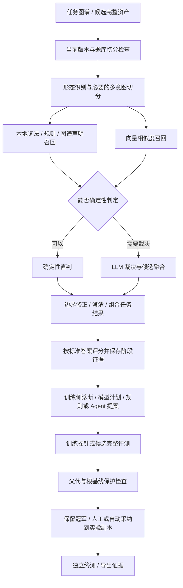

# RSI 全链路审查与问题清单

审查日期：2026-10-23（北京时间）  
任务：`legacy-bank-20261016`  
入口：`http://localhost:17386/ontomind/knowledge/graph/intent-rsi?taskId=legacy-bank-20261016&section=overview`

## 结论与阅读顺序

**目前不能把这套工具认定为“已经证明能稳定、可归因地提高泛化精度”。** 闭环的主要环节已经存在，问题集中在收益归属、评分契约、运行控制、历史证据和用户核查入口。此次确认 **13 项问题：7 项 P1、6 项 P2**；另列 3 项尚需实验验证的风险。没有证据支持把它们夸大成当前任务已发生生产数据损坏的 P0 事故。

需要先纠正一个现状判断：截图时当前 v4 的训练及验证合计成绩已经是 **100%（71 题）**，并非仍停在零提升。但这不是自动进化独立贡献了全部涨分的证据：

| 记录 | 引擎指纹 | 全体完全正确率 | 可以得出的结论 |
|---|---|---:|---|
| v1 | `92bdc2478b32` | 71.8% | 该口径下的初始成绩 |
| v2 | `92bdc2478b32` | 74.6% | 同口径版本变化 +2.8pp |
| v3 | `92bdc2478b32` | 76.1% | 同口径版本变化 +1.5pp |
| v4 | `92bdc2478b32` | 77.5% | 同口径版本变化 +1.4pp；v1→v4 合计 +5.7pp |
| 同一个 v4 | `96eb22c8a159` 等后续指纹 | 90.1%、94.4%、98.6% | 引擎口径变化，不能直接记为图谱进化收益 |
| 同一个 v4 | `c884a96235b0` | 100% | 当前口径成绩；需要同口径对照与独立终测 |

这组数据证明“历史上存在同口径版本涨分”，**没有单独证明该涨分可重复、由具体改动造成、能推广到未见问法**。独立终测 17 题仍未执行，`finalExam.runCount=0`。

建议先读问题总表，再读 R01、R02、R05、R06、R07；它们直接影响“分数能否相信、运行是否可控”。

## 审查范围、方法与证据边界

- 使用 Product Design audit 检查实际部署页面，结合源码、API 快照和隔离复现检查功能。浏览器为本机 Edge / Playwright，复用本会话已使用的方式。
- 实际访问六个页签，保存桌面及手机截图；没有启动新优化、采纳方案、补题、重新评测、运行终测或停止用户正在运行的任务。
- 快照包含 18 个已保存运行和 1 个正在运行的规则实验。正在运行的实验显式配置 `stopOnGoal=false`，因此“已达到 85% 仍在探索”不能直接判定为停止逻辑失效。
- 当前目录存在其他工作的未提交改动，前端也可能由共享工作区的其他构建更新。以本次保存的截图、API 快照和源码哈希为证据，不把整个审查描述成一个不可变部署版本。
- 容器磁盘上的 `intent-rsi`、生产运行器、策略、归因、目标和指纹文件与工作区相应文件哈希一致；没有通过重启验证内存中每个模块的加载版本。
- [API 快照](../reports/intent-rsi-review-20261023/api-snapshot.json)、[任务证据摘要](../reports/intent-rsi-review-20261023/task-evidence.json)、[数据与候选摘要](../reports/intent-rsi-review-20261023/dataset-summary.json)、[源码哈希](../reports/intent-rsi-review-20261023/source-hashes.json)、[代码定位索引](../reports/intent-rsi-review-20261023/source-index.json)。
- 为避免后续共享工作区变化使代码证据消失，另保存 17 份相关源码副本；相对路径和 SHA-256 见[快照清单](../reports/intent-rsi-review-20261023/snapshot-hashes.json)，副本位于同级 `source-snapshot/`。
- 本报告没有沿用 10 月 19 日报告的“没有目标”“门禁要求所有维度完全不退”“模型完全无产出”等旧结论。当前代码和运行记录已经发生实质变化。

## 用户流程检查

| 步骤 | 页面 / 操作 | 检查结果 | 截图 |
|---|---|---|---|
| 1 | 概览：判断当前效果及下一步 | 有任务状态与主操作；累计收益跨口径、谱系初始视野有问题。默认页面约 3314px 高。 | [01 概览](../reports/intent-rsi-review-20261023/01-overview.png) |
| 2 | 配置：了解对象、目标和运行偏好 | 对象及副本范围明确；数字目标没有可见编辑入口，统计显示已出 0 次方案但已采纳 3 个。 | [06 配置](../reports/intent-rsi-review-20261023/06-setup.png) |
| 3 | 题目：核查当前 88 道题及错误 | 实际页面主要提供导入和引擎对照，缺少当前题库及逐题结果浏览。 | [04 题目](../reports/intent-rsi-review-20261023/04-data.png) |
| 4 | 运行：查看方案、测量和失败 | 选定运行、结果汇总和展开明细已存在；运行中样本、重复、失败等仍需进一步统一统计与控制契约。 | [02 运行](../reports/intent-rsi-review-20261023/02-runs.png) |
| 5 | 候选：比较、验证、采纳 | 后端会阻止旧父版本采纳；前端却把此类旧候选引导到无法完成的重新评测路径。 | [03 候选](../reports/intent-rsi-review-20261023/03-candidates.png) |
| 6 | 成绩与交付：检查终测和导出 | 明确提示终测未执行和导出不等于发布；独立泛化证据仍缺失。 | [05 交付](../reports/intent-rsi-review-20261023/05-results.png) |
| 7 | 新运行确认 / 实际启动 | 当前有其他运行，未为审查停止它或启动新实验；本次不把真实启动、收费请求和恢复流程列为浏览器实测通过。 | 限制已记录 |
| 8 | 手机概览 | 390px 视口没有整页横向溢出；主页面仍很长，多个图表和表格需单独滚动。 | [08 手机](../reports/intent-rsi-review-20261023/08-overview-mobile.png) |

浏览器捕获未发现未处理的页面 JavaScript 异常。这不等于功能和无障碍检查全部通过。未完成全键盘流程、屏幕阅读器和完整对比度审计。[捕获日志](../reports/intent-rsi-review-20261023/capture-log.json)。

## 实际链路核对

本次查到的 RSI 评分入口是 `scripts/rsi-engine-score.js → routes/intent-evaluator-v2.js`。不能把其他银行 Agent 的召回架构直接套到这个评分器上。



核对结果：

- **存在多路召回，但不是任意描述中的“三路召回 + 独立学习精排”。** V2 主流程可确认本地词法/规则/图谱声明与向量两类结果，随后选择直接判定或 LLM 裁决、边界修正。没有在这个主流程里发现单独调用的学习式 reranker。`evaluateSingleIntentPipeline` 约 4014–4083 行。
- **LLM 并非每次都做最终裁决。** 当前代码允许 `deterministic_agree`、`deterministic_declared_exact` 等直判。归因不能一见错题就认定“LLM 判错”，必须先看实际 decision mode。
- **阶段证据已进入模型上下文。** `rsi-reasoning.js` 保存召回、决策与澄清观察；规划只选择训练侧案例，计划、训练对照、反思有契约校验。不能再说完全没有归因与反馈链。
- **候选测量与采纳有程序权威。** 完整候选冻结、版本/资产/题库/切分/指纹校验、父代与根基线检查已经存在。模型不能自行改分或决定发布。
- **模型、规则和 Agent 路径的验证过程不同。** 模型实验有显式小样本探针，规则候选可以直接完整评测，Agent 有工具探针。页面不能把所有模式都画成完全相同的五个必经阶段。
- **采纳与生产发布分离。** 当前导出 manifest 标记 `productionPublished=false`；运行期参数/提示词依赖候选资产环境，外部系统上线需要独立集成。报告没有发现工具在采纳时自动发布生产。

上述是“链路实现和约束存在”的确认，**不是对各路召回质量、裁决正确率和泛化效果的整体背书**。

## 问题总表

P1：应优先修复，会破坏关键判断、运行控制或核心核查流程。P2：重要的历史兼容、操作指引、统计和体验问题。

| 编号 | 级别 | 问题 | 证据类型 |
|---|---|---|---|
| R01 | P1 | 跨引擎成绩仍被计算成累计进化收益 | 页面 + API + 源码 |
| R02 | P1 | 负例导入与评分契约冲突，旧负例语义也不安全 | 隔离复现 |
| R03 | P1 | 当前题库和逐题结果没有完整的用户核查入口 | 页面 + 源码 |
| R04 | P1 | 目标支持部分得分率，但达标题数、晋升和停止仍混用完全正确率 | 隔离复现 + 源码 |
| R05 | P1 | 重复投票可以突破完整评测次数上限 | 隔离复现 |
| R06 | P1 | 停止并行评测只取消最后一个控制器 | 隔离复现 |
| R07 | P1 | 评测指纹没有覆盖实际依赖的 FAQ 数据和模型路由配置 | 隔离复现 + 源码 |
| R08 | P2 | 旧分支仅有简写成绩时，策略学习用当前基线替代历史父代 | 隔离复现 |
| R09 | P2 | 旧父版本候选被引导重新评测，但后端必然拒绝 | 页面 + API + 源码 |
| R10 | P2 | 运行统计仍读取旧计数器，出现 0 个提案与几十个候选并存 | 页面 + API + 源码 |
| R11 | P2 | 谱系默认视野中没有节点，“适应画布”也未展示完整图 | 浏览器交互复现 |
| R12 | P2 | 参数校验已改成截断修正，对应回归测试仍要求抛错 | 实际测试失败 |
| R13 | P2 | 数字验收目标与业务目标模板没有清晰连通 | 页面 + 源码 |

### R01 · 跨口径累计收益归属错误

**现象与复现：** 打开概览，可以同时看到“评测口径不同，不连线比较”和“累计 +28.2pp”。题型拆解还把旧引擎的歧义题 12.5% 和当前引擎的 100% 算为 +87.5pp。

**根因：** `RsiTaskOverview.tsx` 的 `FormalTrendChart` 在约 27 行直接做最后减最初；线段可比性只在绘图时判断。`ShapeBreakdown` 和 `IterationLineage` 另算自己的差值，未统一校验上下文。`sameEngine` 只核对 SHA 与 mode，遗漏 `protoRev`、题库与切分；另有“当前生产版本”字样，把实验固化版本说成生产版本。

**影响：** 无法回答“模型进化究竟带来了多少收益”，人工改引擎产生的涨分会混入版本进化主叙事。不能因当前得分 100% 就声称 RSI 自动进化贡献 +28.2pp。

**建议修复与验收：** 统一比较函数，核对资产、engine SHA、协议、模型配置、题库、切分；跨口径取消累计增益及题型差值。将“同引擎资产变化”和“同资产引擎变化”分开呈现。对本任务应保留旧同口径 +5.7pp 的事实，把跨口径部分标为不能直接归因。旧资产也可在当前引擎下重新对照，但不应自动为此启动收费评测。

证据：[概览截图](../reports/intent-rsi-review-20261023/01-overview.png)、[任务证据](../reports/intent-rsi-review-20261023/task-evidence.json)；源码 `RsiTaskOverview.tsx:14,27,102,156,353`。

### R02 · 负例导入成功，评分却无效

**复现：** `negative_intent` 加 `expected_intents: []` 能通过 `normalizeCases`，但 `scoreEngineCase` 立即返回 `invalid_gold`，一次识别调用都没有发生。完整评分脚本把该错误计入 `engineErrors`，运行器会拒绝这份测量，因而可连带使含负例的完整评测失效。

另一个旧格式问题：如果为了绕过校验给负例填写 `expected_intents: ['blocked']`，预测成另一个业务意图 `another_business_intent` 会被记为 `strict=true`。这不是通常“域外问法应拒识”的负例定义。

**根因：** 导入定义负例答案必须为空；`validateGold` 却统一要求非空；负例评分又把 expected 当成“禁止命中的列表”。三处语义不同。

**影响范围：** 当前 88 道题没有负例，因此不能把当前失败全部归因于此问题；但工具宣称支持四种题型，任何新增负例任务都会触发。

**建议修复与验收：** 明确域外拒识和“不能命中指定意图”是否为不同题型，统一导入、评分、模板和训练反馈契约。用空答案的合法负例贯穿导入、基线、候选、终测：拒识正确；乱命中任一业务意图失败；不再产生 `invalid_gold`。

证据：[复现 R02 两项](../reports/intent-rsi-review-20261023/reproductions.log)；源码 `rsi-task-dataset.js:28`、`rsi-case-scoring.js:20,237`。

### R03 · 用户无法核查当前题目和逐题结果

**现象与复现：** 概览显示已有 88 道题，点击“查看评测与题目”却进入一个以“准备评测题目”为主的导入页面。看不到现有题目的切分、期望答案、预测、是否完全正确、召回/裁决证据，以及版本前后变化。

**根因：** `RsiDataPreparation` 的表格只预览将要导入文件的前 5 题；当前 `data` 页接入该组件和引擎对照，没有当前任务逐题核查界面。

**影响：** 用户不能判断 100% 是题目太像声明、答案本身有问题，还是引擎真正改善。发现错判后也无法在正常页面完成“找到题 → 看证据 → 纠正数据/指定后续实验”的闭环。运行中的少量探针明细不能替代当前题库浏览。

**建议修复与验收：** `data` 默认显示当前训练/验证题清单，支持题型、正误、版本变化筛选，展开期望/预测/阶段证据；导入作为次级动作。终测保持封存，不能为了补一个浏览表就把隐藏标准答案交给优化器。一个当前训练错题须能从概览在两次操作内找到并核对。

证据：[题目页面](../reports/intent-rsi-review-20261023/04-data.png)、`RsiDataPreparation.tsx`、`RsiEvolutionPanel.tsx:843`。

### R04 · 目标指标没有贯穿判定层

**复现：** 设置 `metric=relaxed_pct`、目标 85%，传入当前 relaxed=90%、strict=50% 的两题结果，`goalProgress` 同时返回 `met=true` 和 `missingCases=1`。

**根因：** `goalProgress` 按配置指标读取 `current`，却按 `row.strict` 统计正确题数；`gateReport`、`trainingBetter` 和循环中的达标停止比较仍以 strict 为主。API 接受的两种指标并没有完整兑现。

**影响范围：** 当前任务设置 strict，因此这个复现不代表当前 100% 的计算错误；切换到 API 明确允许的 relaxed 目标后，进度、晋升和停止可能相互矛盾。

**建议修复与验收：** 若产品当前只支持完全正确率，就拒绝 relaxed 验收目标；若支持，应统一进度、选择、门禁与停止语义。部分得分率的缺口不能伪装为整数“还差几道完全正确题”。用 strict 不变、relaxed 改善的用例验证完整决策。

证据：[复现 R04](../reports/intent-rsi-review-20261023/reproductions.log)；源码 `rsi-goal.js:91,98,99,182,204`，`rsi-production-runtime.js:931,940,948,968`。

### R05 · 重复投票超过评测预算

**复现：** 在隔离运行器中保留有效基线，设置完整评测上限 2、`repeatVotes=5`，只产生一个候选；结果实际执行 5 次模拟测量，`run.metricCalls=5`。

**根因：** 进入候选前检查 `calls >= limit`，进入后直接执行 `calls += repeat - 1`，没有为整组投票预留预算。

**影响：** API 的评测次数上限不是硬上限。默认 repeat=1 的页面运行未因此被证明超支；支持的重复评测配置会触发。

**建议修复与验收：** 在启动整组投票前原子预留所需调用次数；不足就明确跳过，或使用产品定义的较小完整投票组并记录实际票数。任何并发与 repeat 组合都必须满足实际次数 ≤ 上限，不得先执行后计超支。

证据：[复现 R05](../reports/intent-rsi-review-20261023/reproductions.log)；源码 `rsi-production-runtime.js:676,731,753`。

### R06 · 并发评分的停止信号不完整

**复现：** 隔离运行器同时启动 3 份投票评分，发出 stop 后只有 1 个收到 abort，另外 2 个在停止之后正常完成。复现使用模拟评分，没有请求模型。

**根因：** `scoreRepeat` 用 `Promise.all` 并行评分；每个 `score` 都覆盖同一个 `activeAbort`；`stop()` 只取消最后保存的控制器。规则分支并行评分也使用这个全局单引用设计。

**影响：** 页面显示停止后，先启动的其他评分仍可能运行并产生用量；`Promise.all` 先失败也不自动取消兄弟任务。这不是停止按钮的视觉问题。

**建议修复与验收：** 使用运行级父信号和活动子任务集合，停止时取消所有子进程、模型请求及 Agent 请求，并等待资源收尾。并发数 1/2/4、repeat 1/3/5 下验证所有已启动任务都收到取消，不再创建新任务。

证据：[复现 R06](../reports/intent-rsi-review-20261023/reproductions.log)；源码 `rsi-production-runtime.js:193,204,240,290`。

### R07 · 指纹没有覆盖全部影响识别的依赖

**复现：** 用隔离目录构造同样的五个指纹源码输入，再修改 FAQ seed 与模型路由配置，`engineRevision` 返回相同 SHA。

**根因：** 指纹只散列列出的五个源码文件、部分环境变量及在线/离线标记。V2 实际读取的 `data/graphs/intent-faq-seed.json` 和默认模型路由配置不在集合内，也没有把网关实际解析后的模型身份完整固化。

**影响：** 当这些依赖改变而显式环境变量未改变时，旧基线、缓存、检查点和采纳证据可能被误认成同口径。此项证明了校验缺口，没有证明本次任务已实际发生相应依赖漂移。

**建议修复与验收：** 将影响预测的外部数据及无密钥模型配置摘要纳入不可变评测上下文；记录实际模型标识、网关路由版本和缓存版本。改变任一相关依赖后，freshness、候选采纳、恢复及跨版本比较都必须失效；密钥值不能写入指纹或报告。

证据：[复现 R07](../reports/intent-rsi-review-20261023/reproductions.log)；源码 `rsi-engine-revision.js:8,14`，`intent-evaluator-v2.js:22,29,1686`。

### R08 · 历史父代丢失时，策略学习读错参照

**复现：** 历史父代仅保存简写 `trainStrict=70`，子代 75，当前基线 90；策略摘要把这次真实 +5pp 的变化记成 `gainSum=-15`。候选状态为 alive 时又会计 1 次 win，形成内部矛盾。

**根因：** `rsi-strategy.js:155` 只读历史父代的 `fullScores.train.strict_pct`，缺失就直接回落当前任务基线，没有读取父代简写 `scores.trainStrict` 或拒绝未知比较。

**影响范围：** 这是简写历史记录的兼容缺陷；不能据此断言当前所有策略臂都已污染。错误参照会影响经验收益摘要和后续策略排序/解释。

**建议修复与验收：** 依次读取同运行的完整父代与简写父代证据；没有可比父代时保留为未知，绝不借用当前基线。当前基线从 90 改为 95 时，同一历史动作的收益仍须是 +5，或明确无法判断。

证据：[复现 R08](../reports/intent-rsi-review-20261023/reproductions.log)；源码 `rsi-strategy.js:155–164`。

### R09 · 旧父版本候选没有可走通的处理路径

**现象：** 当前唯一 passed 待处理候选 `run_bca88823f86fa234_b4` 来自 v1，当前为 v4，后端 `adoptability.ok=false`。候选页仍提示展开后重新评测可刷新证据；展开卡主要给出“重新复核”。

**根因：** 前端把引擎过期、题库过期和父资产变化合并成一类 stale。后端 `evaluate()` 对父版本或父资产变化会在评分之前直接抛错；重新复核使用的也是这条执行路径。

**影响：** 用户按提示点击不能完成操作，待审阅数量持续阻碍概览推荐。不能通过简单重测把一个旧父代候选变为当前父代候选。

**建议修复与验收：** 区分可重测与必须基于当前资产重新生成的状态。后者提供“基于当前版本重新提出”或归档/拒绝，并重新测量完整结果；无对应能力时直说原因并禁用无效操作。用本任务 v1 候选验证不再引导到必失败按钮。

证据：[候选截图](../reports/intent-rsi-review-20261023/03-candidates.png)、[待处理候选摘要](../reports/intent-rsi-review-20261023/dataset-summary.json)；源码 `RsiCandidatesTable.tsx:150–159`、`RsiCureCard.tsx:199–216`、`rsi-production-runtime.js:1007`。

### R10 · 运行统计仍绑定旧计数器

**现象：** 顶部和配置页显示“已出 0 次方案”，运行统计为模型请求 0/0，实际快照有 53 个 archive 条目、53 个 evaluated、4 个 passed 和 3 个 adopted。模型历史运行也明确记录了非零 `modelCalls`。

**根因：** 界面仍用 `state.stats.proposeRuns / llmCalls / proposalsTotal` 等旧环统计；生产多代环主要更新 evaluated/passed，模型请求另存每个 run 的用量。多个统计源没有统一口径。

**建议修复与验收：** 使用可重算的运行证据派生统计，分别标注生成候选、完成完整评测、模型规划请求、识别请求、跳过和失败。未知值显示未知。对当前快照不能再显示“零产出”或“零模型调用”。

证据：[运行截图](../reports/intent-rsi-review-20261023/02-runs.png)、[统计快照](../reports/intent-rsi-review-20261023/dataset-summary.json)；源码 `RsiEvolutionPanel.tsx:472,725–728`。

### R11 · 谱系默认视野为空，缩放下限阻止全貌适配

**浏览器复现：** 概览谱系有 128 个 DOM 节点，但默认 1092×478px 的图内可见节点数为 0；点击“适应画布”后仅 9 个可见；点击“定位胜出分支”才滚动到有 22 个节点的区域。节点数随现有实验进度可能变化，不是静态 fixture 数量。

**根因：** DAG 自动缩放最低 60%，显式 fit 最低 40%，并回到左上角，而布局坐标远大于可视区。多层次布局的有用节点不保证出现在左上角。

**影响：** 页面占用近半屏的大图看似没有数据，用户需要自行猜测缩放、平移和定位操作；“适应画布”名称与行为不一致。

**建议修复与验收：** 初始聚焦当前版本和相关路径，或在概览只显示有意义的子图；完整图按需打开。fit 必须真正按完整边界适配，文字可读性另由“局部阅读”控制。初次打开本任务须有可见的版本/分支节点，不需要先发现隐藏定位操作。

证据：[默认视野](../reports/intent-rsi-review-20261023/09-dag-default.png)、[点击适应后](../reports/intent-rsi-review-20261023/10-dag-fit.png)、[DOM 与交互记录](../reports/intent-rsi-review-20261023/dag-observation.json)；源码 `RsiTrajectory.tsx:201–220`。


### R12 · 现有回归未与新的参数容错契约同步

**实际结果：** 本次运行 9 个相关后端测试文件，120 项中 119 通过、1 失败。失败为 `rsi-reasoning.test.js` 的 `plan rejects hidden case references, unknown parents, unsupported targets and unsafe parameters`。

**根因：** 该测试还要求 `clarificationLimit=999` 抛错；当前 `validatePlan` 已改为对合法数值参数截断到允许范围，并保存 `parameterNotes`。不是隐藏题引用检查被证明放开，也不能把这一项直接称为越权漏洞。

**建议修复与验收：** 明确选择拒绝还是纠正的产品契约，并相应调整测试。若保留截断，应校验修正后值、修正备注、执行资产与展示计划一致，同时单独保持隐藏题、未知父代和未授权路径的拒绝测试。不能为了让测试绿而删除整组约束断言。

证据：[真实测试日志](../reports/intent-rsi-review-20261023/tests-backend.log)；源码 `tests/rsi-reasoning.test.js:12–14`、`rsi-reasoning.js:158–182`。

### R13 · 业务目标模板没有连接到数字验收目标

**现象：** 概览使用真实 `state.goal.target=85`，配置页与新运行目标选项却是“整体提升、少漏识别、先澄清”等模板；当前前端没有对应的 `/goal` 更新调用。模板实际只改算子范围和连续无提升停止轮数。

**影响：** 用户难以区分“这轮重点改善哪类错误”和“任务达到什么标准算结束”。通过页面不能清楚设置 90% 等验收目标，也看不到目标指标、最小效应和停止策略的完整关联。

**建议修复与验收：** 把任务验收目标与本轮实验重点分开；在任务配置中呈现、编辑并保存受支持的数字目标，启动确认展示本轮冻结的目标和停止策略。业务模板不能让人误以为它已经修改了后台的 85% 验收线。刷新后目标须与 API 完全一致。

证据：[配置页](../reports/intent-rsi-review-20261023/06-setup.png)、[概览](../reports/intent-rsi-review-20261023/01-overview.png)；源码 `rsiGoalTemplates.ts`、`RsiEvolutionPanel.tsx`、`rsi-production-runtime.js` 的 `/goal`。

## 尚需实验验证的风险

这些是当前不能签字确认的环节，不和已复现缺陷混在一起计算。

| 编号 | 风险 / 缺口 | 已知证据 | 还需怎样验证 |
|---|---|---|---|
| V01 | 收益稳定性没有得到当前审查证明 | 默认 `repeatVotes=1`；候选可走“修题且零破坏”晋升通道，单次涨题不等于可重复收益 | 固定资产、引擎、模型路由及题库，对基线和冠军分别重复测量，保存配对变化及方差；重复评测先修 R05/R06 |
| V02 | 泛化与覆盖不足 | 训练涉及 38 个意图，验证涉及 25 个，14 个训练意图未被验证覆盖；验证中 20 个意图只有 1 题；当前 88 题没有负例；17 题 test 从未测量 | 先修负例契约，再补真实独立变体、按问法族去重/分组切分；冻结方案后人工运行终测。不要直接移动现有 test 到训练侧 |
| V03 | 结果类型归类不等于因果归因 | `diagnoseError` 主要按 `resultType` 分族；模型拥有阶段观察和可证伪假设，但不是每次运行都保存了“假设→仅改该机制→对照→证伪/确认”的完整证据 | 抽查真实错题：区分未召回、排序、直判、LLM、澄清及组合阶段；用相同模型条件做最小反事实，不靠提示词的自述宣布根因成立 |

关于 V02：25 个验证意图包含训练外意图，因此 `38-25` 不等于未覆盖数，未覆盖 14 来自集合差。数据计算没有把 test 题暴露给优化器。

## 建议的修复顺序与验收门槛

1. **先让证据可信。** 修 R01/R02/R04/R07，统一成绩比较、题型与目标契约；完成 R03 的训练/验证逐题核查入口。任何“提升”都能定位到同口径资产比较和题目变化。
2. **再让运行可控。** 修 R05/R06，验证次数硬上限、停止所有子任务、预算不足和失败回收。使用模拟服务先验收，不把真实模型费用当回归测试成本。
3. **修历史与操作闭环。** 修 R08/R09/R10/R13，保证策略学习不借当前分数给历史贴标签，旧候选有可执行的处理动作，统计和目标与后台一致。
4. **收敛展示与回归。** 修 R11/R12；概览保留当前可信效果、距目标缺口、当前运行和下一步，把全量图与技术细节放进按需入口。
5. **最后证明收益。** 在冻结的同口径条件下对比基线与候选，做稳定性测量，再人工执行独立终测。报告分别写“训练收益、验证收益、独立终测、未覆盖范围”，不能只写一个总精度。

整体验收应至少包括：合法负例能完整评分；所有收益具有一致上下文；预算不超限；停止后没有遗留评分；历史策略不随当前基线改变；旧候选不会落入必失败操作；用户能查看当前逐题证据；目标配置能够贯穿判定和刷新恢复。

## 本次验证清单与复现方法

### 后端现有回归

从仓库根目录运行：

```powershell
node --test tests/rsi-quality-contract.test.js tests/rsi-goal.test.js tests/rsi-strategy.test.js tests/rsi-reasoning.test.js tests/rsi-optimization.test.js tests/rsi-production-runtime.test.js tests/rsi-agent-mode.test.js tests/rsi-model-loop.test.js tests/rsi-task-storage.test.js
```

结果：120 项，119 通过，1 失败，详见 R12。不把这个结果表述成“后端全部通过”。

### 隔离问题复现

```powershell
node --test reports/intent-rsi-review-20261023/reproductions.test.cjs
```

7 项复现断言通过，覆盖 R02 两种负例语义、R04、R05、R06、R07、R08。**这些断言通过表示问题仍能复现，不表示修复通过。** 脚本注入模拟评分，临时目录经路径校验后清理，不修改真实任务、不调用模型服务。

### 前端与浏览器

- 前面界面调整对应的 33 项模型/视图逻辑回归通过，TypeScript 检查通过；这不是此次所有新增审查结论的端到端验收。
- 本次重新捕获六个部署页签与手机概览，页面异常列表为空；复现默认 DAG 视野及 fit/focus 行为。
- 前面启动弹窗在手机尺寸下的确认按钮可见性自动检查未通过，尚未完成原因复查；不作为已确认线上缺陷，也不宣称该弹窗手机验收通过。
- 本次没有重启服务或主动发布新构建，没有把其他会话正在运行的优化结果算作本次审查产出。

本报告交付的是可追溯的问题文档与复现证据。以上为原审查时点的结论，后续状态见下方修复记录。

## 2026-10-26 修复记录

保留上面的原始证据与失败日志，不用新的通过结果覆盖原审查事实。

| 问题 | 已实施修改 | 验证及边界 |
|---|---|---|
| R01 | 固定引擎的资产版本增益要求完整一致的评测条件；新增协同实测轨迹用不同线型保留引擎变化，题库/切分/评分协议变化仍断线 | 71.8→100 可显示为资产与引擎共同变化的历史观测，不能写成纯图谱或纯引擎收益；细化说明见下方链接 |
| R02 | 负例统一为空 `expected_intents`，禁止旧排除名单和业务任务；弱召回本身不算错误，业务裁决/任务/选项命中才违反拒绝 | 三项新增评分回归；前端原生负例导入一致 |
| R03 | 新增只读 `/case-review` 与当前逐题列表、历史运行对比及阶段证据抽屉 | 后端隔离任务的 HTTP 测试验证终测封存；旧测量缺少阶段记录时明确未知 |
| R04 | 验收只接受 `strict_pct`，显式拒绝不受支持的 relaxed/未知指标；迁移旧默认，保留 relaxed 辅助展示 | 目标与运行器回归覆盖 |
| R05 | 候选重复测量组原子预留预算；失败也占用实际预留，余量不足不发起半组 | 模拟评分验证总次数上限；基线仍为既有单次测量，稳定性不因此获证 |
| R06 | 注册并取消全部并发控制器、子进程与重复评分；退出前等待清理，不做隐藏超时重试 | 并发停止、超时、失败清理回归覆盖 |
| R07 | 指纹纳入 FAQ、运行/评分依赖、模型路由非秘密配置；不执行配置 getter，不把凭证放入哈希输入 | 指纹变更与凭证排除回归；引擎协议仍为 3，API 状态修订为 7 |
| R08 | 历史父代只使用自身保存的完整/紧凑读数；缺失则未知，不借当前基线 | 历史父代与策略折叠回归覆盖 |
| R09 | 旧父代候选禁用必失败的重评/复核，提供基于当前版本重新生成及拒绝入口 | 视图回归覆盖可用/禁用动作 |
| R10 | 从去重后的运行、分支与档案重算候选、完整评测、采纳等统计 | 活动统计回归覆盖活动快照去重、档案回退；不以统计数证明效果 |
| R11 | 概览按运行显示并适应画布，完整谱系可切换；修正 fit 最小缩放限制，保留局部阅读与展开 | DAG 边界与视图检查；全任务缩略图仍需局部阅读查看小节点 |
| R12 | 依现有截断契约检查修正值和备注，保留隐藏题/未知父代/未知目标等拒绝断言 | 原失败参数测试修复，相关后端回归通过 |
| R13 | 任务配置新增数字完全正确率目标、最小效应和 alpha 保存；与本轮搜索重点分开，启动确认显示任务目标 | 后端目标契约、类型检查及配置入口验证；浏览器验收未修改真实目标 |

任务概览同时按“结果摘要—正式版本趋势/题型—业务任务—运行 DAG/代际柱状图—按需历史”的结构重做，详见 [概览设计与验收](intent-rsi-overview-2026-10-26.md)。

用户补充引擎也应作为演进对象后，趋势进一步支持[资产与引擎协同演进](intent-rsi-joint-evolution-2026-10-26.md)。实际 v4 历史包含资产与引擎共同变更，页面按真实指纹分类，避免把全部变化归给单一因素。

修复回归为后端 **149/149**、前端逻辑 **50/50**、视图和业务分组 **24/24**；TypeScript 与生产构建通过。部署及浏览器检查证据归档于 `reports/intent-rsi-remediation-20261026/`。原七项复现脚本用于复现旧缺陷，不能代替修复后的验收测试。

**未关闭的效果风险：** V01–V03 仍然成立。没有启动收费模型运行来验证界面；当前历史 100% 在新指纹下显示待重测，17 道终测保持封存。不能把运行契约及界面修复等同于“已经证明精度持续提升”，也不能据此承诺整个引擎链路已经完成因果验证。
