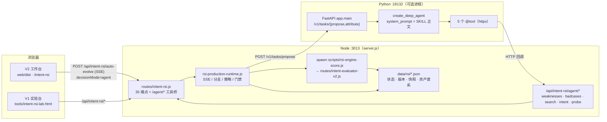

# RSI V2 架构说明 — Agent + Skill 完整链路

> 本文是 `graph-builder` 独立部署版 1.1 的 RSI 子系统架构记录。端点字段以 [API 参考](api.md) 为唯一权威，本文只讲链路、职责边界与设计取舍。

## 这是什么

**RSI** 是 **Recursive Self-Improvement（递归自我改进）** 的缩写。openJiuwen 2026 年 9 月发布的双维度 RSI 框架把它定义为「从真实任务反馈中生成改进方案、执行验证、保留有效改进」的工程框架，分 **Harness 优化**（提示词、技能、工具、执行约束）与 **Artifacts 优化**（具体交付物）两个方向，已在 WorkSwarm 的「实验」模式落地（[中国日报报道](https://cn.chinadaily.com.cn/a/202609/14/WS6aa7b4d1e4b09a165c789ef1.html)、[openJiuwen Agent Platform](https://openjiuwen.com/)）。

本仓库把这套思路收窄到**一个优化对象：意图图谱**。闭环是「用评测题库考出图谱弱点 → 生成改进提案 → 同一引擎复测 → 四关门禁 → 采纳或回滚」，每个版本的资产、成绩与引擎指纹都落盘可查。它不追求通用自我改进，代价见[设计决策](#设计决策与代价)。

**V2 的关键结论**：`routes/intent-rsi.js`（202 KB）与 `routes/rsi-production-runtime.js`（175 KB）是**调度 / 持久化 / 测量 / 门禁层**，不是推理主体。提案与归因的大脑在 `services/rsi-agent/` —— 一个独立 Python 进程里的 openjiuwen DeepAgent。V1 才是 Node 内的 `rules|model` 决策。

## 名词表

| 名词 | 含义 |
|------|------|
| **DeepAgent** | openjiuwen 的 Agent 构造入口 `create_deep_agent(model, card, workspace, system_prompt, tools, enable_task_loop, max_iterations, …)`。本仓 `app/agent_factory.py:96-110` 用它建实例。 |
| **Agent Skill** | Anthropic 定义为「organized folders of instructions, scripts, and resources that agents can discover and load dynamically」，入口是带 YAML frontmatter 的 `SKILL.md`，靠 progressive disclosure 按需加载（[官方工程博客](https://www.anthropic.com/engineering/equipping-agents-for-the-real-world-with-agent-skills)）。本仓的 `SKILL.prompt` 属同一类「把领域指令作为资源包交给 Agent」的实践，实现方式不同。 |
| **SKILL.prompt** | `services/rsi-agent/skills/{proposal,attribution}/SKILL.prompt`，分别驱动提案与归因两类任务。正文被剥掉 frontmatter 后注入 Agent 的 `system_prompt`。 |
| **工具桥** | Node 侧 `/api/intent-rsi/agent/*` 五个只读端点，供 Python Agent 回读 RSI 状态；Agent 本身不持有 `rsi-state.json`。 |
| **probe_query** | 反事实探针：把候选草案真应用到评测引擎上复测，用工具反馈验证提案，而不是靠 prompt 纪律保证闭环。 |
| **引擎指纹（EngineRev）** | `engineSha + protoRev + engineMode` 三元组。跨指纹的历史成绩不可比；采纳前要求三关成绩、引擎复核与当前指纹一致。 |
| **四关门禁** | 练习题初筛 → 防回退 → 隐藏考 → 生产引擎复核。前端 `web/src/pages/IntentRsiEvolution/rsiShared.tsx:canAdopt()` 与后端 `runAdopt` 逐条对齐。 |
| **决策模式** | `rules`（V1，Node 内规则 + LLM）、`model`（Node 内 LLM）、`agent`（V2，Python Agent 提案）。 |
| **RSI_DIR** | RSI 数据根目录，默认 `data/rsi`，可由 `INTENT_RSI_DIR` 覆盖。 |

## 进程拓扑

| 组件 | 位置 | 职责 | 是否持有状态 |
|------|------|------|--------------|
| V2 工作台 | `web/dist/`（源码 `web/src/pages/IntentRsiEvolution/`，34 文件） | 任务管理、自动进化 SSE、候选对比、谱系 DAG、成绩轨迹 | 否，只缓存 ETag |
| V1 实验台 | `tools/intent-rsi-lab.html` | 直接查看 `/state`、`/baseline`、`/propose` 等原始响应 | 否 |
| RSI 路由 | `routes/intent-rsi.js` | 35 个端点（状态/基线/提案/评测/采纳/回滚/任务/校准…）+ `/agent/*` 工具桥 | **是**，`rsi-state.json` 与任务目录 |
| 进化运行时 | `routes/rsi-production-runtime.js` + 20 个 `rsi-*.js` | 自动进化循环、多分支策略、测量策略、资产谱系、采纳门禁、SSE 事件流 | 是 |
| 评测引擎 | `routes/intent-evaluator-v2.js`（274 KB）+ `scripts/rsi-engine-score.js` | 独立子进程按 `--graph/--cases/--out` 打分，输出带引擎指纹 | 否 |
| Python Agent | `services/rsi-agent/`（13 个源码/配置文件） | DeepAgent 提案与归因，5 个 HTTP 工具 | **否**，状态全在 Node |

**依赖闭包实证**：`routes/intent-rsi.js` 顶部 24-34 行只 require Node 内置模块 + `../config/api-keys` + 11 个本地 `rsi-*.js`；二级/三级互相引用（`rsi-production-runtime` → `rsi-optimization` → `rsi-learning`/`rsi-strategy`/`rsi-run-evidence`/`rsi-evolution-trace`…），因此**必须整包搬 20 个 `rsi-*.js`**，只搬顶部 11 个会在评分子进程里崩。整条 Node 闭包**零 npm 第三方依赖**。另需 `routes/intent-evaluator-{v2,graphs,park}.js` 支撑 `spawn` 的评分/校准子进程。

## 三种决策模式

| 模式 | 提案来源 | 需要 Python Agent | 需要模型密钥 | 典型入口 |
|------|---------|------------------|--------------|---------|
| `rules` | Node 内注入的 `propose` 服务（规则 + 可选 LLM） | 否 | 部分算子需要 | V1 实验台、`/propose` |
| `model` | Node 内 LLM 调用 | 否 | 是 | V1 实验台 |
| `agent` | Python DeepAgent + SKILL.prompt | **是**（:18132） | 是（Agent 侧） | V2 工作台 `/auto-evolve` |

运行时 `routes/rsi-production-runtime.js:954` 会早期校验：`rules` 模式未注入 `propose` 函数时直接抛 400，避免静默回退到 LLM 路径导致提案格式不符、进化全部 `no_adopt`。这条校验正是源仓 13 个历史测试失败的根因（测试 fixture 仍传 `propose: undefined`）。

## 一次 agent 模式闭环

1. 工作台发 `POST /api/intent-rsi/auto-evolve`，body 带 `decisionMode:'agent'`，`Accept: text/event-stream`；Node 通过 SSE 持续推事件。
2. `rsi-production-runtime.js:1391` 组装 payload（含 `tool_ctx:{taskId, branch}`）调 Agent 的 `POST /v1/tasks/propose`。
3. Agent 按 SKILL 指令用 `list_weaknesses` / `list_badcases` / `search_intents` / `inspect_intent` 调研，再用 `probe_query` 把候选草案真应用到引擎做反事实复测，验证后才交卷（`max_iterations=56`）。
4. 节点的 `/agent/*` 工具桥把请求映射到只读状态查询；`probe` 会走一次草案级评测。
5. Node 拿到提案后 `spawn` `scripts/rsi-engine-score.js`，评测子进程加载 `intent-evaluator-v2.js`，按模板 `template.intent.v2.json` 的 schema 常量打分，输出 `engineRev`。
6. Node 跑四关门禁，校验引擎指纹一致性、练习题净收益、防回退与隐藏考，通过才写版本链；否则记 `gated` 并保留证据。
7. 全程测量在服务端，**不经过模型**；模型只负责提出候选，不负责判定收益。

## 工具桥契约

| Agent 工具 | 回调端点 | 用途 |
|-----------|---------|------|
| `list_weaknesses` | `/api/intent-rsi/agent/weaknesses` | 当前失败族与错题摘要 |
| `list_badcases` | `/api/intent-rsi/agent/badcases` | 坏例明细 |
| `search_intents` | `/api/intent-rsi/agent/search` | 意图检索 |
| `inspect_intent` | `/api/intent-rsi/agent/intent` | 单意图详情 |
| `probe_query` | `/api/intent-rsi/agent/probe` | 反事实探针：真应用草案 + 引擎复测 |

实现见 `services/rsi-agent/app/tools.py:111-190` 与 `routes/intent-rsi.js:3223-3232`。无运行中的 Agent 代次时这些端点返回 500「Agent 工具桥未开放」，属预期降级，不是故障。

Agent 侧还暴露 `/health`、`/v1/skills/{task_type}`、`/v1/rsi/status`、`/v1/rsi/prompt-current`、`/v1/rsi/optimize-prompt`、`/v1/rsi/analyze`、`/v1/rsi/experience/*`（`app/main.py:188-258`），用于 Skill 热查与 prompt 层优化。

## 测量与门禁

- **引擎指纹**：`routes/rsi-engine-revision.js` 用引擎文件 sha + 协议版本 + `online|offline-deterministic`（+`decl`）生成 `engineMode`。成绩跨指纹不可比。
- **四关**：练习题初筛（有净收益）→ 防回退（历史已修用例不许再错）→ 隐藏考（heldout 全程不参与拟合）→ 生产引擎复核（第四关，带指纹）。前端 `canAdopt()` 与后端 `runAdopt` 逐条对齐，避免「按钮亮着、后台拒绝」。
- **降级作废**：`rsi-production-runtime.js:433,550` 检测到 `evidence.decision.mode === 'degraded_fusion'` 或召回通道 `status:'error'` 时抛错「模型或召回通道调用失败/降级，本次测量不作为方案收益或无收益的证据」。**无密钥时评分子进程能跑完打分，但 `/baseline` 会返回 400**——这是正确的测量策略，不拿降级数据当证据。
- **离线口径**：`offlineChildEnv()`（`intent-rsi.js:2218`）把 `QWEN_KEY`/`DEEPSEEK_KEY`/… 强制清空，让校准子进程走确定性引擎；`childEnv()` 再按需注入 key。

## Skill 机制与代价

Anthropic 的 Agent Skills 以 `SKILL.md` + YAML frontmatter 为入口，靠 progressive disclosure 分三层加载：启动时只把 `name`/`description` 放进 `system prompt`，判断相关后才读正文，再按需读引用文件；因此可捆绑的上下文「近乎无界」。

本仓库不同：

1. **扩展名是 `.prompt`**：openjiuwen.harness 加载后会按扩展名注册 parser 接管 `.md`/`.txt`/`.json` 访问，workspace 之外的读取被拦截。`config.py:13-33` 的 `preload_skill_texts()` 在 import openjiuwen 之前用标准库预读 SKILL 正文、剥掉 frontmatter。
2. **正文烧录进镜像**：`app/skill_texts.py` 由 `gen-skill-texts.js` 生成，`ATTRIBUTION_SKILL` / `PROPOSAL_SKILL` 是 Python 常量；`agent_factory.py:32-45` 的 `load_skill_prompt()` 优先用预加载文本，其次读文件，最后用内置兜底。Dockerfile 仍 `COPY skills ./skills` 保留可读源。
3. **正文全量作 `system_prompt`**：`agent_factory.py:100` 把 SKILL 正文直接传给 `create_deep_agent`，不是按需加载。

**代价**：放弃 progressive disclosure 的上下文扩展性；改 Skill 必须重跑 `gen-skill-texts.js` 并重建镜像。**收益**：规避 WSL2 bind mount 文件系统视图陈旧与 harness 的 parser 接管，容器里指令加载确定可靠。

## 数据契约

`data/rsi/`（`INTENT_RSI_DIR` 可覆盖），全部 JSON 文件、无数据库：

| 路径 | 用途 | 入库 |
|------|------|------|
| `rsi-graph.v1.json` | v1 底图种子（`meta` + `intent_nodes`） | 是（8.9 KB） |
| `rsi-eval-cases.json` | 主题库，60 题 | 是（13 KB） |
| `rsi-eval-cases.imported.json` | imported 题库，146 题 | 是（45 KB，可选） |
| `park-history.json` | 园区引擎调参轨迹（只读参考记录） | 是（7.1 KB，可选） |
| `rsi-state.json` / `active-task.json` | 全局状态与活动任务指针 | 否，首次访问由 `initState()` 自动重建 |
| `versions/` `snapshots/` `calibration/` `heldout-archive/` | 版本图、快照、校准报告、held-out 归档 | 否，仅 `.gitkeep` |
| `drafts/` `tasks/` `artifacts/` `checkpoints/` `logs/` | 草案、任务数据、冻结资产、断点、评分日志 | 否，运行期生成，全部 gitignore |

**剥离时丢弃**：源单体 `data/rsi/` 的 1186 个运行期文件（>2 GB），其中 `checkpoints/` 2.0 GB、`artifacts/` 388 MB、`tasks/` 156 MB、`drafts/` 144 MB，以及 13 个 `validation-*/` 目录。种子之外不带任何历史成绩，因此干净 clone 后任务列表初始只有 `default` 与只读的 `park` 参考记录。

另需 `data/graphs/intent-graph-version-manifest.json`（`import-snapshot`/`bases` 用）、`data/graphs/intent-faq-seed.json`（引擎指纹用）、`data/graph-builder-templates/template.intent.v2.json`（780 KB，schema 常量对齐与漂移检测）。本仓 1.0 缺最后一个文件，1.1 补齐后 `checkTemplateAlignment()` 返回 `{"ok":true,"issues":[]}`。

## 环境变量与端口

| 变量 | 默认 | 说明 |
|------|------|------|
| `PORT` / `HOST` | `3013` / `127.0.0.1` | Node 服务 |
| `INTENT_RSI_DIR` | `./data/rsi` | RSI 数据根目录 |
| `RSI_AGENT_URL` | `http://rsi-agent:18132` | **Node → Agent**。本机演示设 `http://127.0.0.1:18132` |
| `RSI_AGENT_API_BASE_URL` | `http://127.0.0.1:3013/api/intent-rsi/agent` | **Agent → Node 工具桥**，容器部署必须换成服务名 |
| `INTENT_LLM_ROUTE` | `qwen3.7-flash` | 评测引擎默认对话路由，见 `config/api-keys.js` |
| `INTENT_EMBEDDING_ROUTE` | `text-embedding-v4` | 向量召回路由 |
| `RSI_SCORING_MAX_CONCURRENCY` | `8` | 评分并发上限 |
| `RSI_AGENT_MODEL_{NAME,BASE_URL,API_KEY,PROVIDER}` | `qwen-plus` 或 `deepseek-chat` | Agent 侧模型；`QWEN_KEY` / `DEEPSEEK_KEY` 可作兜底 |
| `RSI_AGENT_PORT` / `RSI_AGENT_MAX_ITERATIONS` | `18132` / `56` | Agent 监听端口与迭代预算 |

两端地址必须互指。历史单体的 `http://ai-harbor:3000/...` 与 `http://localhost:3000` 已全部改为独立仓地址：Python 侧 `config.py:50,79-82`、Node 侧 `config/api-keys.js`、Vite 代理 `web/vite.config.ts:8`。

`server.requestTimeout = 30min`、`headersTimeout = 65s`（`server.js` 末尾），支撑 `/auto-evolve` 的 SSE 长连接与 8–15 分钟的 prompt 层优化管线。

## 独立化改造清单

| 位置 | 从单体改为独立仓 |
|------|-----------------|
| `server.js` | 新增 `/api/intent-rsi` 分发、`/ontomind/wiki/api/* → /api/*` 兼容层、`/assets/` 静态映射、SPA 兜底、历史工具页重定向、`requestTimeout=30min`、健康检查列出 6 组 API 与 `rsiAgent`/`spa` 状态 |
| `web/src/.../rsiShared.tsx:8` | `BASE = "/ontomind/wiki/api"` → `"/api"` |
| `web/vite.config.ts` | `proxyTarget` 默认 3000 → 3013；合并重复的两个 `build` 键（原 `emptyOutDir:false` 被覆盖） |
| `web/index.html` / `web/dist/index.html` | title 从 OntoMind 改为 graph-builder |
| `web/src/main.tsx` | 「图谱应用」子菜单的 4 个单体工具页换成本仓页面 |
| `tools/appbar.js` | `HOME` 指向 `/tools/index.html`，导航换成本仓工具页 + `/intent-rsi` |
| `services/rsi-agent/app/config.py:50,79-82` | `http://ai-harbor:3000/api/intent-rsi/agent` → `http://127.0.0.1:3013/...`，容器用 `RSI_AGENT_API_BASE_URL` 覆盖 |
| `config/api-keys.js` | 补 `qwen3.7-flash` 路由（缺失会让评分子进程 require 时抛 TypeError） |
| `.gitignore` | 新增 RSI 9 个运行期目录、备份文件、`__pycache__`、`.tmp-tests/` 忽略规则 |
| `.env.example` | 新增 RSI 与 Agent 的全部环境变量注释 |
| `package.json` | 1.1.0；新增 `test:core` / `test:rsi` / `build:web` 脚本 |

## 设计决策与代价

| 决策 | 代价 |
|------|------|
| Node 保留测量与采纳权威，模型只提候选 | Agent 无法自行宣布改进有效，每轮都要付一次真实评测成本；换来成绩可复现、不可被模型话术绕过。 |
| 评测放独立子进程 `spawn` | 进程启动与 JSON 序列化开销；换来引擎崩溃不拖垮主服务、评分可并发、引擎指纹可精确锚定文件版本。 |
| 整包搬 20 个 `rsi-*.js` + 3 个 `intent-evaluator-*.js` | 约 1 MB 运行时代码进入仓库；换来 `/baseline` 评分链路在干净 clone 里真跑通。 |
| 只带 4 份种子 JSON，丢弃 1186 个运行期文件 | 历史成绩、断点恢复、资产谱系不可回放；换来仓库可控（约 20 MB）且首次启动能从 `initState()` 自愈。 |
| Python Agent 做成可选进程 | 不启动则 `agent` 模式不可用，且要维护两套地址环境变量；换来 Node 侧零第三方依赖、无密钥也能看全部界面。 |
| 保留历史 `web/dist` + 服务端前缀兼容层 | `server.js` 多一段归一化与旧链接重定向；源码与产物存在一行 `BASE` 差异。换来不需要在本机重建 React 应用即可开箱使用。 |
| SKILL 用 `.prompt` 并烧录成常量 | 放弃 progressive disclosure，改 Skill 要重建镜像；换来容器/WSL2 下指令加载可靠。 |
| 13 个历史失败测试原样保留 | `npm test` 非全绿；由 `npm run test:core`（127/127）承担门禁，失败原因公开写在 README 而非删测试。 |

## 已知限制与契约冲突

- **算子契约冲突**：`docs/intent-rsi-audit-2026-10-19.md:215` 记录 SKILL 曾授权 A6–A8 结构级算子，而 Node 侧 `routes/rsi-reasoning.js` 的校验只认 A1–A5。`services/rsi-agent/tests/test_tools_contract.py` 已把 proposal SKILL 约束为只教可执行算子（含 `A6_ambiguity_cluster_expand`，禁 `A6_add_intent` / `A7_merge_intent` / `A8_relation_edit` / `targetTracking.improved=true`）。改 Skill 前先核对这两处。
- **无密钥时基线被拒**：见[测量与门禁](#测量与门禁)，属设计行为。
- **`SKILL.md` 无代码引用**：`data/rsi/skills/attribution/SKILL.md`（源单体）在全库无引用，已丢弃；权威副本是 `services/rsi-agent/skills/**/SKILL.prompt`。
- **13 个测试失败继承源仓**：运行时新增 `rules` 必须注入 `propose` 的早期校验后 fixture 未同步；源仓 `/d/project/vscode` 与独立仓失败名单逐条一致（194 用例：181 通过 / 13 失败）。另有一例时序相关用例偶发 flaky。
- **Python 契约测试未在本机执行**：`tests/test_tools_contract.py` 需要 `httpx` + pytest（本机未装）；`app/*.py` 已通过 `python -m py_compile`。
- **`dist` 与源码的 BASE 差异**：历史产物写死 `/ontomind/wiki/api`，靠 `server.js` 归一化；重建 `web/dist` 后可删掉兼容分支。
- **无鉴权**：`SKIP_AUTH=true` + `HOST=127.0.0.1` 仅限本机；生产需 `SKIP_AUTH=false` + `JWT_SECRET` + 反代访问控制。RSI 的采纳/回滚写操作无权限模型。

## 验证记录（1.1，2026-11-12）

| 项目 | 结果 |
|------|------|
| `npm run test:core` | 127 / 127 通过 |
| `npm test` 全量 | 321 用例：308 通过 / 13 失败（与源仓 RSI 对照：194 用例 181 / 13，名单一致） |
| `python -m py_compile services/rsi-agent/app/*.py` | 通过 |
| `checkTemplateAlignment()` | `{"ok":true,"issues":[]}` |
| `GET /api/intent-rsi/state` | 200，自动 `initState()`（`default/v1/main`，60 题：42 练习 / 18 隐藏考） |
| 只读端点 | `bases` / `optimization-capabilities` / `asset-lineage` / `goal` / `strategy` 均 200 |
| `POST /tasks/create` → `/baseline` | 任务创建成功；评分子进程产出 3 份日志（58 题，strict 19% / relaxed 55.2%），基线因无密钥降级被门禁 400 拒绝（设计行为） |
| `/ontomind/wiki/api/intent-rsi/state` | 200（兼容层生效） |
| 无头浏览器 4 页 | 门户 / V1 实验台 / V2 SPA / 构建工作台：**0 控制台异常、0 HTTP ≥ 400** |
| V2 SPA 实际渲染 | 任务列表、题库数、新建任务、参考记录均正常显示，说明 RSI API 已真正打通 |

> 测量口径：本机 Windows / Node 22.22.2 / Chrome 157 无头，服务 `PORT=3015 HOST=127.0.0.1`，未配置任何模型密钥。截图为 2x PNG，见 `docs/screenshots/rsi-v2-workbench.png` 与 `rsi-v1-lab.png`。

## 参考

- [中国日报：openJiuwen 双维度 RSI 框架落地 WorkSwarm](https://cn.chinadaily.com.cn/a/202609/14/WS6aa7b4d1e4b09a165c789ef1.html) — RSI 全称与四层协作定义
- [openJiuwen Agent Platform](https://openjiuwen.com/) — DeepAgent / WorkSwarm / Agentic Hub
- [Anthropic：Equipping agents for the real world with Agent Skills](https://www.anthropic.com/engineering/equipping-agents-for-the-real-world-with-agent-skills) — SKILL.md、frontmatter、progressive disclosure
- `docs/intent-rsi-*.md`（9 份）— 本子系统的历史设计、评审与审计记录
